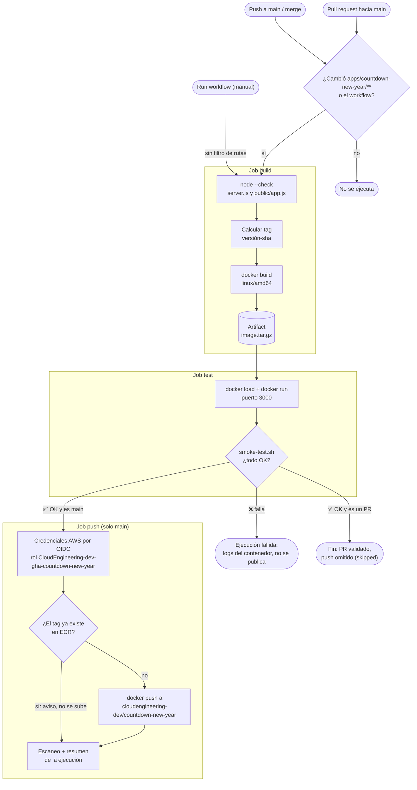
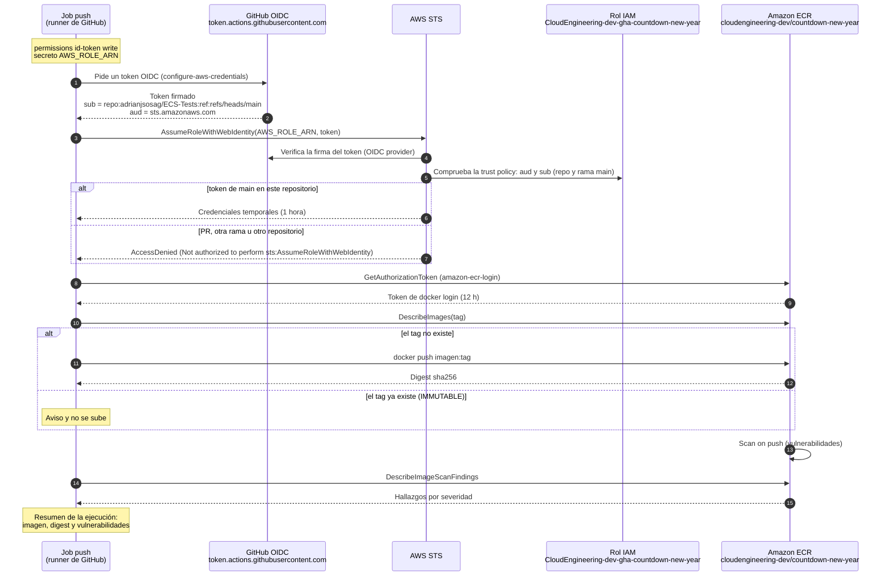

# ⚙️ Workflow `countdown-new-year CI` – cómo funciona

Este documento explica el workflow [`countdown-new-year-ci.yml`](countdown-new-year-ci.yml), que **construye, prueba y publica en Amazon ECR** la imagen Docker de la app [`apps/countdown-new-year`](../../apps/countdown-new-year/README.md).

La idea en una frase: **cada cambio se construye y se prueba; solo lo que llega a `main` y pasa las pruebas se sube a ECR**, sin guardar llaves de AWS en GitHub.

| 🧭 Ficha rápida | |
|---|---|
| **Archivo** | [`.github/workflows/countdown-new-year-ci.yml`](countdown-new-year-ci.yml) |
| **App** | [`apps/countdown-new-year`](../../apps/countdown-new-year/README.md) (Node.js 22, sin dependencias) |
| **Jobs** | `build` → `test` → `push` |
| **Destino** | ECR `cloudengineering-dev/countdown-new-year` ([`ECR-module`](../../Terraform/ECR-module/README.md)) |
| **Autenticación en AWS** | OIDC con el rol `CloudEngineering-dev-gha-countdown-new-year` ([`GitHub-OIDC-module`](../../Terraform/GitHub-OIDC-module/README.md#roles-y-quién-los-usa)) |
| **Tag de la imagen** | `<versión de package.json>-<sha corto>`, p. ej. `1.0.0-e60567f` |
| **Configuración en GitHub** | Variables `AWS_REGION` y `ECR_REPOSITORY`; secreto `AWS_ROLE_ARN` ([detalle](#configuración-necesaria)) |

---

## Índice

1. 🔀 [Diagrama: flujo de los jobs](#diagrama-flujo-de-los-jobs)
2. ⏰ [Cuándo se ejecuta](#cuándo-se-ejecuta)
3. 🧱 [Cómo funciona cada job](#cómo-funciona-cada-job)
4. 🏷️ [Tag de la imagen](#tag-de-la-imagen)
5. 🔐 [Diagrama: secuencia OIDC + ECR](#diagrama-secuencia-oidc--ecr)
6. ⚙️ [Configuración necesaria](#configuración-necesaria)
7. 📋 [Resultado de una ejecución](#resultado-de-una-ejecución)
8. ✏️ [Cómo modificarlo](#cómo-modificarlo)
9. 🛠️ [Problemas frecuentes](#problemas-frecuentes)

---

## Diagrama: flujo de los jobs



👀 **Cómo leerlo:**
- **PR y push a `main`** pasan por el filtro de rutas: si el commit no toca la app ni el workflow, no se ejecuta nada. El **disparo manual** no tiene filtro: siempre arranca.
- **`build` y `test` corren siempre**; `push` solo en `main` y solo si `test` terminó bien (`needs: [build, test]`).
- **La imagen se construye una sola vez:** `build` la guarda como artifact y `test` y `push` usan **exactamente esa imagen**. Lo que se publica es lo mismo que se probó.

---

## Cuándo se ejecuta

| Evento | Cuándo ocurre | Jobs que corren |
|---|---|---|
| `pull_request` hacia `main` | Abres un PR o le subes commits | `build` → `test`. `push` aparece como *skipped* |
| `push` a `main` | Merge de un PR o push directo a `main` | `build` → `test` → `push` |
| `workflow_dispatch` | Botón **Run workflow** en la pestaña *Actions* | `build` → `test` → `push` si se lanza sobre `main` (en otra rama, sin `push`) |

| Regla | Configuración | Para qué |
|---|---|---|
| **Filtro de rutas** | `paths: apps/countdown-new-year/**` y el propio workflow | Un cambio en `Terraform/` u otra app no lanza este CI |
| **Concurrencia** | `group: countdown-new-year-ci-<rama>` | Una ejecución a la vez por rama |
| **Cancelación** | `cancel-in-progress` **solo en PR** | En un PR, un commit nuevo cancela la ejecución anterior. En `main` nunca se cancela, para no cortar un push a ECR a medias |
| **Permisos** | `contents: read` en todo el workflow; `id-token: write` **solo** en `push` | Solo el job que publica puede pedir un token OIDC a GitHub |

---

## Cómo funciona cada job

### Job `build` – Build (Node.js + imagen Docker)

| Step | Qué hace | Si falla… |
|---|---|---|
| `Checkout` | Descarga el código del commit | — |
| `Instalar Node.js 22 (...)` | La misma versión que la imagen base `node:22-alpine` | — |
| `Comprobar la sintaxis de JavaScript` | `node --check` de `server.js` y `public/app.js`. La app no tiene dependencias: no hay `npm install` | Error de sintaxis: se detiene todo |
| `Calcular el tag de la imagen (<versión>-<sha corto>)` | Lee `version` de `package.json` y le añade los 7 primeros caracteres del SHA. Lo publica como output `image_tag` | — |
| `Construir la imagen Docker` | `docker build --platform linux/amd64` (Fargate es X86_64) con etiquetas OCI: repositorio, commit y versión | Error del Dockerfile: se detiene todo |
| `Guardar la imagen para los jobs test y push` | `docker save` + `gzip` → `image.tar.gz` | — |
| `Subir la imagen como artifact` | Artifact `countdown-new-year-image`, guardado 1 día | — |

> ℹ️ **¿Por qué un artifact?** Cada job corre en una máquina nueva. Pasar la imagen como artifact evita reconstruirla y garantiza que `push` publica **la misma imagen** que `test` probó.

### Job `test` – Test (smoke test del contenedor)

| Step | Qué hace | Si falla… |
|---|---|---|
| `Checkout (para el script de smoke test)` | Trae [`apps/countdown-new-year/ci/smoke-test.sh`](../../apps/countdown-new-year/ci/smoke-test.sh) | — |
| `Descargar la imagen` / `Cargar la imagen en Docker` | Descarga el artifact y lo carga con `docker load` | — |
| `Arrancar el contenedor` | `docker run -d --name countdown-test -p 3000:3000 -e TIMEZONE=UTC` | La imagen no arranca |
| `Smoke test` | Ejecuta `smoke-test.sh http://localhost:3000 countdown-test` (comprobaciones abajo) | **El job falla y `push` no se ejecuta** |
| `Logs del contenedor (solo si algo falló)` | `docker logs countdown-test` para diagnosticar | — |
| `Parar el contenedor` | `docker rm -f` (siempre, `if: always()`) | — |

✔️ **Comprobaciones del smoke test:**

| # | Prueba | Esperado |
|---|---|---|
| 1 | Espera a que arranque (`GET /health`) | Responde en menos de 60 s |
| 2 | `GET /health` | HTTP 200 con `"status":"ok"` |
| 3 | `GET /` | HTTP 200 con la página HTML |
| 4 | `GET /api/config` | HTTP 200 con `"nextYear"` |
| 5 | `GET /app.js` | HTTP 200 (archivos estáticos) |
| 6 | `GET /no-existe` | HTTP 404 |
| 7 | `HEALTHCHECK` del Dockerfile | `healthy` en menos de 90 s (el primer chequeo es a los 30 s) |

### Job `push` – Push a Amazon ECR

Solo corre con `if: github.event_name != 'pull_request' && github.ref == 'refs/heads/main'`.

| Step | Qué hace | Si falla… |
|---|---|---|
| `Comprobar las variables y el secreto de GitHub` | Verifica que existan `AWS_REGION`, `ECR_REPOSITORY` y `AWS_ROLE_ARN` | Error claro con el nombre de lo que falta |
| `Descargar la imagen` / `Cargar la imagen en Docker` | La misma imagen que se probó | — |
| `Credenciales de AWS (OIDC, rol CloudEngineering-dev-gha-countdown-new-year)` | Cambia el token OIDC de GitHub por credenciales temporales del rol ([secuencia](#diagrama-secuencia-oidc--ecr)) | `Not authorized to perform sts:AssumeRoleWithWebIdentity` |
| `Login en Amazon ECR` | `docker login` en el registro privado | — |
| `Comprobar si el tag ya existe en ECR` | `aws ecr describe-images`. Si existe (p. ej. al relanzar el mismo commit), avisa y salta el push | — |
| `Subir la imagen a ECR` | `docker tag` + `docker push` a `<registry>/cloudengineering-dev/countdown-new-year:<tag>` | `AccessDenied` si `ECR_REPOSITORY` no es el del rol |
| `Escaneo de vulnerabilidades y resumen` | Lee el digest, espera el *scan on push* de ECR y escribe el [resumen](#resultado-de-una-ejecución). **No bloquea** | Si el escaneo tarda, lo indica en el resumen |

---

## Tag de la imagen

```text
1.0.0   -   e60567f
  │            │
  │            └── 7 primeros caracteres del SHA del commit (único por commit)
  └── "version" de apps/countdown-new-year/package.json (legible)
```

- **Por qué no `1.0.0` a secas:** el repositorio ECR es **IMMUTABLE** y no permite subir dos veces el mismo tag. Con solo la versión, el segundo merge sin cambiar `package.json` fallaría.
- **Por qué no `latest`:** no identifica qué código corre, y el repositorio IMMUTABLE no podría actualizarlo.
- **Relanzar el mismo commit:** se genera el mismo tag, el step `Comprobar si el tag ya existe en ECR` lo detecta y el job termina bien sin volver a subirlo.
- **Nueva versión:** cambia `version` en `package.json` (por ejemplo a `1.1.0`) en el mismo PR.

---

## Diagrama: secuencia OIDC + ECR

Cómo el job `push` consigue permiso para escribir en ECR **sin ninguna llave de AWS guardada en GitHub**:



📌 **Paso a paso:**

| Pasos | Qué pasa | Dónde se configura |
|---|---|---|
| 1–2 | GitHub emite un **token firmado** que dice de qué repositorio y rama viene la ejecución. Solo es posible porque el job tiene `id-token: write` | Workflow (`permissions` del job `push`) |
| 3 | El workflow presenta ese token a AWS STS y pide asumir el rol del secreto `AWS_ROLE_ARN` | Secreto `AWS_ROLE_ARN` |
| 4 | STS verifica la firma con el **OIDC provider** de GitHub registrado en la cuenta | `GitHub-OIDC-module` (`aws_iam_openid_connect_provider`) |
| 5–7 | La **trust policy** del rol exige `aud = sts.amazonaws.com` y `sub = repo:adrianjsosag/ECS-Tests:ref:refs/heads/main`. Si coincide, devuelve credenciales que **caducan en 1 hora** | `GitHub-OIDC-module` (`github_ci_roles["countdown-new-year"].branches`) |
| 8–12 | Con esas credenciales, el job hace login, comprueba el tag y sube la imagen. La **política del rol** solo permite escribir en `cloudengineering-dev/countdown-new-year` | `GitHub-OIDC-module` (`ecr_repositories`) |
| 13–15 | ECR escanea la imagen y el job resume el resultado | `ECR-module` (`scan_on_push`) |

> 🔒 **Por qué un pull request no puede publicar,** aunque alguien quitara el `if` del job: el token de un PR tiene `sub = repo:adrianjsosag/ECS-Tests:pull_request`, que no coincide con la trust policy, y AWS lo rechaza en el paso 7. La protección está **en AWS**, no solo en el YAML.

---

## Configuración necesaria

En **GitHub → Settings → Secrets and variables → Actions**:

| Tipo | Nombre | Valor | Lo usa | De dónde sale |
|---|---|---|---|---|
| Variable | `AWS_REGION` | `us-east-1` | `push` | Región de la plataforma |
| Variable | `ECR_REPOSITORY` | `cloudengineering-dev/countdown-new-year` | `push` | `terraform output repository_names` del [`ECR-module`](../../Terraform/ECR-module/README.md) |
| Secreto | `AWS_ROLE_ARN` | `arn:aws:iam::373716886058:role/CloudEngineering-dev-gha-countdown-new-year` | `push` (credenciales) | `terraform output -json role_arns` → `countdown-new-year` del [`GitHub-OIDC-module`](../../Terraform/GitHub-OIDC-module/README.md) |

`build` y `test` **no necesitan nada de esto**: un PR se valida aunque AWS no esté configurado. La puesta en marcha completa (Terraform + GitHub) está en el [README de la app](../../apps/countdown-new-year/README.md#puesta-en-marcha-una-sola-vez).

---

## Resultado de una ejecución

En la pestaña **Actions** de GitHub, cada ejecución en `main` muestra los tres jobs en verde y un **resumen** generado por el job `push`:

| Campo | Ejemplo |
|---|---|
| Imagen | `373716886058.dkr.ecr.us-east-1.amazonaws.com/cloudengineering-dev/countdown-new-year:1.0.0-e60567f` |
| Digest | `sha256:…` |
| Vulnerabilidades | `{"MEDIUM":2,"LOW":5}` |

**El workflow no despliega.** Para ejecutar esa imagen en ECS, usa el tag en un servicio de [`ECS-services-module`](../../Terraform/ECS-services-module/README.md#añadir-otro-servicio) (`image_tag = "1.0.0-e60567f"`). Ver [Desplegar la imagen en ECS](../../apps/countdown-new-year/README.md#desplegar-la-imagen-en-ecs).

---

## Cómo modificarlo

| Quiero… | Cambio |
|---|---|
| Publicar una versión nueva | Sube `version` en `apps/countdown-new-year/package.json` |
| Añadir una prueba | Añade una línea `check "<desc>" <ruta> <código> [texto]` en [`smoke-test.sh`](../../apps/countdown-new-year/ci/smoke-test.sh). Puedes probarla en local ([cómo](../../apps/countdown-new-year/README.md#probar-el-smoke-test-en-local)) |
| Publicar también desde otra rama | Añádela en `on.push.branches` **y** en `branches` de la entrada `countdown-new-year` del `GitHub-OIDC-module` (si no, AWS rechaza el token) |
| Bloquear el push si hay vulnerabilidades CRITICAL | Haz que el step `Escaneo de vulnerabilidades y resumen` termine con error según `FINDINGS` (hoy solo informa) |
| Crear el CI de otra app | Copia este workflow, cambia `APP_DIR`, `IMAGE_NAME`, `paths` y el nombre del secreto, y añade su rol en `github_ci_roles` ([cómo](../../Terraform/GitHub-OIDC-module/README.md#añadir-un-rol-para-otra-app)) |

> ⚠️ Si añades `environment:` al job `push`, el `sub` del token cambia a `repo:…:environment:<nombre>` y hay que adaptar la trust policy del rol.

---

## Problemas frecuentes

| Síntoma | Causa | Solución |
|---|---|---|
| El workflow no aparece tras un commit | El commit no toca `apps/countdown-new-year/` ni el workflow | Es el filtro de rutas; usa **Run workflow** |
| `push` aparece como *skipped* | Es un pull request o una rama distinta de `main` | Es lo esperado |
| `test` falla con `la app no respondió en 60s` | La app no arranca | Mira el step `Logs del contenedor (solo si algo falló)` |
| `Falta la variable …` / `Falta el secreto AWS_ROLE_ARN` | No se crearon en GitHub | [Configuración necesaria](#configuración-necesaria) |
| `Not authorized to perform sts:AssumeRoleWithWebIdentity` | El rol no existe, el secreto es de otro rol, o la ejecución no es de `main` | Aplica `GitHub-OIDC-module` y revisa el secreto y la rama |
| `AccessDeniedException … ecr:PutImage` | `ECR_REPOSITORY` no es el repositorio permitido al rol | `cloudengineering-dev/countdown-new-year` |

Más casos en el [README de la app](../../apps/countdown-new-year/README.md#problemas-frecuentes).
