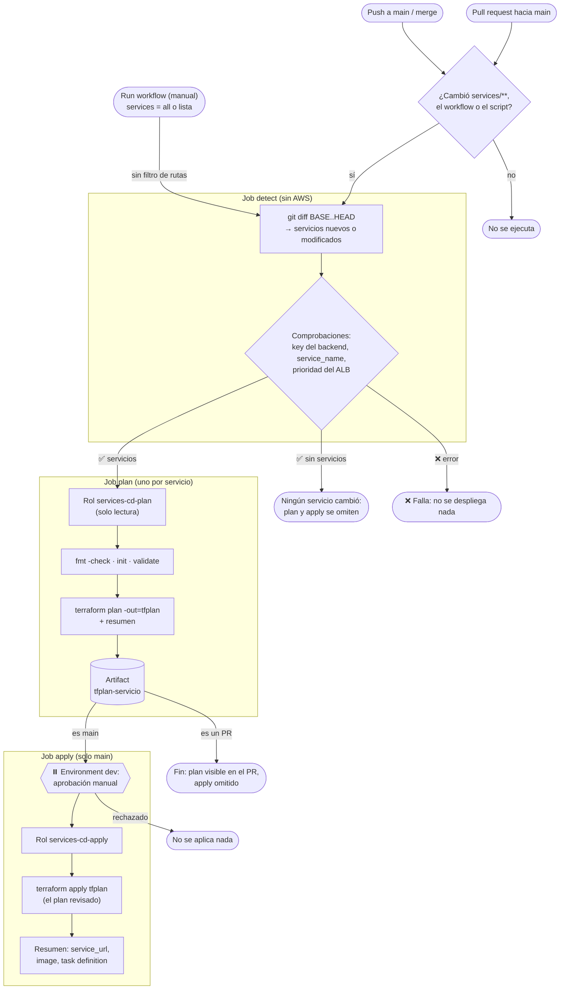
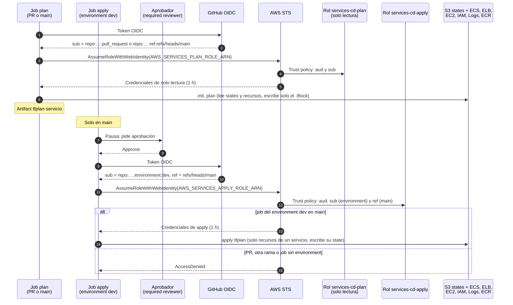

# 🚀 Workflow `services CD` – cómo funciona

Este documento explica el workflow [`terraform-services-cd.yml`](terraform-services-cd.yml), que **despliega con Terraform los servicios ECS nuevos o modificados** de [`Terraform/ECS-services-module/services/`](../../Terraform/ECS-services-module/README.md).

La idea en una frase: **en un pull request ves el `plan` de cada servicio que cambiaste; al hacer merge a `main`, alguien lo aprueba y se aplica exactamente ese plan**, sin llaves de AWS en GitHub.

| 🧭 Ficha rápida | |
|---|---|
| **Archivo** | [`.github/workflows/terraform-services-cd.yml`](terraform-services-cd.yml) |
| **Detección de cambios** | [`.github/scripts/detect-changed-services.sh`](../scripts/detect-changed-services.sh) |
| **Qué despliega** | Cada carpeta `Terraform/ECS-services-module/services/<servicio>/manifests/` nueva o modificada (hoy: `nginx-1`) |
| **Jobs** | `detect` → `plan` (uno por servicio) → `apply` (uno por servicio, con aprobación) |
| **Aprobación** | Environment de GitHub `dev` con *required reviewers* |
| **Roles IAM** | `CloudEngineering-dev-gha-services-cd-plan` (solo lectura) y `CloudEngineering-dev-gha-services-cd-apply` ([`GitHub-OIDC-module`](../../Terraform/GitHub-OIDC-module/README.md#roles-del-cd-de-servicios)) |
| **Terraform** | 1.17.0 (la misma versión con la que se valida la plataforma) |
| **Configuración en GitHub** | Variable `AWS_REGION`; secretos `AWS_SERVICES_PLAN_ROLE_ARN` y `AWS_SERVICES_APPLY_ROLE_ARN`; environment `dev` ([detalle](#configuración-necesaria)) |

---

## Índice

1. 🔀 [Diagrama: flujo de los jobs](#diagrama-flujo-de-los-jobs)
2. ⏰ [Cuándo se ejecuta](#cuándo-se-ejecuta)
3. 🔍 [Cómo detecta los servicios que cambiaron](#cómo-detecta-los-servicios-que-cambiaron)
4. 🛡️ [Comprobaciones de seguridad](#comprobaciones-de-seguridad)
5. 🧱 [Cómo funciona cada job](#cómo-funciona-cada-job)
6. 🔐 [Diagrama: secuencia OIDC con dos roles](#diagrama-secuencia-oidc-con-dos-roles)
7. ⚙️ [Configuración necesaria](#configuración-necesaria)
8. ➕ [Desplegar un servicio nuevo con el CD](#desplegar-un-servicio-nuevo-con-el-cd)
9. 🚫 [Qué NO hace](#qué-no-hace)
10. ✅ [Cómo se verificó](#cómo-se-verificó)
11. 🛠️ [Problemas frecuentes](#problemas-frecuentes)

---

## Diagrama: flujo de los jobs



👀 **Cómo leerlo:**
- **`detect`** decide qué servicios desplegar y bloquea todo si una carpeta pisaría el state o la regla del ALB de otro servicio.
- **`plan`** corre un job por servicio (`matrix`) con un rol que **no puede cambiar nada**.
- **`apply`** solo existe en `main`, espera la aprobación del environment `dev` y aplica **el plan guardado**, no uno nuevo.

---

## Cuándo se ejecuta

| Evento | Cuándo ocurre | Jobs que corren |
|---|---|---|
| `pull_request` hacia `main` | Abres un PR o le subes commits | `detect` → `plan`. `apply` aparece como *skipped* |
| `push` a `main` | Merge de un PR o push directo | `detect` → `plan` → `apply` (espera aprobación) |
| `workflow_dispatch` | **Run workflow** en la pestaña *Actions*, con `services` = `all` o `nginx-1,otro` | `detect` → `plan` → `apply` si se lanza sobre `main` |

| Regla | Configuración | Para qué |
|---|---|---|
| **Filtro de rutas** | `Terraform/ECS-services-module/services/**`, el workflow y el script | Un cambio en otro módulo de Terraform o en una app no lanza el CD |
| **Concurrencia** | `group: services-cd`, `cancel-in-progress: false` | Una ejecución a la vez y **nunca** se cancela: cortar un `apply` dejaría el state bloqueado (`.tflock`) |
| **Permisos** | `contents: read`; `id-token: write` solo en `plan` y `apply` | Solo los jobs que hablan con AWS piden un token OIDC |
| **Matriz** | `plan`: en paralelo y `fail-fast: false`. `apply`: `max-parallel: 1` | Los planes no se bloquean entre sí; los apply van de uno en uno porque todos tocan el mismo listener del ALB |

---

## Cómo detecta los servicios que cambiaron

El job `detect` ejecuta [`detect-changed-services.sh`](../scripts/detect-changed-services.sh) con:

| Evento | `BASE` | `HEAD` |
|---|---|---|
| `pull_request` | `git merge-base` de la base del PR y el último commit del PR (solo los cambios del PR) | Último commit del PR |
| `push` | `github.event.before` (el commit anterior al push) | `github.sha` |
| `workflow_dispatch` | — (usa la lista `services`) | — |

Con `git diff --name-only BASE HEAD -- Terraform/ECS-services-module/services/` saca el nombre de cada servicio (`services/<servicio>/...`) y lo clasifica:

| Caso | Ejemplo | Resultado |
|---|---|---|
| **Servicio nuevo** | Se añade `services/web-1/` | `plan` (+ `apply` en `main`) de `web-1` |
| **Servicio modificado** | `image_tag = "1.0.1"` en `services/nginx-1/manifests/service.auto.tfvars` | `plan` (+ `apply`) de `nginx-1` |
| **Varios en el mismo push** | `web-1` nuevo y `nginx-1` modificado | Un job por servicio |
| **Servicio borrado** | Se borra `services/web-1/` | ⚠️ **Aviso** en el resumen; **no** se destruye ([por qué](#qué-no-hace)) |
| **Solo cambia el workflow o el script** | — | Ningún servicio: `plan` y `apply` se omiten |
| **Archivo suelto en `services/`** | `services/NOTAS.md` | No es un servicio: se ignora |
| **Sin commit base** | Primer push de una rama, o `before` desconocido | Todos los servicios |
| **Manual** | `services = all` / `nginx-1,web-1` | Los indicados. Un nombre que no existe → error |

El job escribe en el **resumen de la ejecución** la tabla de servicios detectados y la acción de cada uno.

---

## Comprobaciones de seguridad

Antes de tocar AWS, el script revisa cada servicio a desplegar. Si algo falla, el job `detect` termina con error y **no se despliega ningún servicio**:

| Comprobación | Por qué | Error |
|---|---|---|
| La `key` de `backend.tf` es `ECS-services-module/services/<carpeta>/terraform.tfstate` | Al copiar `nginx-1/` para crear un servicio, olvidar cambiar la `key` haría que el nuevo **pisara el state de nginx-1** | `la key de backend.tf es '…nginx-1…' y debe ser '…<carpeta>…'` |
| `service_name` de `service.auto.tfvars` = nombre de la carpeta | El nombre del servicio ECS y de sus recursos sale de `service_name`; si no coincide con la carpeta, los nombres y el state no corresponden | `service_name en service.auto.tfvars es 'x' y debe ser '<carpeta>'` |
| `listener_rule_priority` única entre **todos** los servicios | Dos reglas del ALB no pueden tener la misma prioridad (`PriorityInUse` en el `apply`) | `listener_rule_priority = 100 está repetida en 'a' y 'b'` |

---

## Cómo funciona cada job

### Job `detect` – Detectar servicios nuevos o modificados

| Step | Qué hace |
|---|---|
| `Checkout (historial completo para el diff)` | `fetch-depth: 0`: necesita los commits `BASE` y `HEAD` |
| `Detectar servicios y comprobar backend, service_name y prioridades` | Calcula `BASE`/`HEAD` según el evento y ejecuta el script. Outputs: `services` (JSON), `has_services` y `deleted` |

### Job `plan` – Plan (`<servicio>`)

Corre una vez por servicio detectado, en `Terraform/ECS-services-module/services/<servicio>/manifests`.

| Step | Qué hace | Si falla… |
|---|---|---|
| `Checkout` | Código del commit | — |
| `Comprobar la variable y el secreto de GitHub` | `AWS_REGION` y `AWS_SERVICES_PLAN_ROLE_ARN` | Error con el nombre de lo que falta |
| `Instalar Terraform` | `hashicorp/setup-terraform` con 1.17.0 (sin *wrapper*) | — |
| `Credenciales de AWS (OIDC, rol CloudEngineering-dev-gha-services-cd-plan)` | Credenciales temporales del rol **de solo lectura** | `Not authorized to perform sts:AssumeRoleWithWebIdentity` |
| `terraform fmt -check` | Formato del código | Muestra el `diff` de formato |
| `terraform init` | Backend S3 del servicio y providers | `AccessDenied` si la `key` no es de un servicio |
| `terraform validate` | Sintaxis y referencias | — |
| `terraform plan` | `plan -out=tfplan`; guarda también la salida en `plan.txt` | P. ej. `couldn't find resource` si la imagen no está en ECR |
| `Resumen del plan` | `Plan: X to add, Y to change, Z to destroy` y la lista de recursos en el resumen de la ejecución | — |
| `Guardar el plan para el job apply` | Artifact `tfplan-<servicio>` (plan + `.terraform.lock.hcl`), 5 días | — |

### Job `apply` – Apply (`<servicio>`)

Solo con `push` a `main` o `workflow_dispatch` sobre `main`. **Espera la aprobación** del environment `dev` antes de empezar.

| Step | Qué hace | Si falla… |
|---|---|---|
| `Checkout` | Código del mismo commit | — |
| `Comprobar la variable y el secreto de GitHub` | `AWS_REGION` y `AWS_SERVICES_APPLY_ROLE_ARN` | Error con el nombre de lo que falta |
| `Descargar el plan revisado` | El artifact `tfplan-<servicio>` del job `plan` | — |
| `Instalar Terraform` | 1.17.0 | — |
| `Credenciales de AWS (OIDC, rol CloudEngineering-dev-gha-services-cd-apply)` | Credenciales del rol **de apply** (solo desde el environment `dev` y la rama `main`) | `Not authorized…` si el job no usa el environment |
| `terraform init` | Con el `.terraform.lock.hcl` del plan: mismas versiones de providers | — |
| `terraform apply (plan guardado)` | `terraform apply tfplan`: aplica **exactamente** lo que se vio en el plan. ECS espera a que las tareas estén sanas (`wait_for_steady_state`) | `Saved plan is stale` si el state cambió desde el plan → relanza el workflow |
| `Resumen del despliegue` | `service_url`, `image`, `task_definition_arn` y `log_group_name` | — |

> ℹ️ **Si el `plan` de un servicio falla**, el job `apply` no se ejecuta para **ninguno** (depende de todos los planes). Así nunca se despliega a medias un cambio que tocaba varios servicios.

---

## Diagrama: secuencia OIDC con dos roles



| Pasos | Qué pasa | Dónde se configura |
|---|---|---|
| 1–6 | El job `plan` obtiene un token con `sub` de PR o de `main`, asume el rol **de solo lectura** y calcula el plan, que queda guardado como artifact | `GitHub-OIDC-module`: `services_cd.plan_branches` |
| 7–8 | En `main`, el job `apply` se **pausa** hasta que un *required reviewer* del environment `dev` lo aprueba | GitHub → Settings → Environments → `dev` |
| 9–12 | El token del job `apply` lleva `sub = …:environment:dev` y `ref = refs/heads/main`. La trust policy del rol de apply exige **las dos cosas** | `GitHub-OIDC-module`: `services_cd.environment` y `apply_branches` |
| 13–14 | Con las credenciales del rol de apply, Terraform aplica el plan guardado | `GitHub-OIDC-module`: política `services-cd-write` |
| 15 | Fuera de ese contexto (PR, otra rama, job sin environment), AWS niega el rol | — |

> 🔒 **Por qué dos roles:** el código de un PR (incluido el propio workflow, si alguien lo modifica en su rama) se ejecuta con el rol de **plan**, que no puede crear, modificar ni borrar nada. Solo un job aprobado del environment `dev`, en `main`, obtiene permisos de escritura.

---

## Configuración necesaria

### 1. Roles en AWS

Aplica [`GitHub-OIDC-module`](../../Terraform/GitHub-OIDC-module/README.md) (crea los dos roles) y copia sus ARNs:

```bash
cd ~/ECS-Tests/Terraform/GitHub-OIDC-module/manifests
terraform init && terraform apply
terraform output -json services_cd_role_arns    # {"apply": "arn:…:role/CloudEngineering-dev-gha-services-cd-apply", "plan": "arn:…-plan"}
```

### 2. Variables, secretos y environment en GitHub

En **GitHub → repositorio `ECS-Tests` → Settings**:

| Dónde | Nombre | Valor |
|---|---|---|
| Secrets and variables → Actions → **Variables** | `AWS_REGION` | `us-east-1` (ya existe si configuraste el CI de countdown-new-year) |
| Secrets and variables → Actions → **Secrets** | `AWS_SERVICES_PLAN_ROLE_ARN` | `services_cd_role_arns["plan"]` |
| Secrets and variables → Actions → **Secrets** | `AWS_SERVICES_APPLY_ROLE_ARN` | `services_cd_role_arns["apply"]` |
| **Environments** → New environment | `dev` | Activa **Required reviewers** y añade quién aprueba los despliegues. Opcional: *Deployment branches* = `main` |

### 3. Requisitos de la plataforma

Para que el `plan` de un servicio funcione deben existir: el bucket del state, la VPC, el ALB, el cluster, el ECR y **la imagen del servicio en ECR** (con el tag de `image_tag`). Ver la [guía de despliegue](../../Terraform/README.md#guía-de-despliegue-paso-a-paso).

---

## Desplegar un servicio nuevo con el CD

1. **Sube la imagen** a ECR: con su CI (como `countdown-new-year-ci.yml`) o con `ECR-module/push-image.sh`.
2. **Crea la carpeta del servicio** copiando `services/nginx-1/` ([detalle](../../Terraform/ECS-services-module/README.md#añadir-otro-servicio)) y cambia:
   - `backend.tf` → `key = "ECS-services-module/services/<servicio>/terraform.tfstate"`.
   - `service.auto.tfvars` → `service_name = "<servicio>"`, `ecr_repository`, `image_tag`, `container_port`, `health_check_path`, `path_patterns` y una `listener_rule_priority` **única**.
3. **Abre un PR**: el job `detect` valida la carpeta y el job `plan` muestra lo que se va a crear (10 recursos por servicio).
4. **Haz merge** a `main` y **aprueba** el despliegue en la pestaña *Actions* (botón *Review deployments*).
5. El resumen del job `apply` muestra la URL del servicio (`service_url`).

Para **actualizar** un servicio (por ejemplo, una imagen nueva) basta con cambiar `image_tag` en su `service.auto.tfvars` y repetir los pasos 3–5.

---

## Qué NO hace

| No hace | Por qué | Cómo hacerlo |
|---|---|---|
| **Destruir servicios borrados** | Un borrado accidental de una carpeta tumbaría un servicio en producción. Además, sin la carpeta Terraform no tiene la configuración para destruirlo | **Antes** de borrar la carpeta: `terraform destroy` en `services/<servicio>/manifests`. Luego borra la carpeta |
| **Construir ni subir imágenes** | Es tarea del CI de cada app | `countdown-new-year-ci.yml` o `push-image.sh` |
| **Desplegar otros módulos** (VPC, ALB, cluster, ECR…) | Son la base de la plataforma: se aplican a mano y con poca frecuencia. Los roles del CD **no tienen permisos** para tocarlos | Guía de despliegue del [README de Terraform](../../Terraform/README.md) |

---

## Cómo se verificó

Sin GitHub ni `terraform apply`, desde WSL:

| Prueba | Resultado |
|---|---|
| `actionlint` (con `shellcheck`) del workflow y `shellcheck` del script | Sin avisos |
| Script de detección en un repositorio git temporal: 15 casos (nuevo, modificado, varios, borrado, solo workflow, archivo suelto, sin base, base desconocida, dispatch `all`/lista/inexistente, `key` copiada, prioridad repetida, `service_name` distinto, corrección) | 15/15 correctos |
| Steps del job `plan` de `nginx-1` (`fmt -check`, `init`, `validate`, `plan -out`, resumen) con states ficticios | `Plan: 10 to add`; el plan guardado se lee en otra carpeta con su lock (como hace `apply`) |
| `GitHub-OIDC-module`: `plan` con los roles nuevos | `Plan: 8 to add` (2 roles y 3 políticas nuevas); `sub` y `ref` de cada rol comprobados |
| Políticas de los roles con **IAM Access Analyzer** (`validate-policy`) | Sin hallazgos en las políticas de permisos |
| **Simulador de políticas de IAM**: 31 acciones de lo que hace Terraform con un servicio y de lo que debe quedar prohibido (leer el state del Bastion, escribir el de la VPC, crear otros roles, adjuntar `AdministratorAccess`, borrar el ALB, el cluster o la VPC…) | 31/31 como se esperaba |

---

## Problemas frecuentes

| Síntoma | Causa | Solución |
|---|---|---|
| El workflow no se ejecuta | El commit no toca `services/`, el workflow ni el script | Es el filtro de rutas; usa **Run workflow** |
| `plan` y `apply` aparecen como *skipped* | Ningún servicio cambió (p. ej. solo cambió el workflow) | Es lo esperado; para forzarlo, **Run workflow** con `services = all` |
| `detect` falla con `la key de backend.tf es …` | Carpeta copiada sin cambiar la `key` | Corrige `backend.tf` ([comprobaciones](#comprobaciones-de-seguridad)) |
| `detect` falla con `listener_rule_priority = N está repetida` | Dos servicios con la misma prioridad | Cambia la del servicio nuevo |
| `Falta el secreto AWS_SERVICES_…_ROLE_ARN` | No se crearon los secretos | [Configuración necesaria](#configuración-necesaria) |
| `Not authorized to perform sts:AssumeRoleWithWebIdentity` en `apply` | El environment no se llama `dev`, el job no corre en `main`, o el secreto es el del rol de plan | Revisa el environment, la rama y los secretos |
| `apply` se queda en *Waiting* | Falta la aprobación del environment `dev` | *Review deployments* → *Approve* |
| `reading ECR Images: couldn't find resource` en `plan` | La imagen con ese `image_tag` no está en ECR | Súbela antes (CI de la app o `push-image.sh`) |
| `Error acquiring the state lock` | Otro `plan`/`apply` (o uno a mano) usa ese state | Espera; si nadie lo usa: `terraform force-unlock <ID>` a mano |
| `Saved plan is stale` | El state cambió entre el `plan` y el `apply` (p. ej. un `apply` manual) | Relanza el workflow para generar un plan nuevo |
| `AccessDenied` en `apply` sobre un recurso | El servicio crea algo fuera de lo previsto (otro nombre o tipo de recurso) | Amplía la política `services-cd-write` en `GitHub-OIDC-module/manifests/github-services-cd.tf` |
