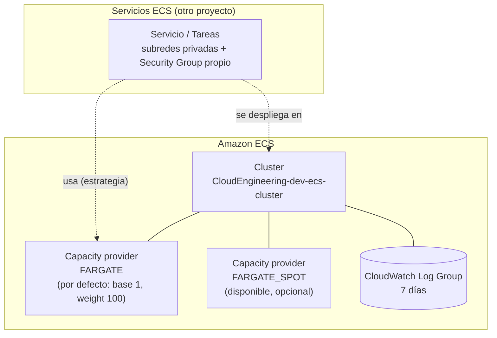

# 🚢 AWS ECS Cluster (Fargate) – Terraform

Este proyecto crea un **cluster de Amazon ECS** cuyos contenedores se ejecutan **solo con AWS Fargate**: AWS pone y administra los servidores, y tú solo defines los contenedores. No hay instancias EC2, Auto Scaling Group ni llaves SSH.

| 🧭 Ficha rápida | |
|---|---|
| **Paso en el despliegue** | **3** ([guía](../README.md#guía-de-despliegue-paso-a-paso)) |
| **Depende de** | Bucket del state ([`S3-tfstate-backend-module`](../S3-tfstate-backend-module/README.md)). **No** depende de la VPC |
| **Lo usan** | Los servicios ECS que se desplieguen en el cluster (leen `cluster_arn` y `cluster_name`) |
| **Recursos (`plan`)** | 4 |
| **Tiempo de despliegue** | ~1 min |
| **Costo principal** | Casi nada: se pagan las tareas Fargate de los servicios |

> ⚠️ **Antes de desplegar este módulo debe existir el bucket S3 del state** ([`S3-tfstate-backend-module`](../S3-tfstate-backend-module/README.md)): su `backend.tf` guarda el state ahí. Si no existe, `terraform init` falla con `NoSuchBucket`.

> 🗺️ Vista general de toda la plataforma: [README de Terraform](../README.md).

---

## Índice

1. 📦 [¿Qué se crea?](#qué-se-crea)
2. 📚 [Conceptos básicos](#conceptos-básicos)
3. 🗺️ [Diagrama](#diagrama)
4. 🔍 [Cómo funciona](#cómo-funciona)
5. 🔗 [¿De qué depende? (remote state)](#de-qué-depende-remote-state)
6. 📁 [Estructura de archivos](#estructura-de-archivos)
7. 🏷️ [Versiones](#versiones)
8. ⚙️ [Variables](#variables)
9. 📤 [Outputs](#outputs)
10. 🧪 [Cómo probarlo sin crear nada (plan)](#cómo-probarlo-sin-crear-nada-plan)
11. 🚀 [Cómo desplegarlo paso a paso](#cómo-desplegarlo-paso-a-paso)
12. 🧩 [Cómo usar el cluster desde otro proyecto](#cómo-usar-el-cluster-desde-otro-proyecto)
13. 🔒 [Seguridad](#seguridad)
14. 💰 [Costos](#costos)
15. 🛠️ [Problemas frecuentes](#problemas-frecuentes)

---

## ¿Qué se crea?

Se crea un cluster ECS vacío llamado `CloudEngineering-dev-ecs-cluster`, listo para ejecutar contenedores en **Fargate** o en **Fargate Spot**. **No se crea ningún servidor.**

| Recurso | Cantidad | ¿Para qué sirve? |
|---|---|---|
| **Cluster ECS** | 1 | El "orquestador" que agrupa y vigila tus servicios y tareas |
| **Capacity providers** `FARGATE` y `FARGATE_SPOT` | 2 (asociados) | Las dos formas de obtener capacidad sin servidores: normal y Spot (más barata) |
| **Estrategia por defecto** | 1 | Si un servicio no dice dónde ejecutarse, va a `FARGATE` |
| **CloudWatch Log Group** `/aws/ecs/CloudEngineering-dev-ecs-cluster` | 1 | Guarda el registro de las sesiones de **ECS Exec**, con 7 días de retención |

> 💡 **Analogía:** con Fargate **alquilas un escritorio por cada trabajo, solo mientras dura**. El edificio y el mantenimiento son problema de AWS.

---

## Conceptos básicos

| Término | Qué significa en palabras simples |
|---|---|
| **Contenedor** | Una aplicación empaquetada con todo lo que necesita (por ejemplo, una imagen Docker). |
| **ECS** (Elastic Container Service) | El servicio de AWS que ejecuta y vigila contenedores. |
| **Cluster** | Un grupo lógico donde viven tus servicios y tareas. Con Fargate es solo una "carpeta" y no tiene servidores visibles. |
| **Task (tarea)** | Uno o varios contenedores ejecutándose juntos. |
| **Service (servicio)** | Mantiene corriendo un número fijo de tareas y las reemplaza si fallan. |
| **Fargate** | Modo "sin servidores": AWS crea una pequeña máquina aislada para cada tarea, con la CPU y memoria que pidas. |
| **Fargate Spot** | Igual que Fargate, pero usando capacidad sobrante de AWS: **hasta ~70 % más barato**. Puede ser interrumpido con 2 minutos de aviso. |
| **Capacity provider** | De dónde saca ECS la capacidad: `FARGATE` o `FARGATE_SPOT`. |
| **Capacity provider strategy** | La regla de reparto de tareas entre capacity providers (`base` y `weight`). |
| **`awsvpc`** | El modo de red de Fargate: **cada tarea recibe su propia IP privada y su propio Security Group** dentro de la VPC. |
| **ECS Exec** | Permite abrir una terminal **dentro de un contenedor en ejecución** (`aws ecs execute-command`). Reemplaza al SSH, porque no hay servidores a los que entrar. |

---

## Diagrama



👀 **Cómo leerlo:**
- **Cluster:** tiene asociados los dos capacity providers de Fargate. `FARGATE` es el de por defecto.
- **Servicios:** se despliegan desde **otro proyecto**. Cada uno indica sus subredes privadas y su Security Group.

---

## Cómo funciona

```hcl
module "ecs_cluster" {
  source  = "terraform-aws-modules/ecs/aws//modules/cluster"
  version = "7.6.1"

  name = local.cluster_name                               # CloudEngineering-dev-ecs-cluster

  setting = [{ name = "containerInsights", value = var.ecs_container_insights }]

  cluster_capacity_providers = ["FARGATE", "FARGATE_SPOT"]
  default_capacity_provider_strategy = {
    FARGATE = { weight = 100, base = 1 }
  }

  ...
}
```

- **`cluster_capacity_providers`:** asocia al cluster los dos capacity providers de Fargate. **Ya existen en AWS**, no hay que crearlos; solo se "enchufan" al cluster.
- **`default_capacity_provider_strategy`:**
  - **`base = 1`:** la primera tarea va siempre a `FARGATE`.
  - **`weight = 100`:** el resto también. Si un servicio quiere usar Spot, lo indica en su propia estrategia, por ejemplo `FARGATE = { base = 1, weight = 1 }` y `FARGATE_SPOT = { weight = 3 }`.
- **`setting` (Container Insights):** métricas detalladas en CloudWatch. Está en `disabled` para ahorrar.
- **ECS Exec, configurado automáticamente por el módulo:** el cluster se crea con `execute_command_configuration` en modo `logging = "OVERRIDE"`. Cada sesión de `aws ecs execute-command` queda registrada en el log group `/aws/ecs/CloudEngineering-dev-ecs-cluster` (7 días).
- **`create_security_group` / `create_infrastructure_iam_role = false`:** solo hacen falta para *ECS Managed Instances*. Con Fargate no se usan.

---

## ¿De qué depende? (remote state)

Guarda su state en el [bucket S3](../S3-tfstate-backend-module/README.md) (`ECS-cluster-module/terraform.tfstate`). **No lee el state de ningún otro proyecto**: el cluster Fargate no necesita la VPC; la red de las tareas la define cada servicio.

---

## Estructura de archivos

```
ECS-cluster-module/
├── README.md
└── manifests/
    ├── versions.tf                  # Terraform + provider aws
    ├── backend.tf                   # State en el bucket S3 (clave ECS-cluster-module/terraform.tfstate)
    ├── generic-variables.tf         # región, entorno, división
    ├── local-values.tf              # name, common_tags, cluster_name
    ├── terraform.tfvars             # us-east-1 / dev / CloudEngineering
    ├── ecs-variables.tf             # ecs_container_insights
    ├── ecs.auto.tfvars              # valores
    ├── ecs-cluster.tf               # Cluster Fargate + capacity providers
    └── ecs-outputs.tf               # Outputs
```

**Archivos que genera Terraform** (no los escribas a mano):

| Archivo | Cuándo aparece | ¿Se sube a git? |
|---|---|---|
| `.terraform/` | `terraform init` | No |
| `.terraform.lock.hcl` | `terraform init` | **Sí**: fija las versiones exactas de los providers (`aws`, y `time`, que usa el módulo) |
| State `ECS-cluster-module/terraform.tfstate` | Con `terraform apply`. Se guarda en el **bucket S3**, no en esta carpeta | — |

---

## Versiones

| Componente | Versión | Comentario |
|---|---|---|
| Terraform | `>= 1.16` | Validado con v1.17.0 |
| Provider `hashicorp/aws` | `~> 6.67` | Validado con 6.70.0 (no hay `.terraform.lock.hcl` en el repositorio: `init` instala la última 6.x) |
| Provider `hashicorp/time` | `>= 0.13` | Lo pide el módulo ECS (espera interna de 20 s) |
| Módulo `terraform-aws-modules/ecs/aws//modules/cluster` | `7.6.1` | |

---

## Variables

| Variable | Tipo | Valor actual | Descripción |
|---|---|---|---|
| `aws_region` | texto | `us-east-1` | Región |
| `environment` | texto | `dev` | Entorno (nombres y etiquetas) |
| `business_division` | texto | `CloudEngineering` | Área responsable (nombres y etiquetas) |
| `ecs_container_insights` | texto | `disabled` | `enabled` activa métricas detalladas (con costo) |

---

## Outputs

| Output | Descripción | ¿Para qué lo necesitas? |
|---|---|---|
| `cluster_name` | `CloudEngineering-dev-ecs-cluster` | Para desplegar servicios en él |
| `cluster_arn` / `cluster_id` | Identificadores del cluster | Para referenciarlo desde el proyecto de servicios |
| `cluster_capacity_providers` | `["FARGATE", "FARGATE_SPOT"]` | Para la estrategia de capacidad de los servicios |

---

## Cómo probarlo sin crear nada (plan)

```bash
cd ~/ECS-Tests/Terraform/ECS-cluster-module/manifests
terraform init                  # descarga providers y módulos, y conecta con el bucket del state
terraform fmt -check -recursive # revisa el formato (sin salida = correcto)
terraform validate              # revisa la sintaxis y las referencias
terraform plan                  # muestra lo que se crearía
```

✅ **Verificado** (Terraform v1.17.0, provider AWS 6.70.0, sin `apply`): `validate` y `fmt -check` correctos y `Plan: 4 to add, 0 to change, 0 to destroy.` Con `ecs_container_insights` distinto de `enabled`/`disabled`, el `plan` falla con la validación.

🔎 **Qué deberías ver en el `plan`: 4 recursos.**
- `module.ecs_cluster.aws_ecs_cluster.this[0]`
- `module.ecs_cluster.aws_ecs_cluster_capacity_providers.this[0]`: `FARGATE`, `FARGATE_SPOT` y la estrategia por defecto.
- `module.ecs_cluster.aws_cloudwatch_log_group.this[0]`
- `module.ecs_cluster.time_sleep.this[0]`: espera interna del módulo de **20 segundos**; no crea nada en AWS.

Todos los recursos llevan las etiquetas `owners = "CloudEngineering"` y `environment = "dev"`.

---

## Cómo desplegarlo paso a paso

### Requisitos previos

1. **El bucket del state creado** ([`S3-tfstate-backend-module`](../S3-tfstate-backend-module/README.md)).
2. **Terraform 1.16 o superior** (en WSL).
3. **Credenciales de AWS** (perfil `default` o `AWS_PROFILE`). Compruébalas con `aws sts get-caller-identity`.
4. **Rol enlazado de ECS** (solo si la cuenta nunca usó ECS): `aws iam create-service-linked-role --aws-service-name ecs.amazonaws.com`.

### Pasos

```bash
cd ~/ECS-Tests/Terraform/ECS-cluster-module/manifests
terraform init
terraform plan          # Plan: 4 to add
terraform apply
terraform output
```

🔎 **Comprobar el cluster:**

```bash
aws ecs describe-clusters --clusters CloudEngineering-dev-ecs-cluster \
  --query 'clusters[0].{status:status,capacityProviders:capacityProviders,default:defaultCapacityProviderStrategy}'
```

### Eliminar

```bash
terraform destroy
```

Antes de destruir el cluster, elimina los servicios ECS que hayas desplegado en él.

---

## Cómo usar el cluster desde otro proyecto

Este proyecto **solo crea el cluster**. Los servicios leen sus outputs con `terraform_remote_state`:

```hcl
data "terraform_remote_state" "ecs_cluster" {
  backend = "s3"
  config = {
    bucket = "cloudengineering-dev-tfstate-<cuenta>"
    key    = "ECS-cluster-module/terraform.tfstate"
    region = "us-east-1"
  }
}

# Uso:
#   cluster = data.terraform_remote_state.ecs_cluster.outputs.cluster_arn
```

📋 **Qué necesita cada servicio Fargate:**

| Necesita | De dónde sale | Por qué |
|---|---|---|
| ARN o nombre del cluster | Output `cluster_arn` / `cluster_name` de este proyecto | Para saber en qué cluster ejecutarse |
| Subredes privadas | Output `private_subnets` de la [VPC](../VPC-module/README.md) | En modo `awsvpc` cada tarea recibe una IP dentro de esas subredes |
| Un Security Group propio | Lo crea el proyecto de servicios | Define qué tráfico llega a las tareas (por ejemplo, solo desde el [ALB](../ALB-module/README.md)) |
| Salida a Internet | NAT Gateway de la VPC | Para descargar la imagen del contenedor del [ECR](../ECR-module/README.md) |
| `assign_public_ip = false` | Configuración del servicio | Las tareas quedan privadas y salen por el NAT |
| Estrategia de capacidad (opcional) | Configuración del servicio | Si no se indica, usa la del cluster (`FARGATE`). Para ahorrar, se puede repartir con `FARGATE_SPOT` |
| `enable_execute_command = true` (opcional) | Configuración del servicio | Para poder entrar a los contenedores con ECS Exec |

🖥️ **Entrar a un contenedor con ECS Exec.** Requiere el [plugin de Session Manager](https://docs.aws.amazon.com/systems-manager/latest/userguide/session-manager-working-with-install-plugin.html) y que el servicio tenga `enable_execute_command = true`:

```bash
aws ecs execute-command --cluster CloudEngineering-dev-ecs-cluster \
  --task <task-id> --container <nombre-del-contenedor> \
  --interactive --command "/bin/sh"
```

---

## Seguridad

- **No hay servidores que administrar:** no hay SSH ni llaves. Para entrar a un contenedor se usa **ECS Exec**, y cada sesión queda registrada en el log group `/aws/ecs/CloudEngineering-dev-ecs-cluster` (7 días).
- **El cluster no abre ningún puerto:** cada servicio define el Security Group de sus tareas.
- **Container Insights está desactivado** (`disabled`): no hay métricas detalladas.

---

## Costos

| Recurso | Costo |
|---|---|
| Cluster ECS y capacity providers | Gratis |
| CloudWatch Log Group | Mínimo (7 días de retención) |
| Container Insights | `disabled`. Si lo activas, se cobra por métricas |
| **Tareas Fargate** (cuando despliegues servicios) | Por vCPU y GB de memoria **por segundo**, mientras la tarea corre |
| Tareas Fargate Spot | Hasta ~70 % más barato, pero interrumpible |

**Mientras no despliegues servicios, el cluster prácticamente no cuesta nada.**

---

## Problemas frecuentes

| Síntoma | Causa probable | Solución |
|---|---|---|
| `Unable to assume the service linked role` en el primer `apply` | La cuenta nunca usó ECS | `aws iam create-service-linked-role --aws-service-name ecs.amazonaws.com` y vuelve a aplicar |
| Las tareas Fargate quedan en `PENDING` y fallan con `CannotPullContainerError` | La tarea no tiene salida a Internet | Usa subredes privadas con NAT Gateway (o `assign_public_ip = true` en subred pública) |
| Tareas en Fargate Spot se detienen solas | AWS reclamó la capacidad Spot | Es normal; usa `base` en `FARGATE` para mantener un mínimo estable |
| `ecs_container_insights must be "enabled" or "disabled"` | Valor no válido | Usa exactamente `enabled` o `disabled` |
| `No valid credential sources found` en el `plan` | Faltan credenciales de AWS | Ejecuta `aws configure` y revisa el perfil `default` |
| `NoSuchBucket` / `S3 bucket does not exist` en `terraform init` | Aún no existe el bucket del state, o el `bucket` de `backend.tf` no coincide con tu cuenta | Aplica antes [`S3-tfstate-backend-module`](../S3-tfstate-backend-module/README.md) y revisa `backend.tf` |
| `aws ecs execute-command` falla con `TargetNotConnectedException` | El servicio no tiene `enable_execute_command = true`, o falta el plugin de Session Manager | Activa la opción en el servicio, vuelve a desplegar las tareas e instala el plugin |
