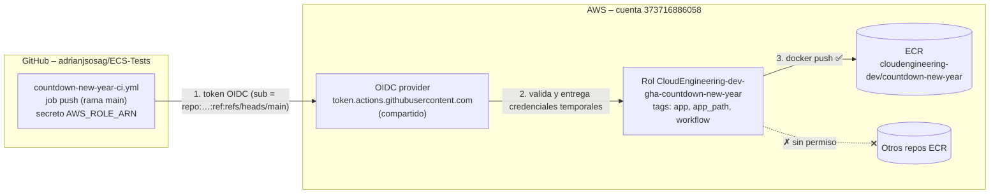

# 🔑 GitHub Actions OIDC (roles de CI) – Terraform

Este proyecto crea la **confianza entre GitHub Actions y AWS** para que los workflows de este repositorio trabajen en AWS **sin guardar llaves de AWS en GitHub**:

- **CI de las apps:** un rol por app para subir su imagen al [ECR](../ECR-module/README.md) (hoy `countdown-new-year`).
- **CD de los servicios:** dos roles (plan y apply) para que [`terraform-services-cd.yml`](../../.github/workflows/terraform-services-cd.yml) despliegue los servicios de [`ECS-services-module`](../ECS-services-module/README.md).

Cada rol indica **qué app y qué workflow lo usan**: en el código ([`github-oidc.auto.tfvars`](manifests/github-oidc.auto.tfvars), [`github-oidc.tf`](manifests/github-oidc.tf)), en la descripción y las etiquetas del rol en AWS, en el output `roles_usage` y en la tabla [Roles y quién los usa](#roles-y-quién-los-usa).

| 🧭 Ficha rápida | |
|---|---|
| **Paso en el despliegue** | **7** – después de [`ECR-module`](../ECR-module/README.md) ([guía](../README.md#guía-de-despliegue-paso-a-paso)) |
| **Depende de** | Bucket del state ([`S3-tfstate-backend-module`](../S3-tfstate-backend-module/README.md)) y [`ECR-module`](../ECR-module/README.md) (lee `repository_arns`) |
| **Lo usan** | Los workflows de GitHub Actions: [`countdown-new-year-ci.yml`](../../.github/workflows/countdown-new-year-ci.yml) (CI) y [`terraform-services-cd.yml`](../../.github/workflows/terraform-services-cd.yml) (CD de servicios) |
| **Recursos (`plan`)** | 1 OIDC provider + 2 por app de CI (rol y política) + 5 del CD de servicios (2 roles y 3 políticas). Hoy: 8 |
| **Tiempo de despliegue** | Menos de 1 min |
| **Costo** | Gratis (IAM no tiene costo) |

> 🗺️ Vista general de toda la plataforma: [README de Terraform](../README.md).

---

## Índice

1. 📦 [¿Qué se crea?](#qué-se-crea)
2. 🧑‍💻 [Roles y quién los usa](#roles-y-quién-los-usa)
   - 🚀 [Roles del CD de servicios](#roles-del-cd-de-servicios)
3. 📚 [Conceptos básicos](#conceptos-básicos)
4. 🗺️ [Diagrama](#diagrama)
5. 🔍 [Cómo funciona](#cómo-funciona)
6. 🔗 [¿De qué depende? (remote state)](#de-qué-depende-remote-state)
7. 📁 [Estructura de archivos](#estructura-de-archivos)
8. 🏷️ [Versiones](#versiones)
9. ⚙️ [Variables](#variables)
10. 📤 [Outputs](#outputs)
11. 🧪 [Cómo probarlo sin crear nada (plan)](#cómo-probarlo-sin-crear-nada-plan)
12. 🚀 [Cómo desplegarlo paso a paso](#cómo-desplegarlo-paso-a-paso)
13. ➕ [Añadir un rol para otra app](#añadir-un-rol-para-otra-app)
14. 🔒 [Seguridad](#seguridad)
15. 🛠️ [Problemas frecuentes](#problemas-frecuentes)

---

## ¿Qué se crea?

| Recurso | Cantidad | ¿Para qué sirve? |
|---|---|---|
| **OIDC identity provider** `token.actions.githubusercontent.com` | 1 por cuenta de AWS | Hace que AWS confíe en los tokens que emite GitHub Actions. **Lo comparten todos los roles** de este módulo |
| **Rol IAM** `CloudEngineering-dev-gha-<app>` | 1 por app | Lo asume el workflow de CI de esa app. Su descripción y sus etiquetas (`app`, `app_path`, `workflow`, `used_by`) dicen quién lo usa |
| **Política inline** `ecr-push-<app>` | 1 por app | Permite el login en ECR y el push **solo** a los repositorios de esa app |
| **Roles del CD** `CloudEngineering-dev-gha-services-cd-plan` / `-apply` | 2 | Los asume [`terraform-services-cd.yml`](../../.github/workflows/terraform-services-cd.yml): plan (solo lectura) y apply (solo los recursos de un servicio). Ver [Roles del CD de servicios](#roles-del-cd-de-servicios) |
| **Políticas inline** `services-cd-read` (×2) y `services-cd-write` | 3 | Lectura para los dos roles; escritura solo para el de apply |

> 💡 **Analogía:** en lugar de dar a GitHub una **llave maestra** permanente (access keys), AWS le da un **pase de visitante** que caduca en 1 hora. Solo se lo da si GitHub demuestra que la petición viene de este repositorio y de la rama `main`, y el pase solo abre **una** puerta: el repositorio ECR de esa app.

---

## Roles y quién los usa

| Rol IAM | App | Workflow (job) | Secreto de GitHub | Repositorios ECR permitidos | Ramas permitidas |
|---|---|---|---|---|---|
| `CloudEngineering-dev-gha-services-cd-plan` | Servicios de [`ECS-services-module`](../ECS-services-module/README.md) | [`.github/workflows/terraform-services-cd.yml`](../../.github/workflows/terraform-services-cd.yml) (job `plan`, [cómo funciona](../../.github/workflows/README-terraform-services-cd.md)) | `AWS_SERVICES_PLAN_ROLE_ARN` = `services_cd_role_arns["plan"]` | — (solo lectura) | Pull requests y `main` |
| `CloudEngineering-dev-gha-services-cd-apply` | Servicios de [`ECS-services-module`](../ECS-services-module/README.md) | [`.github/workflows/terraform-services-cd.yml`](../../.github/workflows/terraform-services-cd.yml) (job `apply`) | `AWS_SERVICES_APPLY_ROLE_ARN` = `services_cd_role_arns["apply"]` | — (no toca ECR) | `main`, **solo** dentro del environment `dev` |
| `CloudEngineering-dev-gha-countdown-new-year` | [`apps/countdown-new-year`](../../apps/countdown-new-year/README.md) | [`.github/workflows/countdown-new-year-ci.yml`](../../.github/workflows/countdown-new-year-ci.yml) (job `push`, [cómo funciona](../../.github/workflows/README-countdown-new-year-ci.md#diagrama-secuencia-oidc--ecr)) | `AWS_ROLE_ARN` = `role_arns["countdown-new-year"]` | `cloudengineering-dev/countdown-new-year` | `main` |

📌 Cada rol se define con una entrada de `github_ci_roles` en [`github-oidc.auto.tfvars`](manifests/github-oidc.auto.tfvars), comentada con la misma información:

```hcl
github_ci_roles = {
  # Role: CloudEngineering-dev-gha-countdown-new-year
  # App:      apps/countdown-new-year
  # Used by:  .github/workflows/countdown-new-year-ci.yml, job "push" (GitHub secret AWS_ROLE_ARN)
  # Allows:   push images ONLY to cloudengineering-dev/countdown-new-year, ONLY from the main branch
  countdown-new-year = {
    app_path         = "apps/countdown-new-year"
    workflow_file    = ".github/workflows/countdown-new-year-ci.yml"
    ecr_repositories = ["countdown-new-year"]
    branches         = ["main"]
  }
}
```

🔎 **Ver quién usa cada rol** después del `apply`:

```bash
terraform output roles_usage                    # rol → workflow, job, secreto y qué permite
aws iam list-role-tags --role-name CloudEngineering-dev-gha-countdown-new-year
```

### Roles del CD de servicios

Los define [`github-services-cd.tf`](manifests/github-services-cd.tf) a partir de la variable `services_cd` de [`github-oidc.auto.tfvars`](manifests/github-oidc.auto.tfvars). Hay **dos roles** para que el código de un pull request nunca pueda cambiar infraestructura:

| | `CloudEngineering-dev-gha-services-cd-plan` | `CloudEngineering-dev-gha-services-cd-apply` |
|---|---|---|
| **Job** | `plan` (PR y `main`) | `apply` (solo `main`, tras la aprobación del environment `dev`) |
| **Trust (`sub`)** | `repo:adrianjsosag/ECS-Tests:pull_request` y `…:ref:refs/heads/main` | `repo:adrianjsosag/ECS-Tests:environment:dev` **y** `ref = refs/heads/main` |
| **States (S3)** | Lee el de cada servicio y los que lee un servicio (VPC, ALB, cluster, ECR); escribe solo `*.tflock` de los servicios | Lo mismo + escribe los states de los servicios |
| **IAM** | Lee los roles `CloudEngineering-dev-*-exec` | Crea/borra esos roles, solo les adjunta `AmazonECSTaskExecutionRolePolicy` y solo los pasa a `ecs-tasks.amazonaws.com` |
| **Logs** | Describe | Crea/borra `/ecs/CloudEngineering-dev-ecs-cluster/*` |
| **EC2** | Describe | Security Groups de las tareas y sus reglas |
| **ELB** | Describe | Target groups `CloudEngineering-dev-*` y reglas del listener de `CloudEngineering-dev-alb` |
| **ECS** | Describe/List | Task definitions y servicios **del cluster** `CloudEngineering-dev-ecs-cluster` |
| **No puede** | Cambiar nada | Leer el state del Bastion (tiene la llave SSH), escribir el state de otros módulos, crear otros roles, adjuntar otras políticas, borrar el ALB, el cluster o la VPC |

✅ Comprobado con el **simulador de políticas de IAM** (31 acciones permitidas y prohibidas) y con **IAM Access Analyzer** (sin hallazgos en las políticas de permisos). Access Analyzer avisa de que el `sub` de un pull request no incluye la rama: es inevitable en un PR y el rol de plan es de solo lectura. Por eso el rol de apply exige además `ref = refs/heads/main`.

Detalle del workflow: [README-terraform-services-cd.md](../../.github/workflows/README-terraform-services-cd.md).

---

## Conceptos básicos

| Término | Qué significa en palabras simples |
|---|---|
| **OIDC** (OpenID Connect) | Un estándar para que un sistema (GitHub) demuestre su identidad a otro (AWS) con un token firmado, sin contraseñas. |
| **Token de GitHub Actions** | Lo emite GitHub en cada ejecución (si el job tiene `id-token: write`). Dice de qué repositorio, rama y workflow viene. |
| **`sts:AssumeRoleWithWebIdentity`** | La llamada con la que el workflow cambia el token de GitHub por **credenciales temporales** (1 h) del rol. |
| **Trust policy** | La política del rol que dice **quién** puede asumirlo. Aquí: solo tokens de `adrianjsosag/ECS-Tests` en la rama `main`. |
| **Claim `sub`** | El campo del token que identifica el origen, por ejemplo `repo:adrianjsosag/ECS-Tests:ref:refs/heads/main`. |
| **Claim `aud`** | El destinatario del token. Para AWS es `sts.amazonaws.com`. |

---

## Diagrama



👀 **Cómo leerlo:** el workflow nunca tiene llaves de AWS. Presenta un token de GitHub, AWS comprueba que viene del repositorio y la rama permitidos, y le da credenciales temporales de **un** rol. Ese rol solo puede escribir en el repositorio ECR de su app.

---

## Cómo funciona

[`github-oidc.tf`](manifests/github-oidc.tf) crea un rol por cada entrada de `github_ci_roles` (`for_each`):

```hcl
resource "aws_iam_role" "github_ci" {
  for_each    = var.github_ci_roles
  name        = local.role_names[each.key]         # CloudEngineering-dev-gha-countdown-new-year
  description = "GitHub Actions CI of apps/countdown-new-year (.github/workflows/countdown-new-year-ci.yml): push to ECR cloudengineering-dev/countdown-new-year"
  tags        = { app = ..., app_path = ..., workflow = ..., used_by = "GitHub Actions" }
}
```

| Pieza | Qué controla |
|---|---|
| **Trust policy** (`github_ci_trust`) | `aud = sts.amazonaws.com` y `sub = repo:adrianjsosag/ECS-Tests:ref:refs/heads/<rama>` para cada rama de la entrada. Los **pull requests no pueden** asumir el rol (su `sub` es `…:pull_request`): por eso el workflow solo hace push en `main` |
| **Política** (`github_ci_ecr_push`) | `ecr:GetAuthorizationToken` sobre `*` (el login no admite otro recurso) + push, `DescribeImages` y `DescribeImageScanFindings` **solo** sobre los ARNs de los repositorios de la app, leídos del state de ECR |
| **Precondición** | Si una entrada pide un repositorio que el ECR-module no crea, el `plan` falla con un mensaje claro |
| **`create_oidc_provider`** | Solo puede haber **un** provider de GitHub por cuenta. Si ya existe (creado por otro proyecto), pon `false` y se reutiliza con un data source |

---

## ¿De qué depende? (remote state)

Guarda su state en `GitHub-OIDC-module/terraform.tfstate` del [bucket S3](../S3-tfstate-backend-module/README.md) y lee el del ECR con `terraform_remote_state` ([`remote-state-datasource.tf`](manifests/remote-state-datasource.tf)):

| State | Clave en el bucket S3 | Valores que usa |
|---|---|---|
| ECR | `ECR-module/terraform.tfstate` | `repository_arns` |

**Ningún módulo de Terraform lee su state.** Su output `role_arns` se copia a mano en el secreto `AWS_ROLE_ARN` del repositorio de GitHub.

---

## Estructura de archivos

```
GitHub-OIDC-module/
├── README.md
└── manifests/
    ├── versions.tf                  # Terraform + provider AWS
    ├── backend.tf                   # State en el bucket S3 (clave GitHub-OIDC-module/terraform.tfstate)
    ├── generic-variables.tf         # región, entorno, división
    ├── terraform.tfvars             # us-east-1 / dev / CloudEngineering
    ├── local-values.tf              # nombres de los roles, repos ECR completos, ARN del provider
    ├── remote-state-datasource.tf   # Lectura del state de ECR (repository_arns)
    ├── github-oidc-variables.tf     # github_repository, create_oidc_provider, github_ci_roles
    ├── github-oidc.auto.tfvars      # ← LOS ROLES: una entrada comentada por app + services_cd
    ├── github-oidc.tf               # OIDC provider + rol + trust + política por app (CI)
    ├── github-services-cd.tf        # Roles plan / apply del CD de servicios (terraform-services-cd.yml)
    └── github-oidc-outputs.tf       # oidc_provider_arn, role_arns, services_cd_role_arns, roles_usage
```

---

## Versiones

| Componente | Versión | Comentario |
|---|---|---|
| Terraform | `>= 1.16` | Validado con v1.17.0 |
| Provider `hashicorp/aws` | `~> 6.67` | Validado con 6.70.0 (sin `.terraform.lock.hcl` en el repositorio) |
| Módulos externos | — | Solo recursos nativos de AWS |

---

## Variables

| Variable | Tipo | Valor actual | Descripción |
|---|---|---|---|
| `aws_region` / `environment` / `business_division` | texto | `us-east-1` / `dev` / `CloudEngineering` | Generales; deben coincidir con los otros módulos |
| `github_repository` | texto | `adrianjsosag/ECS-Tests` | Repositorio cuyos workflows pueden asumir los roles |
| `create_oidc_provider` | sí/no | `true` | `false` si la cuenta ya tiene el provider de GitHub |
| `services_cd` | objeto | `{ workflow_file = ".github/workflows/terraform-services-cd.yml", environment = "dev", plan_branches = ["main"], apply_branches = ["main"] }` | Roles del CD de servicios. `null` = no se crean |
| `github_ci_roles` | mapa | `{ countdown-new-year = {...} }` | Un rol por app. Campos: `app_path`, `workflow_file`, `ecr_repositories` (claves del ECR-module), `branches` (por defecto `["main"]`) |
| `state_bucket` | texto | `null` → `cloudengineering-dev-tfstate-<cuenta>` | Bucket con el state del ECR |
| `remote_state_local_dir` | texto | `null` | **Solo pruebas:** carpeta con un `ECR-module.tfstate` ficticio |

✔️ **Validaciones:** claves de `github_ci_roles` en minúsculas (máx. 39 caracteres, para que el nombre del rol no pase de 64), al menos un repositorio y una rama por entrada, y `github_repository` con formato `owner/name`.

---

## Outputs

| Output | Ejemplo | ¿Para qué? |
|---|---|---|
| `role_arns` | `{ countdown-new-year = "arn:aws:iam::373716886058:role/CloudEngineering-dev-gha-countdown-new-year" }` | Valor del secreto `AWS_ROLE_ARN` de cada workflow |
| `services_cd_role_arns` | `{ plan = "arn:…:role/CloudEngineering-dev-gha-services-cd-plan", apply = "arn:…-apply" }` | Valores de los secretos `AWS_SERVICES_PLAN_ROLE_ARN` y `AWS_SERVICES_APPLY_ROLE_ARN` de `terraform-services-cd.yml` |
| `roles_usage` | `{ countdown-new-year = {…}, services-cd-plan = {…}, services-cd-apply = {…} }` con `role_name`, `workflow_file`, `job`, `github_secret` y `allows` | Ver de un vistazo qué workflow y qué job usan cada rol y qué permite |
| `oidc_provider_arn` | `arn:aws:iam::373716886058:oidc-provider/token.actions.githubusercontent.com` | Informativo |

---

## Cómo probarlo sin crear nada (plan)

Con el ECR aplicado: `terraform init && terraform plan`. Sin desplegar nada, con un `backend_override.tf` local y un **state ficticio** `ECR-module.tfstate` con el output `repository_arns` (ver [cómo hacerlo](../README.md#probar-sin-crear-nada)):

```bash
terraform plan -var remote_state_local_dir=/ruta/a/states-ficticios
```

✅ **Resultado verificado** (Terraform v1.17.0, provider AWS 6.70.0, sin `apply`): `Plan: 8 to add, 0 to change, 0 to destroy.` Con `services_cd = null`, `Plan: 3 to add`.
- `aws_iam_openid_connect_provider.github[0]`
- `aws_iam_role.github_ci["countdown-new-year"]`: nombre `CloudEngineering-dev-gha-countdown-new-year`, con las etiquetas `app`, `app_path`, `workflow` y `used_by`
- `aws_iam_role_policy.github_ci_ecr_push["countdown-new-year"]`: `Resource` = `*` (login) y `…:repository/cloudengineering-dev/countdown-new-year`
- `aws_iam_role.services_cd["plan"]` y `["apply"]`, con `aws_iam_role_policy.services_cd_read["plan"]`, `["apply"]` y `services_cd_write[0]`
- Con un repositorio que el ECR no crea, el `plan` falla con `Resource precondition failed` (esperado).

---

## Cómo desplegarlo paso a paso

### Requisitos previos

1. **Bucket del state y ECR aplicados**, con el repositorio de la app en `ECR-module/manifests/ecr.auto.tfvars` (hoy `countdown-new-year`).
2. **Terraform 1.16+** y **credenciales de AWS** con permisos IAM (`iam:CreateOpenIDConnectProvider`, `iam:CreateRole`, `iam:PutRolePolicy`, `iam:TagRole`…).

### Pasos

```bash
cd ~/ECS-Tests/Terraform/GitHub-OIDC-module/manifests
terraform init
terraform plan          # Plan: 8 to add
terraform apply
terraform output -json role_arns              # CI de las apps
terraform output -json services_cd_role_arns   # CD de servicios: plan / apply
```

Después, en GitHub (**Settings → Secrets and variables → Actions**):
- **CI de countdown-new-year:** el secreto **`AWS_ROLE_ARN`** con `role_arns["countdown-new-year"]` y las variables del workflow (ver el [README de la app](../../apps/countdown-new-year/README.md#variables-y-secretos-de-github)).
- **CD de servicios:** los secretos **`AWS_SERVICES_PLAN_ROLE_ARN`** y **`AWS_SERVICES_APPLY_ROLE_ARN`** con `services_cd_role_arns`, y el environment **`dev`** con *required reviewers* (ver [configuración del CD](../../.github/workflows/README-terraform-services-cd.md#configuración-necesaria)).

### Eliminar

```bash
terraform destroy
```

Destrúyelo **antes** que el ECR (lee su state). Al borrarlo, el workflow deja de poder hacer push (`Not authorized to perform sts:AssumeRoleWithWebIdentity`).

---

## Añadir un rol para otra app

1. Añade el repositorio de la app en `ECR-module/manifests/ecr.auto.tfvars` y aplica el ECR.
2. Añade una entrada **comentada** en `github-oidc.auto.tfvars`, indicando la app, el workflow y lo que permite:
   ```hcl
   # Role: CloudEngineering-dev-gha-mi-api
   # App:      apps/mi-api
   # Used by:  .github/workflows/mi-api-ci.yml, job "push" (GitHub secret AWS_ROLE_ARN_MI_API)
   # Allows:   push images ONLY to cloudengineering-dev/mi-api, ONLY from the main branch
   mi-api = {
     app_path         = "apps/mi-api"
     workflow_file    = ".github/workflows/mi-api-ci.yml"
     ecr_repositories = ["mi-api"]
   }
   ```
3. `terraform apply` y copia `role_arns["mi-api"]` a un secreto de GitHub **propio de ese workflow** (por ejemplo `AWS_ROLE_ARN_MI_API`). Así cada workflow solo puede asumir su rol.
4. Añade una fila a la tabla [Roles y quién los usa](#roles-y-quién-los-usa) y comenta el rol en el encabezado del workflow.

---

## Seguridad

| Control | Estado |
|---|---|
| Sin llaves de AWS en GitHub: credenciales temporales (1 h) por OIDC | ✅ |
| Rol limitado a **un repositorio** de GitHub y a la rama `main` (los PR no pueden asumirlo) | ✅ |
| Permisos mínimos: push **solo** a los repositorios ECR de su app | ✅ |
| Un rol por app: un workflow comprometido no puede escribir en los repositorios de otra app | ✅ |
| Quién usa cada rol, visible en el código, las etiquetas de IAM y `roles_usage` | ✅ |
| CD de servicios: rol de escritura solo desde el environment `dev` (aprobación manual) y la rama `main`; los PR solo leen | ✅ |
| Restringir además por workflow (`job_workflow_ref`) | ⏳ Mejora futura |

---

## Problemas frecuentes

| Síntoma | Causa probable | Solución |
|---|---|---|
| `Not authorized to perform sts:AssumeRoleWithWebIdentity` | El workflow no corre en `main`, el repositorio no es `github_repository`, el secreto `AWS_ROLE_ARN` es de otro rol, o el job usa un `environment` (cambia el `sub`) | Revisa la rama, `github_repository`, el secreto y `branches` |
| `Credentials could not be loaded` / `Could not fetch an OIDC token` | Al job le falta `permissions: id-token: write` | Añádelo al job que asume el rol |
| `EntityAlreadyExists: Provider with url https://token.actions.githubusercontent.com already exists` | La cuenta ya tiene el provider de GitHub | `create_oidc_provider = false` |
| `Resource precondition failed` (`ecr_repositories`) | El repositorio no está en el ECR-module | Añádelo a `ecr.auto.tfvars` y aplica el ECR |
| `Unable to find remote state` | El ECR no está aplicado o el bucket no es el esperado | Aplica `ECR-module`; usa `state_bucket` si el bucket tiene otro nombre |
| `AccessDeniedException ... ecr:PutImage` en el workflow | `ECR_REPOSITORY` apunta a un repositorio que el rol no permite | Usa `cloudengineering-dev/countdown-new-year` o añade el repositorio a la entrada |
