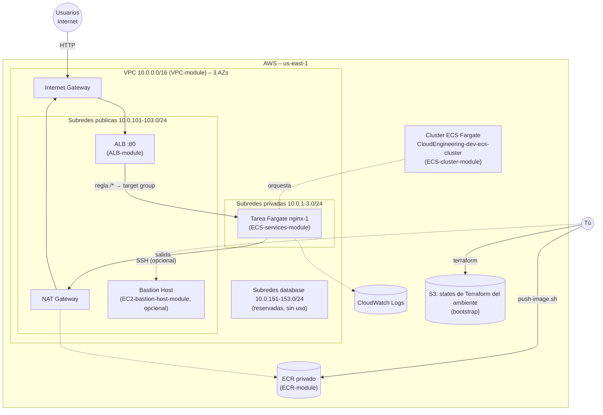
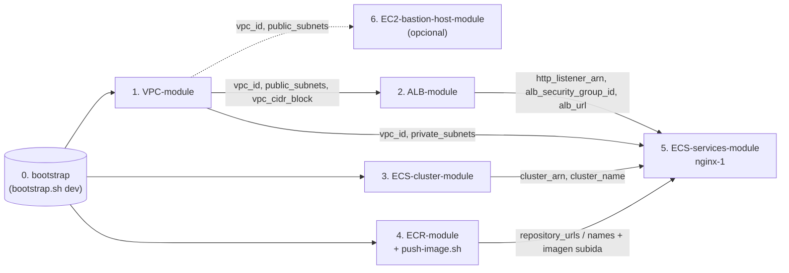

# 🐳 Plataforma de contenedores en AWS (ECS Fargate) – Terraform

Este directorio contiene la infraestructura, escrita en Terraform, para desplegar contenedores en **Amazon ECS con AWS Fargate** (AWS administra los servidores; tú solo defines los contenedores). **No hay modo EC2.**

Está dividida en el **bootstrap** del state y **5 proyectos independientes** en [`modules/`](modules/) (más **1 opcional**, el Bastion Host), cada uno con su propio state en el bucket S3 del ambiente, que se despliegan **a mano** desde la terminal de **WSL Ubuntu**. **Los módulos no tienen valores de ningún ambiente:** cada ambiente vive en [`environments/<ambiente>/`](#ambientes) y se le pasa a Terraform con `-backend-config` y `-var-file`. Hoy existe solo **`dev`**. El objetivo actual es una prueba de extremo a extremo: **un nginx (`nginx-1`) corriendo en Fargate detrás de un ALB**.

Las aplicaciones van en [`apps/`](../apps/README.md) (una carpeta por app); sus imágenes se suben al ECR con `push-image.sh`.

> ⚠️ **Antes de desplegar nada en un ambiente: crea su bucket S3 del state** con el [`bootstrap`](bootstrap/README.md) (`./bootstrap.sh dev`). Sin él, el `terraform init` de los demás falla con `NoSuchBucket`.

---

## Índice

1. 🗺️ [Arquitectura](#arquitectura)
2. 🧱 [Los módulos](#los-módulos)
3. 🌍 [Ambientes](#ambientes)
4. 📏 [Convenciones comunes](#convenciones-comunes)
5. 📋 [Requisitos](#requisitos)
6. 🔗 [Dependencias y orden de despliegue](#dependencias-y-orden-de-despliegue)
7. 🧪 [Probar sin crear nada](#probar-sin-crear-nada)
8. 🚀 [Guía de despliegue paso a paso](#guía-de-despliegue-paso-a-paso)
9. 🧹 [Destruir todo (orden inverso)](#destruir-todo-orden-inverso)
10. 💰 [Costos](#costos)
11. 🔒 [Seguridad](#seguridad)
12. ⏳ [Pendientes conocidos](#pendientes-conocidos)
13. 🔎 [Revisión y plan de evolución](#revisión-y-plan-de-evolución)
14. 🛠️ [Problemas frecuentes](#problemas-frecuentes)

---

## Arquitectura



🧭 **Cómo viaja una petición:** `http://<dns del ALB>/` → Internet Gateway → **ALB** (subred pública) → regla `/*` del servicio → **tarea Fargate** en una subred privada → responde nginx. La tarea descarga su imagen del **ECR** saliendo por el **NAT Gateway**.

---

## Los módulos

```text
Terraform/
├── bootstrap/      # bucket S3 de los states de cada ambiente (./bootstrap.sh <ambiente>)
├── environments/   # valores de cada ambiente: backend.hcl y *.tfvars (hoy solo dev/)
└── modules/        # los proyectos de la plataforma, uno por carpeta (código sin valores de ambiente)
```

Cada proyecto de `modules/` se ejecuta desde su carpeta `manifests/`, con el backend y los valores del ambiente ([cómo](#ambientes)).

| Módulo | Qué crea | Lee el state de | Recursos (`plan`) |
|---|---|---|---|
| [`bootstrap`](bootstrap/README.md) | **Una vez por ambiente, antes que todo** (`./bootstrap.sh <ambiente>`). Bucket S3 privado, versionado, cifrado y solo TLS para los states del ambiente. Su propio state también se guarda en ese bucket | — | 7 |
| [`VPC-module`](modules/VPC-module/README.md) | VPC, 9 subredes (pública, privada y database × 3 AZs), Internet Gateway, 1 NAT Gateway, tablas de rutas, DB subnet group | — | 31 |
| [`ALB-module`](modules/ALB-module/README.md) | ALB público, su Security Group y el listener HTTP :80 (404 por defecto) | VPC | 5 |
| [`ECS-cluster-module`](modules/ECS-cluster-module/README.md) | Cluster ECS **solo Fargate** (`FARGATE` + `FARGATE_SPOT`), y log group de ECS Exec | — | 4 |
| [`ECR-module`](modules/ECR-module/README.md) | Repositorios privados (IMMUTABLE, escaneo al subir, ciclo de vida) + script **`push-image.sh`** | — | 2 por repositorio (2 hoy) |
| [`ECS-services-module`](modules/ECS-services-module/README.md) | Servicio **`nginx-1`**: rol de ejecución, log group, SG, target group, regla del listener, task definition y servicio Fargate | VPC, ALB, cluster, ECR | 10 |
| [`EC2-bastion-host-module`](modules/EC2-bastion-host-module/README.md) *(opcional)* | Bastion EC2 (Amazon Linux 2023, `t3.micro`) en una subred pública: Elastic IP, Security Group (SSH), key pair propio y disco cifrado. **No hace falta para nginx-1**: para entrar a los contenedores está ECS Exec, que hay que habilitar en el servicio ([hallazgo #8](#hallazgos)) | VPC | 8 |

---

## Ambientes

El código de los módulos es **el mismo para todos los ambientes**. Lo que cambia entre ambientes vive en una carpeta por ambiente:

```text
environments/
└── dev/
    ├── backend.hcl            # bucket + region del backend S3 (lo crea el bootstrap)
    ├── common.tfvars          # aws_region, environment, business_division (todos los proyectos)
    ├── bootstrap.tfvars       # bootstrap
    ├── vpc.tfvars             # modules/VPC-module
    ├── alb.tfvars             # modules/ALB-module
    ├── ecs-cluster.tfvars     # modules/ECS-cluster-module
    ├── ecr.tfvars             # modules/ECR-module
    ├── ec2-bastion.tfvars     # modules/EC2-bastion-host-module (opcional)
    └── services/
        └── nginx-1.tfvars     # modules/ECS-services-module/services/nginx-1
```

🧩 **Cómo se usa** en cualquier `modules/<proyecto>/manifests/` (la ruta de `E` es absoluta, así sirve desde cualquier carpeta):

```bash
E=~/ECS-Tests/Terraform/environments/dev
terraform init -reconfigure -backend-config=$E/backend.hcl                # bucket del ambiente
terraform plan  -var-file=$E/common.tfvars -var-file=$E/vpc.tfvars         # comunes + los del proyecto
terraform apply -var-file=$E/common.tfvars -var-file=$E/vpc.tfvars
```

| Archivo | Qué contiene | Se pasa con |
|---|---|---|
| `backend.hcl` | `bucket` y `region` del backend S3. Los `backend.tf` de los módulos solo fijan la `key` (los backends no admiten variables) | `terraform init -backend-config=` |
| `common.tfvars` | Variables generales. `environment` y `business_division` **no tienen valor por defecto**: sin este archivo Terraform se detiene en vez de desplegar con valores equivocados | `-var-file=` en `plan`/`apply`/`destroy` |
| `<proyecto>.tfvars` | Valores propios del proyecto en ese ambiente (CIDRs, tamaños, repositorios…) | `-var-file=` en `plan`/`apply`/`destroy` |

> ℹ️ **`-reconfigure` en el `init`:** cada carpeta `manifests/` recuerda (en `.terraform/`) el último backend usado. Al cambiar de ambiente en la misma carpeta, `-reconfigure` apunta al nuevo bucket **sin copiar** el state del anterior.

🌱 **Crear un ambiente nuevo** (por ejemplo `qa`):
1. Copia `environments/dev/` a `environments/qa/`.
2. En `common.tfvars`: `environment = "qa"`. En `backend.hcl`: el bucket `<división en minúsculas>-qa-tfstate-<cuenta>`.
3. Ajusta los `.tfvars` de cada proyecto: por ejemplo, otro `vpc_cidr_block` si las VPC se van a conectar.
4. `cd bootstrap && ./bootstrap.sh qa` y después la [guía de despliegue](#guía-de-despliegue-paso-a-paso) con `E=~/ECS-Tests/Terraform/environments/qa`.

> ℹ️ Dos ambientes en la **misma cuenta y región** no chocan en los nombres de los recursos, porque todos llevan `<división>-<ambiente>` (`CloudEngineering-dev-…`, `CloudEngineering-qa-…`).

---

## Convenciones comunes

- **Estructura:** cada proyecto de `modules/` tiene `README.md` y `manifests/` con `versions.tf`, `backend.tf` (backend S3 parcial: solo la `key`), `generic-variables.tf`, `local-values.tf` y sus `*-variables.tf` / `*-outputs.tf`. **No hay `.tfvars` dentro de los módulos:** los valores están en [`environments/<ambiente>/`](#ambientes). Los servicios viven en `modules/ECS-services-module/services/<servicio>/manifests/`.
- **Variables generales** (`generic-variables.tf`, valores en `environments/<ambiente>/common.tfvars`), **idénticas en todos los módulos**:

  | Variable | Valor en `dev` | Uso |
  |---|---|---|
  | `aws_region` | `us-east-1` | Región de todos los recursos |
  | `environment` | `dev` | Entorno: forma parte de nombres, etiquetas y del nombre del bucket |
  | `business_division` | `CloudEngineering` | Área responsable: nombres, etiquetas y nombre del bucket |

- **Nombres:** `<business_division>-<environment>-…` → `CloudEngineering-dev-…` (en minúsculas donde AWS lo exige: bucket y ECR → `cloudengineering-dev`).
- **Etiquetas:** todos los recursos llevan `owners = "CloudEngineering"` y `environment = "dev"` (los servicios, además, `service`).
- **States:** un bucket por ambiente (`<división>-<ambiente>-tfstate-<cuenta>`; en `dev`: `cloudengineering-dev-tfstate-373716886058`) y una clave por proyecto (`<Proyecto>/terraform.tfstate`), con cifrado y bloqueo nativo (`use_lockfile`). El state del propio bootstrap está en `bootstrap/terraform.tfstate` del mismo bucket. Los módulos se leen entre sí con `terraform_remote_state`; el nombre del bucket se calcula con la misma fórmula a partir de `environment` y `business_division` (`state_bucket` permite cambiarlo).
- **Los `backend.tf` no admiten variables:** por eso solo fijan la `key`, y el `bucket` y la `region` llegan en el `init` desde `environments/<ambiente>/backend.hcl`. Cambiar de cuenta o de ambiente es cambiar ese archivo, no los módulos.
- **`.gitignore`:** [`Terraform/.gitignore`](.gitignore) excluye `.terraform/`, los `*.tfstate`, los planes, los `*_override.tf` y la llave privada del Bastion.
- **Versiones:** Terraform `>= 1.16`, provider `hashicorp/aws ~> 6.67`. Módulos públicos fijados a versión exacta: vpc `6.7.3`, alb `10.5.1`, ecs cluster `7.6.1`, ecr `3.2.0`, ec2-instance `6.4.1`, key-pair `3.0.1`. No hay `.terraform.lock.hcl` en el repositorio: `terraform init` instala la última 6.x del provider (validado con 6.70.0).

---

## Requisitos

| Herramienta | Para qué |
|---|---|
| **WSL Ubuntu** (terminal Linux) | Todos los comandos de esta guía se ejecutan ahí |
| Terraform `>= 1.16` (validado con 1.17.0) | Todos los módulos |
| AWS CLI v2 con credenciales (`default` o `AWS_PROFILE`) | Terraform, `push-image.sh`, comprobaciones |
| Docker (Docker Engine en WSL o Docker Desktop con integración WSL) | `push-image.sh` |
| bash 4+ | `push-image.sh` |

📋 **Permisos y cuenta:**
- Permisos en AWS para crear S3, VPC/EC2, ELB, ECS, ECR, IAM (roles) y CloudWatch Logs.
- **Rol enlazado de ECS** (solo si la cuenta nunca usó ECS): `aws iam create-service-linked-role --aws-service-name ecs.amazonaws.com`.
- La cuenta configurada en `environments/dev/backend.hcl` es **`373716886058`**.

---

## Dependencias y orden de despliegue



| # | Módulo | Depende de | Si te saltas el orden… |
|---|---|---|---|
| — | Preparación: herramientas, credenciales y rol enlazado de ECS | — | El primer cluster falla con `Unable to assume the service linked role` |
| 0 | `bootstrap` (`./bootstrap.sh dev`) | — | `NoSuchBucket` en cualquier otro `init` |
| 1 | `VPC-module` | Bucket | `Unable to find remote state` en ALB y servicios |
| 2 | `ALB-module` | VPC | `Unable to find remote state` en servicios |
| 3 | `ECS-cluster-module` | Bucket (no depende de la VPC) | `Unable to find remote state` en servicios |
| 4 | `ECR-module` + `push-image.sh nginx-1` | Bucket | Sin la imagen: `couldn't find resource` en el `plan` del servicio |
| 5 | `ECS-services-module/services/nginx-1` | Todos los anteriores | — |
| 6 | `EC2-bastion-host-module` *(opcional)* | VPC | `Unable to find remote state`. Puede aplicarse en cualquier momento después de la VPC; nadie depende de él |

Los pasos 2, 3 y 4 son independientes entre sí: pueden aplicarse en cualquier orden después de sus dependencias.

---

## Probar sin crear nada

Antes de cada `apply`, y siempre que cambies código o valores, comprueba el proyecto con este flujo. **Ninguno de estos comandos crea nada en AWS**: `plan` solo hace lecturas.

| # | Comando (en `modules/<proyecto>/manifests/`) | Qué comprueba |
|---|---|---|
| 1 | `terraform init -reconfigure -backend-config=$E/backend.hcl` | Descarga providers y módulos y conecta con el state del ambiente |
| 2 | `terraform fmt -check -recursive` | Formato del código (sin salida = correcto) |
| 3 | `terraform validate` | Sintaxis, tipos, validaciones y referencias |
| 4 | `terraform plan -var-file=$E/common.tfvars -var-file=$E/<proyecto>.tfvars` | Qué se crearía, cambiaría o destruiría |

Con `E=~/ECS-Tests/Terraform/environments/dev` (ver [Ambientes](#ambientes)).

🧪 **Sin nada desplegado** (ni siquiera el bucket), los pasos 2 y 3 funcionan en todos los proyectos con un `init` sin backend, que no necesita AWS:

```bash
cd ~/ECS-Tests/Terraform
terraform fmt -check -recursive
for d in bootstrap/manifests modules/*/manifests modules/ECS-services-module/services/*/manifests; do
  echo "=== $d" && (cd "$d" && terraform init -backend=false -input=false >/dev/null && terraform validate) || break
done
```

📋 **El `plan` necesita lo que el proyecto lee de AWS y de otros states**, así que sigue el [orden de despliegue](#dependencias-y-orden-de-despliegue):

| Proyecto | Para el `plan` necesita | Resultado esperado |
|---|---|---|
| `bootstrap` | Solo credenciales (el `plan` se hace con un backend local temporal, ver su [README](bootstrap/README.md#cómo-probarlo-sin-crear-nada-plan)) | `7 to add` (bucket `cloudengineering-dev-tfstate-373716886058`) |
| `VPC-module` | El bucket del ambiente | `31 to add` |
| `ALB-module` | El bucket y la VPC aplicada | `5 to add` |
| `ECS-cluster-module` | El bucket | `4 to add` |
| `ECR-module` | El bucket | `2 to add` |
| `ECS-services-module/services/nginx-1` | El bucket, VPC, ALB, cluster y ECR aplicados y la imagen `nginx-1:1.0.0` subida. Sin la imagen falla con `couldn't find resource` | `10 to add` |
| `EC2-bastion-host-module` | El bucket y la VPC aplicada | `8 to add` |

✅ **Verificado** (2026-10-28, Terraform 1.17.0, `environment = "dev"`): los 7 proyectos pasan `init`, `fmt -check`, `validate` y `plan` con los resultados de la tabla. También se comprobó que:
- sin `-var-file`, el `plan` se detiene con `No value for required variable "environment"`;
- con `image_tag = "latest"`, el servicio falla con `Invalid value for variable`;
- sin `-backend-config`, el `init` falla con `Missing Required Value` (`The attribute "bucket" is required by the backend`).

---

## Guía de despliegue paso a paso

> ⚠️ **Regla de oro:** cada paso sigue el flujo `init` → `fmt` → `validate` → `plan` → `apply` ([qué comprueba cada uno](#probar-sin-crear-nada)). **Lee el `plan`** antes de escribir `yes`. Comprueba el número de recursos y que diga **`0 to destroy`**.

### Antes de empezar: herramientas y preparación

En la terminal de **WSL Ubuntu**:

```bash
cd ~/ECS-Tests/Terraform
E=~/ECS-Tests/Terraform/environments/dev   # ambiente: úsala en todos los pasos (misma terminal)
terraform version                      # >= 1.16
aws sts get-caller-identity            # tu cuenta y tu usuario
docker info > /dev/null && echo "Docker OK"   # para copiar la imagen de nginx al ECR (paso 4)

# Rol enlazado de ECS (si ya existe, el comando avisa y no pasa nada)
aws iam create-service-linked-role --aws-service-name ecs.amazonaws.com
```

📋 **Revisa:**
- `$E/common.tfvars` tiene los valores del ambiente (`aws_region`, `environment = "dev"`, `business_division`).
- **El `bucket` de `$E/backend.hcl` es `cloudengineering-dev-tfstate-373716886058`**: si tu cuenta no es `373716886058`, cámbialo por `<división en minúsculas>-dev-tfstate-<tu cuenta>`. Es el único sitio donde aparece; `bootstrap.sh` comprueba que coincide antes de crear nada.
- Recomendado: restringe el ALB a tu IP en `$E/alb.tfvars` (`alb_allowed_cidrs = ["<tu-ip>/32"]`; tu IP: `curl -s https://checkip.amazonaws.com`). Si vas a usar el Bastion, haz lo mismo con `bastion_ssh_allowed_cidrs` en `$E/ec2-bastion.tfvars`.

### Paso 0: Bucket S3 del state (una vez por ambiente)

```bash
cd bootstrap
./bootstrap.sh dev                         # 7 to add; después migra su state al bucket
cd ..
```

No queda ningún state local: el del bootstrap se guarda en `s3://cloudengineering-dev-tfstate-<cuenta>/bootstrap/terraform.tfstate`. Detalle: [README del bootstrap](bootstrap/README.md).

### Paso 1: Red (`VPC-module`)

```bash
cd modules/VPC-module/manifests
terraform init -reconfigure -backend-config=$E/backend.hcl
terraform fmt -check -recursive && terraform validate
terraform plan  -var-file=$E/common.tfvars -var-file=$E/vpc.tfvars                          # 31 to add
terraform apply -var-file=$E/common.tfvars -var-file=$E/vpc.tfvars                          # escribe "yes" si el plan es el esperado (3–5 min)
cd ../../..
```

### Paso 2: Balanceador (`ALB-module`)

```bash
cd modules/ALB-module/manifests
terraform init -reconfigure -backend-config=$E/backend.hcl
terraform fmt -check -recursive && terraform validate
terraform plan  -var-file=$E/common.tfvars -var-file=$E/alb.tfvars                          # 5 to add
terraform apply -var-file=$E/common.tfvars -var-file=$E/alb.tfvars                          # escribe "yes" si el plan es el esperado
curl -i "$(terraform output -raw alb_url)/"   # tras 2-3 min: HTTP 404 "no hay ningun servicio en esta ruta" (correcto)
cd ../../..
```

### Paso 3: Cluster ECS Fargate (`ECS-cluster-module`)

```bash
cd modules/ECS-cluster-module/manifests
terraform init -reconfigure -backend-config=$E/backend.hcl
terraform fmt -check -recursive && terraform validate
terraform plan  -var-file=$E/common.tfvars -var-file=$E/ecs-cluster.tfvars                  # 4 to add
terraform apply -var-file=$E/common.tfvars -var-file=$E/ecs-cluster.tfvars                  # escribe "yes" si el plan es el esperado
cd ../../..
```

### Paso 4: Repositorios (`ECR-module`) y la imagen de nginx

```bash
cd modules/ECR-module/manifests
terraform init -reconfigure -backend-config=$E/backend.hcl
terraform fmt -check -recursive && terraform validate
terraform plan  -var-file=$E/common.tfvars -var-file=$E/ecr.tfvars                          # 2 to add (1 repositorio + 1 lifecycle policy)
terraform apply -var-file=$E/common.tfvars -var-file=$E/ecr.tfvars                          # escribe "yes" si el plan es el esperado
cd ..
./push-image.sh nginx-1 1.0.0 --from public.ecr.aws/nginx/nginx:stable-alpine
cd ../..
```

El script termina mostrando el **digest** de la imagen y el resultado del escaneo.

### Paso 5: Servicio `nginx-1` (`ECS-services-module`)

```bash
cd modules/ECS-services-module/services/nginx-1/manifests
terraform init -reconfigure -backend-config=$E/backend.hcl
terraform fmt -check -recursive && terraform validate
terraform plan  -var-file=$E/common.tfvars -var-file=$E/services/nginx-1.tfvars             # 10 to add
terraform apply -var-file=$E/common.tfvars -var-file=$E/services/nginx-1.tfvars             # escribe "yes" si el plan es el esperado (espera a que la tarea esté sana)
curl -i "$(terraform output -raw service_url)/"   # HTTP/1.1 200 OK – "Welcome to nginx!"
cd ../../../../..
```

🔎 **Comprobar:**

```bash
aws ecs describe-services --cluster CloudEngineering-dev-ecs-cluster --services nginx-1 \
  --query 'services[0].{status:status,running:runningCount,desired:desiredCount}'
```

### Paso 6 (opcional): Bastion Host (`EC2-bastion-host-module`)

**No es necesario para la prueba de nginx-1.** Sirve como punto de diagnóstico dentro de la VPC (salida a Internet, DNS, el ALB) y para abrir túneles SSH hacia recursos privados que añadas en el futuro. Las tareas Fargate **no** son accesibles por SSH: para entrar a un contenedor usa ECS Exec.

```bash
cd modules/EC2-bastion-host-module/manifests
terraform init -reconfigure -backend-config=$E/backend.hcl
terraform fmt -check -recursive && terraform validate
terraform plan  -var-file=$E/common.tfvars -var-file=$E/ec2-bastion.tfvars                  # 8 to add
terraform apply -var-file=$E/common.tfvars -var-file=$E/ec2-bastion.tfvars                  # escribe "yes" si el plan es el esperado (1–2 min)
terraform output -raw ssh_command          # ssh -i ./private-key/CloudEngineering-dev-BastionHost.pem ec2-user@<eip>
cd ../../..
```

La llave privada queda **solo en tu PC** (`private-key/*.pem`) y en el state. Destrúyelo cuando termines de usarlo. Detalle: [README del Bastion](modules/EC2-bastion-host-module/README.md).

---

## Destruir todo (orden inverso)

En orden **inverso**: Bastion (si lo creaste) → servicio → ECR → cluster → ALB → VPC. El bucket del state solo si abandonas el ambiente ([cómo](bootstrap/README.md#eliminar)).

```bash
cd ~/ECS-Tests/Terraform
E=~/ECS-Tests/Terraform/environments/dev
for p in EC2-bastion-host-module:ec2-bastion ECS-services-module/services/nginx-1:services/nginx-1 \
         ECR-module:ecr ECS-cluster-module:ecs-cluster ALB-module:alb VPC-module:vpc; do
  d="${p%%:*}"; v="${p#*:}"
  [ -d "modules/$d" ] || continue
  (cd "modules/$d/manifests" && terraform init -reconfigure -backend-config=$E/backend.hcl >/dev/null \
     && terraform destroy -var-file=$E/common.tfvars -var-file=$E/$v.tfvars) || break
done
```

> ℹ️ Si nunca aplicaste el Bastion, su `terraform destroy` termina sin cambios (`0 destroyed`). Lo importante es que, si existe, se destruya **antes de la VPC**.

> ⚠️ No se puede borrar el listener del ALB mientras tenga la regla del servicio, ni la VPC mientras el ALB o las tareas usen sus subredes: respeta el orden.

---

## Costos

| Recurso | Costo aproximado |
|---|---|
| **NAT Gateway** | ~33 USD/mes + GB procesado — **el mayor costo** |
| **ALB** | ~17 USD/mes + LCU |
| Tarea Fargate `nginx-1` (0,25 vCPU / 0,5 GB, 24/7) | ~9 USD/mes |
| Bastion *(opcional)*: `t3.micro` + IPv4 pública + EBS 8 GB | ~12 USD/mes mientras exista |
| ECR, logs, bucket S3 del ambiente, cluster | Céntimos |

Empieza a cobrarse en cuanto se crea el NAT Gateway (paso 1). **Destruye todo al terminar la prueba.**

---

## Seguridad

- Tareas en subredes **privadas**, sin IP pública; solo el SG del ALB llega a ellas.
- Imágenes **IMMUTABLE**, escaneadas al subir y desplegadas **por digest**; `latest` está prohibido en el script y en `image_tag`.
- States cifrados, versionados y solo por TLS.
- Bastion *(opcional)*: disco cifrado, IMDSv2 y la llave privada nunca se copia al servidor. Su SSH está abierto a `0.0.0.0/0` por defecto: restríngelo a tu IP antes de crearlo.
- ⏳ Pendiente: HTTPS, restringir `alb_allowed_cidrs` (hoy `0.0.0.0/0`), roles y Security Groups más estrictos, VPC endpoints, Flow Logs, KMS propio y escaneo mejorado. Detalle y prioridades en [Revisión y plan de evolución](#revisión-y-plan-de-evolución).

---

## Pendientes conocidos

| Pendiente | Detalle |
|---|---|
| Sin `.terraform.lock.hcl` | Las versiones de los providers no están fijadas en el repositorio; conviene versionar el lock tras el primer `init` |
| Subredes database y DB subnet group | Se crean en la VPC, pero ningún módulo las usa hoy |
| Sin HTTPS ni dominio | El servicio se publica en `http://<dns del ALB>` |
| CI/CD (mejora futura) | Hoy las imágenes se suben con `push-image.sh` y los proyectos se despliegan a mano. Opción de mejora: workflows de GitHub Actions que construyan, prueben y suban las imágenes de `apps/` al ECR, y que hagan `plan` / `apply` de Terraform con aprobación, autenticados por OIDC (sin llaves de AWS en GitHub) |

---

## Revisión y plan de evolución

Revisión de buenas prácticas del 2026-10-28, centrada en roles, políticas IAM, red y seguridad. **Veredicto:** como base para un laboratorio `dev` el proyecto está bien construido, pero no está listo para producción. Varios hallazgos conviene corregirlos **antes del primer `apply`** (fase 0).

✅ **Lo que ya está bien:**
- **Tareas:** privadas y sin IP pública; solo el SG del ALB llega a ellas.
- **Imágenes:** IMMUTABLE y fijadas **por digest**, con `latest` prohibido.
- **Despliegues:** circuit breaker con rollback y `wait_for_steady_state`.
- **State:** cifrado, versionado, solo TLS y con bloqueo nativo, con un bucket por ambiente.
- **Variables:** validaciones en todas partes, y ambientes separados en `environments/` con backend parcial.
- **Versiones:** módulos públicos fijados a versión exacta.

### Hallazgos

| # | Prioridad | Hallazgo | Riesgo | Mejora | Dónde |
|---|---|---|---|---|---|
| 1 | 🔴 Alta | La regla `tagStatus = "any"` del ciclo de vida de ECR conserva solo las 10 últimas imágenes | Si se suben 10 versiones nuevas, se borra la imagen fijada por digest y ECS no puede relanzar la tarea (`CannotPullContainerError`) | Que solo caduquen las imágenes sin tag, o usar `tagPatternList` con más margen | [ECR](modules/ECR-module/README.md#mejoras-recomendadas) |
| 2 | 🔴 Alta | Terraform se ejecuta con un usuario IAM con access keys de larga duración | Las llaves robadas sirven hasta que se revoquen; no hay separación por ambiente | IAM Identity Center (SSO) con credenciales temporales y un rol de despliegue por ambiente (`assume_role` en el provider) | [bootstrap](bootstrap/README.md#mejoras-recomendadas) |
| 3 | 🔴 Alta | Cualquier identidad de la cuenta con permisos S3 puede leer los states, y la llave privada del Bastion queda en su state | Exposición de la infraestructura y de la llave SSH | Bucket policy limitada a los roles de despliegue, KMS CMK y no generar llaves con Terraform | [bootstrap](bootstrap/README.md#mejoras-recomendadas), [Bastion](modules/EC2-bastion-host-module/README.md#mejoras-recomendadas) |
| 4 | 🔴 Alta | El Bastion tiene SSH abierto a `0.0.0.0/0` por defecto, IP pública y llave SSH | Superficie de ataque expuesta a Internet | Eliminarlo, o usar una subred privada con **SSM Session Manager** (sin puerto 22, sin llave y sin EIP) | [Bastion](modules/EC2-bastion-host-module/README.md#mejoras-recomendadas) |
| 5 | 🔴 Alta | El ALB es solo HTTP y está abierto a `0.0.0.0/0` | Tráfico sin cifrar y servicio expuesto a todo Internet | ACM + listener 443 (`ELBSecurityPolicy-TLS13-1-2-2021-06`), redirección 80→443, access logs y WAF (opcional) | [ALB](modules/ALB-module/README.md#mejoras-recomendadas) |
| 6 | 🟠 Media | La trust policy del rol de ejecución no tiene condiciones | Riesgo de *confused deputy* | Condiciones `aws:SourceAccount` y `ArnLike aws:SourceArn` = `arn:aws:ecs:<región>:<cuenta>:*` | [servicios](modules/ECS-services-module/README.md#mejoras-recomendadas) |
| 7 | 🟠 Media | El rol de ejecución usa `AmazonECSTaskExecutionRolePolicy` (`Resource: "*"`) | Cada servicio puede hacer pull de cualquier repositorio y escribir en cualquier log group | Política inline mínima: `ecr:GetAuthorizationToken` sobre `*`, pull solo de su repositorio y logs solo de su log group | [servicios](modules/ECS-services-module/README.md#mejoras-recomendadas) |
| 8 | 🟠 Media | ECS Exec está documentado, pero los servicios no lo tienen habilitado | `aws ecs execute-command` falla con `TargetNotConnectedException` | `enable_execute_command` (variable, `true` en dev), un task role con `ssmmessages:*` e `initProcessEnabled` | [servicios](modules/ECS-services-module/README.md#mejoras-recomendadas), [cluster](modules/ECS-cluster-module/README.md#mejoras-recomendadas) |
| 9 | 🟠 Media | No hay un patrón de task role ni de secretos | El primer servicio real que llame a AWS o use secretos no tiene dónde apoyarse | Un task role por servicio (vacío por defecto) y `secrets` de Secrets Manager o SSM, con permisos solo a esos ARNs | [servicios](modules/ECS-services-module/README.md#mejoras-recomendadas) |
| 10 | 🟠 Media | Los Security Groups son demasiado amplios: el ALB sale a toda la VPC con todos los protocolos, y las tareas salen a `0.0.0.0/0` | Más movimiento lateral y salida no controlada | Salida del ALB solo hacia los SG de las tareas en el puerto del contenedor, y salida de las tareas limitada al 443 (con VPC endpoints) | [ALB](modules/ALB-module/README.md#mejoras-recomendadas), [servicios](modules/ECS-services-module/README.md#mejoras-recomendadas) |
| 11 | 🟠 Media | El contenedor no está endurecido | Un contenedor comprometido tiene más margen | `readonlyRootFilesystem`, un `user` que no sea root, `healthCheck` del contenedor, `stopTimeout` y `ulimits` | [servicios](modules/ECS-services-module/README.md#mejoras-recomendadas) |
| 12 | 🟡 Arquitectura | Cada servicio se crea copiando la carpeta `nginx-1/`, y `modules/` contiene configuraciones raíz, no módulos reutilizables | Código duplicado y cambios que hay que repetir en cada servicio | Un módulo hijo `ecs-service` y raíces mínimas por servicio, o una raíz con `for_each` sobre un mapa de servicios | [servicios](modules/ECS-services-module/README.md#mejoras-recomendadas) |
| 13 | 🟡 Arquitectura | `terraform_remote_state` acopla los proyectos y exige leer states completos | Para leer un `vpc_id` hace falta acceso a todo el state | Publicar los outputs en **SSM Parameter Store** o usar data sources por nombre o etiqueta | [VPC](modules/VPC-module/README.md#mejoras-recomendadas), [ALB](modules/ALB-module/README.md#mejoras-recomendadas), [servicios](modules/ECS-services-module/README.md#mejoras-recomendadas) |
| 14 | 🟡 Arquitectura | `desired_count = 1` y sin autoescalado | Una sola tarea en una sola AZ, y sin capacidad ante picos | Application Auto Scaling (target tracking por CPU o `ALBRequestCountPerTarget`) y `desired_count ≥ 2` en producción | [servicios](modules/ECS-services-module/README.md#mejoras-recomendadas) |
| 15 | 🟡 Operación | Observabilidad mínima: Container Insights desactivado, sin alarmas, sin Flow Logs, sin logs del ALB y logs sin KMS | Los fallos se detectan tarde y sin datos para investigarlos | Container Insights, alarmas (5xx del ALB, `UnHealthyHostCount`, CPU y memoria, tareas en ejecución), Flow Logs y access logs | [cluster](modules/ECS-cluster-module/README.md#mejoras-recomendadas), [VPC](modules/VPC-module/README.md#mejoras-recomendadas) |
| 16 | 🟡 Operación | Todo el tráfico hacia ECR, Logs y STS sale por un único NAT, y las subredes de base de datos no se usan | Costo del NAT, salida a Internet innecesaria y un único punto de fallo | VPC endpoints (gateway de S3, `ecr.api`, `ecr.dkr`, `logs`, `ssmmessages`), un NAT por AZ en producción | [VPC](modules/VPC-module/README.md#mejoras-recomendadas) |
| 17 | 🟡 Operación | Las etiquetas se aplican con `merge(common_tags)`, el lock file no está versionado y no hay análisis estático | Etiquetado inconsistente, versiones de providers no reproducibles y errores que se detectan tarde | `default_tags` en el provider (más `ManagedBy`, `Project` y `Repository`), `.terraform.lock.hcl` versionado, `tflint` + `checkov`/`trivy` + `terraform-docs` en `pre-commit` y `terraform test` | Todos los proyectos |

> ℹ️ **Sin verificar en el código de los módulos externos:** IMDSv2 en el Bastion (el módulo `ec2-instance` lo exige por defecto, según su documentación). Confírmalo en el `plan`: `metadata_options.http_tokens = "required"`.

### Plan de evolución

| Fase | Objetivo | Hallazgos | Esfuerzo |
|---|---|---|---|
| **0 — Antes del primer `apply`** | Cerrar los riesgos que cuestan poco | #1, #4, #6, #7, #10, #17 | Horas |
| **1 — Base reutilizable para servicios** | Que añadir un servicio sea declarar su configuración, no copiar código | #5, #8, #9, #11, #12, #13, #14, #15, #16 | Días |
| **2 — Lista para producción** | Aislamiento, cifrado y disponibilidad | #2, #3, #14, #15, #16 | Semanas |
| **3 — Evolución** | Entrega continua y optimización | CI/CD y [pendientes](#pendientes-conocidos) | Continuo |

**Fase 0 — Antes del primer `apply`**
- Corregir el ciclo de vida de ECR (#1).
- Restringir `alb_allowed_cidrs`, y quitar o endurecer el Bastion (#4).
- Añadir las condiciones a la trust policy y una política mínima al rol de ejecución (#6, #7).
- Limitar la salida del ALB a los SG de las tareas (#10).
- `default_tags`, lock file versionado, y `tflint` + `checkov` en `pre-commit` (#17).

**Fase 1 — Base reutilizable para servicios**
- Un módulo `ecs-service` (#12) con:
  - task role opcional, ECS Exec y secretos (#8, #9);
  - autoescalado (#14);
  - contenedor endurecido (#11);
  - alarmas (#15).
- Parámetros SSM en lugar de `terraform_remote_state` (#13).
- HTTPS con Route 53 + ACM y redirección 80→443 (#5).
- VPC endpoints (#16) y Container Insights (#15).

**Fase 2 — Lista para producción**
- Una cuenta por ambiente (AWS Organizations), con Identity Center y roles de despliegue (#2).
- KMS CMK para state, ECR y logs, y una bucket policy limitada a roles (#3).
- Un NAT por AZ, `desired_count ≥ 2`, WAF, Flow Logs y logs del ALB (#14, #15, #16).
- `terraform test` con `mock_provider` (#17).

**Fase 3 — Evolución**
- **Entrega:** CI/CD con OIDC (ver [pendientes](#pendientes-conocidos)) y despliegues blue/green (nativos de ECS o con CodeDeploy).
- **Comunicación entre servicios:** Service Connect / Cloud Map.
- **Imágenes:** escaneo mejorado con Amazon Inspector, SBOM y firma de imágenes.
- **Costos:** Graviton (ARM64, ~20 % más barato), Fargate Spot y apagado programado en `dev`.

---

## Problemas frecuentes

| Síntoma | Causa probable | Solución |
|---|---|---|
| `S3 bucket "…" does not exist` / `NoSuchBucket` / `AccessDenied` en `terraform init` | No existe el bucket del ambiente, o el `bucket` de `environments/<env>/backend.hcl` es de otra cuenta o ambiente | Paso 0 (`./bootstrap.sh <env>`) y revisa `backend.hcl` |
| `terraform init` falla con `Missing Required Value` (`The attribute "bucket" is required by the backend`) | Falta `-backend-config=$E/backend.hcl` | `terraform init -reconfigure -backend-config=$E/backend.hcl` |
| `No value for required variable "environment"` | Falta `-var-file=$E/common.tfvars` (o `E` está vacía en esta terminal) | Pasa los dos `-var-file` del [ambiente](#ambientes) |
| `Backend configuration changed` | La carpeta se inicializó antes con otro ambiente o backend | `terraform init -reconfigure -backend-config=$E/backend.hcl` |
| `Unable to find remote state` | No se aplicó un módulo del que dependes | Sigue el [orden de despliegue](#dependencias-y-orden-de-despliegue) |
| `Unable to assume the service linked role` | La cuenta nunca usó ECS | `aws iam create-service-linked-role --aws-service-name ecs.amazonaws.com` |
| `couldn't find resource` (`aws_ecr_image`) en el servicio | No se subió la imagen | `./push-image.sh nginx-1 1.0.0 --from public.ecr.aws/nginx/nginx:stable-alpine` |
| `./push-image.sh: Permission denied` / `./bootstrap.sh: Permission denied` | El script perdió el permiso de ejecución (p. ej. al copiarlo desde Windows) | `chmod +x modules/ECR-module/push-image.sh bootstrap/bootstrap.sh` o `bash <script> …` |
| `CannotPullContainerError` | Las tareas no tienen salida a Internet | Revisa el NAT Gateway de la VPC |
| El ALB responde **404** | El servicio no está desplegado o la regla no coincide | Paso 5 |
| El ALB responde **503** | No hay tareas sanas | Espera 1–2 min; `aws logs tail /ecs/CloudEngineering-dev-ecs-cluster/nginx-1` |
| `terraform destroy` de la VPC falla con `DependencyViolation` | El Bastion (opcional) sigue en la subred pública | Destruye antes `EC2-bastion-host-module` |
| `ssh` al Bastion da *Connection timed out* | Tu IP no está en `bastion_ssh_allowed_cidrs` o tu red bloquea el puerto 22 | Ver el [README del Bastion](modules/EC2-bastion-host-module/README.md#problemas-frecuentes) |
