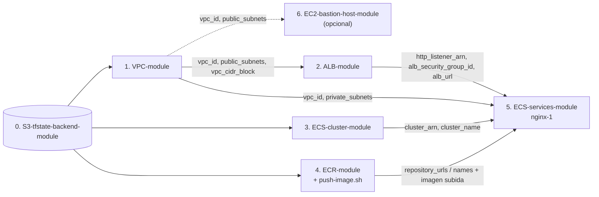

# 🐳 Plataforma de contenedores en AWS (ECS Fargate) – Terraform

Este directorio contiene la infraestructura, escrita en Terraform, para desplegar contenedores en **Amazon ECS con AWS Fargate** (AWS administra los servidores; tú solo defines los contenedores). **No hay modo EC2.**

Está dividida en **6 proyectos independientes** (más **1 opcional**, el Bastion Host), cada uno con su propio state en un bucket S3, que se despliegan **a mano** desde la terminal de **WSL Ubuntu**. El entorno configurado es **`dev`**. El objetivo actual es una prueba de extremo a extremo: **un nginx (`nginx-1`) corriendo en Fargate detrás de un ALB**.

> ⚠️ **Antes de desplegar nada: crea el bucket S3 del state** con [`S3-tfstate-backend-module`](S3-tfstate-backend-module/README.md). Sin él, el `terraform init` de los demás falla con `NoSuchBucket`.

---

## Índice

1. 🗺️ [Arquitectura](#arquitectura)
2. 🧱 [Los módulos](#los-módulos)
3. 📏 [Convenciones comunes](#convenciones-comunes)
4. 📋 [Requisitos](#requisitos)
5. 🔗 [Dependencias y orden de despliegue](#dependencias-y-orden-de-despliegue)
6. 🧪 [Probar sin crear nada](#probar-sin-crear-nada)
7. 🚀 [Guía de despliegue paso a paso](#guía-de-despliegue-paso-a-paso)
8. 🧹 [Destruir todo (orden inverso)](#destruir-todo-orden-inverso)
9. 💰 [Costos](#costos)
10. 🔒 [Seguridad](#seguridad)
11. ⏳ [Pendientes conocidos](#pendientes-conocidos)
12. 🛠️ [Problemas frecuentes](#problemas-frecuentes)

---

## Arquitectura


🧭 **Cómo viaja una petición:** `http://<dns del ALB>/` → Internet Gateway → **ALB** (subred pública) → regla `/*` del servicio → **tarea Fargate** en una subred privada → responde nginx. La tarea descarga su imagen del **ECR** saliendo por el **NAT Gateway**.

---

## Los módulos

| Módulo | Qué crea | Lee el state de | Recursos (`plan`) |
|---|---|---|---|
| [`S3-tfstate-backend-module`](S3-tfstate-backend-module/README.md) | **Una sola vez, antes que todo.** Bucket S3 privado, versionado, cifrado y solo TLS para los states. Su propio state es local | — | 7 |
| [`VPC-module`](VPC-module/README.md) | VPC, 9 subredes (pública, privada y database × 3 AZs), Internet Gateway, 1 NAT Gateway, tablas de rutas, DB subnet group | — | 31 |
| [`ALB-module`](ALB-module/README.md) | ALB público, su Security Group y el listener HTTP :80 (404 por defecto) | VPC | 5 |
| [`ECS-cluster-module`](ECS-cluster-module/README.md) | Cluster ECS **solo Fargate** (`FARGATE` + `FARGATE_SPOT`), log group de ECS Exec y namespace de Service Connect | — | 5 |
| [`ECR-module`](ECR-module/README.md) | Repositorios privados (IMMUTABLE, escaneo al subir, ciclo de vida) + script **`push-image.sh`** | — | 2 por repositorio (12 hoy) |
| [`ECS-services-module`](ECS-services-module/README.md) | Servicio **`nginx-1`**: rol de ejecución, log group, SG, target group, regla del listener, task definition y servicio Fargate | VPC, ALB, cluster, ECR | 10 |
| [`EC2-bastion-host-module`](EC2-bastion-host-module/README.md) *(opcional)* | Bastion EC2 (Amazon Linux 2023, `t3.micro`) en una subred pública: Elastic IP, Security Group (SSH), key pair propio y disco cifrado. **No hace falta para nginx-1**: para entrar a los contenedores se usa ECS Exec | VPC | 8 |

---

## Convenciones comunes

- **Estructura:** cada módulo tiene `README.md` y `manifests/` con `versions.tf`, `backend.tf` (salvo el bucket del state), `generic-variables.tf`, `terraform.tfvars`, `local-values.tf` y sus `*-variables.tf` / `*.auto.tfvars` / `*-outputs.tf`. Los servicios viven en `ECS-services-module/services/<servicio>/manifests/`.
- **Variables generales** (`generic-variables.tf` + `terraform.tfvars`), **idénticas en todos los módulos**:

  | Variable | Valor actual | Uso |
  |---|---|---|
  | `aws_region` | `us-east-1` | Región de todos los recursos |
  | `environment` | `dev` | Entorno: forma parte de nombres, etiquetas y del nombre del bucket |
  | `business_division` | `CloudEngineering` | Área responsable: nombres, etiquetas y nombre del bucket |

- **Nombres:** `<business_division>-<environment>-…` → `CloudEngineering-dev-…` (en minúsculas donde AWS lo exige: bucket, ECR, namespace → `cloudengineering-dev`).
- **Etiquetas:** todos los recursos llevan `owners = "CloudEngineering"` y `environment = "dev"` (los servicios, además, `service`).
- **States:** uno por proyecto en `s3://cloudengineering-dev-tfstate-<cuenta>/<Proyecto>/terraform.tfstate`, con cifrado y bloqueo nativo (`use_lockfile`). Los módulos se leen entre sí con `terraform_remote_state`; el nombre del bucket se calcula con la misma fórmula (`state_bucket` permite cambiarlo).
- **Los `backend.tf` no admiten variables:** el bucket `cloudengineering-dev-tfstate-373716886058` está escrito en los 6 `backend.tf`. Si cambias de cuenta, de `environment` o de `business_division`, actualízalos (comando en el [README del bucket](S3-tfstate-backend-module/README.md#cómo-funciona)).
- **Modo de prueba:** ALB, servicios y Bastion aceptan `remote_state_local_dir` para leer states ficticios locales en lugar de S3 (ver [Probar sin crear nada](#probar-sin-crear-nada)).
- **Versiones:** Terraform `>= 1.16`, provider `hashicorp/aws ~> 6.67`. Módulos públicos fijados a versión exacta: vpc `6.7.3`, alb `10.5.1`, ecs cluster `7.6.1`, ecr `3.2.0`, ec2-instance `6.4.1`, key-pair `3.0.1`. No hay `.terraform.lock.hcl` en el repositorio: `terraform init` instala la última 6.x del provider (validado con 6.70.0).

---

## Requisitos

| Herramienta | Para qué |
|---|---|
| **WSL Ubuntu** (terminal Linux) | Todos los comandos de esta guía se ejecutan ahí |
| Terraform `>= 1.16` (validado con 1.17.0) | Todos los módulos |
| AWS CLI v2 con credenciales (`default` o `AWS_PROFILE`) | Terraform, `push-image.sh`, comprobaciones |
| Docker (Docker Engine en WSL o Docker Desktop con integración WSL) | `push-image.sh` |
| bash 4+ | `push-image.sh` |

📋 **Permisos y cuenta:**
- Permisos en AWS para crear S3, VPC/EC2, ELB, ECS, ECR, IAM (roles), CloudWatch Logs y Cloud Map.
- **Rol enlazado de ECS** (solo si la cuenta nunca usó ECS): `aws iam create-service-linked-role --aws-service-name ecs.amazonaws.com`.
- La cuenta configurada en los `backend.tf` es **`373716886058`**.

---

## Dependencias y orden de despliegue



| # | Módulo | Depende de | Si te saltas el orden… |
|---|---|---|---|
| — | Preparación: herramientas, credenciales y rol enlazado de ECS | — | El primer cluster falla con `Unable to assume the service linked role` |
| 0 | `S3-tfstate-backend-module` | — | `NoSuchBucket` en cualquier otro `init` |
| 1 | `VPC-module` | Bucket | `Unable to find remote state` en ALB y servicios |
| 2 | `ALB-module` | VPC | `Unable to find remote state` en servicios |
| 3 | `ECS-cluster-module` | Bucket (no depende de la VPC) | `Unable to find remote state` en servicios |
| 4 | `ECR-module` + `push-image.sh nginx-1` | Bucket | Sin la imagen: `couldn't find resource` en el `plan` del servicio |
| 5 | `ECS-services-module/services/nginx-1` | Todos los anteriores | — |
| 6 | `EC2-bastion-host-module` *(opcional)* | VPC | `Unable to find remote state`. Puede aplicarse en cualquier momento después de la VPC; nadie depende de él |

Los pasos 2, 3 y 4 son independientes entre sí: pueden aplicarse en cualquier orden después de sus dependencias.

---

## Probar sin crear nada

Se puede comprobar **toda la plataforma sin `terraform apply`**, sin el bucket y sin los módulos anteriores aplicados. Solo hacen falta credenciales de AWS (el `plan` hace consultas de lectura: cuenta, AZs, AMI). Para no dejar `.terraform/` ni states en el proyecto, la prueba se hace en una **copia temporal**:

1. **Copia** el proyecto a una carpeta temporal (por ejemplo `~/ECS-Tests/.tf-test-tmp/tf`).
2. **`terraform fmt -check -recursive`** en `Terraform/`, y en cada `manifests/` de la copia `terraform init -backend=false && terraform validate`.
3. **Backend local:** en cada `manifests/` de la copia, un `backend_override.tf`:
   ```hcl
   terraform {
     backend "local" {
       path = "/home/<usuario>/ECS-Tests/.tf-test-tmp/plan-states/<proyecto>.tfstate"
     }
   }
   ```
4. **States ficticios** de los módulos de los que dependen otros (`VPC-module.tfstate`, `ALB-module.tfstate`, `ECS-cluster-module.tfstate`, `ECR-module.tfstate`), con solo los `outputs` que se leen. Ejemplo:
   ```json
   {"version":4,"terraform_version":"1.17.0","serial":1,"lineage":"fake-vpc","resources":[],
    "outputs":{
      "vpc_id":{"value":"vpc-0fake00000000001","type":"string"},
      "vpc_cidr_block":{"value":"10.0.0.0/16","type":"string"},
      "public_subnets":{"value":["subnet-0fakepub000001","subnet-0fakepub000002","subnet-0fakepub000003"],"type":["list","string"]},
      "private_subnets":{"value":["subnet-0fakepriv00001","subnet-0fakepriv00002","subnet-0fakepriv00003"],"type":["list","string"]}}}
   ```
5. **`terraform init -reconfigure`** y **`terraform plan -var remote_state_local_dir=<carpeta de states ficticios>`** (la variable solo existe en ALB, servicios y Bastion).
6. **Servicio:** `data "aws_ecr_image"` busca la imagen real en ECR; sin imagen subida, el `plan` falla con `couldn't find resource` (esperado). Para completar el `plan`, en la copia se sustituye ese data source por un digest simulado.
7. **Borra la carpeta temporal** al terminar.

✅ **Último resultado** (2026-10-22, Terraform 1.17.0, provider AWS 6.70.0, `environment = "dev"`):

| Proyecto | `validate` | `plan` |
|---|---|---|
| `S3-tfstate-backend-module` | ✅ | `7 to add` (bucket `cloudengineering-dev-tfstate-373716886058`) |
| `VPC-module` | ✅ | `31 to add` |
| `ALB-module` | ✅ | `5 to add` |
| `ECS-cluster-module` | ✅ | `5 to add` |
| `ECR-module` | ✅ | `12 to add` |
| `ECS-services-module/services/nginx-1` | ✅ | `10 to add` (con digest simulado; sin imagen: `couldn't find resource`, esperado) |
| `EC2-bastion-host-module` | ✅ | `8 to add` |

---

## Guía de despliegue paso a paso

> ⚠️ **Regla de oro:** en cada paso, **lee el `plan`** antes de escribir `yes`. Comprueba el número de recursos y que diga **`0 to destroy`**.

### Antes de empezar: herramientas y preparación

En la terminal de **WSL Ubuntu**:

```bash
cd ~/ECS-Tests/Terraform
terraform version                      # >= 1.16
aws sts get-caller-identity            # tu cuenta y tu usuario
docker info > /dev/null && echo "Docker OK"   # para copiar la imagen de nginx al ECR (paso 4)

# Rol enlazado de ECS (si ya existe, el comando avisa y no pasa nada)
aws iam create-service-linked-role --aws-service-name ecs.amazonaws.com
```

📋 **Revisa:**
- `terraform.tfvars` tiene los **mismos valores** en todos los módulos (`aws_region`, `environment = "dev"`, `business_division`).
- **El `bucket` de los `backend.tf` es `cloudengineering-dev-tfstate-373716886058`**: si tu cuenta no es `373716886058`, cámbialo en los 6 `backend.tf` (5 + el del Bastion opcional) por el valor de `terraform output state_bucket` del paso 0.
- Recomendado: restringe el ALB a tu IP en `ALB-module/manifests/alb.auto.tfvars` (`alb_allowed_cidrs = ["<tu-ip>/32"]`; tu IP: `curl -s https://checkip.amazonaws.com`). Si vas a usar el Bastion, haz lo mismo con `bastion_ssh_allowed_cidrs` en `EC2-bastion-host-module/manifests/ec2bastion.auto.tfvars`.

### Paso 0: Bucket S3 del state (una sola vez)

```bash
cd S3-tfstate-backend-module/manifests
terraform init && terraform apply          # 7 to add
terraform output state_bucket              # → cloudengineering-dev-tfstate-<cuenta>
cd ../..
```

Su state queda **local** en `S3-tfstate-backend-module/manifests/terraform.tfstate`: guarda una copia.

### Paso 1: Red (`VPC-module`)

```bash
cd VPC-module/manifests
terraform init && terraform apply          # 31 to add (3–5 min)
cd ../..
```

### Paso 2: Balanceador (`ALB-module`)

```bash
cd ALB-module/manifests
terraform init && terraform apply          # 5 to add
curl -i "$(terraform output -raw alb_url)/"   # tras 2-3 min: HTTP 404 "no hay ningun servicio en esta ruta" (correcto)
cd ../..
```

### Paso 3: Cluster ECS Fargate (`ECS-cluster-module`)

```bash
cd ECS-cluster-module/manifests
terraform init && terraform apply          # 5 to add
cd ../..
```

### Paso 4: Repositorios (`ECR-module`) y la imagen de nginx

```bash
cd ECR-module/manifests
terraform init && terraform apply          # 12 to add (6 repositorios + 6 lifecycle policies)
cd ..
./push-image.sh nginx-1 1.0.0 --from public.ecr.aws/nginx/nginx:stable-alpine
cd ..
```

El script termina mostrando el **digest** de la imagen y el resultado del escaneo.

### Paso 5: Servicio `nginx-1` (`ECS-services-module`)

```bash
cd ECS-services-module/services/nginx-1/manifests
terraform init && terraform apply          # 10 to add (espera a que la tarea esté sana)
curl -i "$(terraform output -raw service_url)/"   # HTTP/1.1 200 OK – "Welcome to nginx!"
cd ../../../..
```

🔎 **Comprobar:**

```bash
aws ecs describe-services --cluster CloudEngineering-dev-ecs-cluster --services nginx-1 \
  --query 'services[0].{status:status,running:runningCount,desired:desiredCount}'
```

### Paso 6 (opcional): Bastion Host (`EC2-bastion-host-module`)

**No es necesario para la prueba de nginx-1.** Sirve como punto de diagnóstico dentro de la VPC (salida a Internet, DNS, el ALB) y para abrir túneles SSH hacia recursos privados que añadas en el futuro. Las tareas Fargate **no** son accesibles por SSH: para entrar a un contenedor usa ECS Exec.

```bash
cd EC2-bastion-host-module/manifests
terraform init && terraform apply          # 8 to add (1–2 min)
terraform output -raw ssh_command          # ssh -i ./private-key/CloudEngineering-dev-BastionHost.pem ec2-user@<eip>
cd ../..
```

La llave privada queda **solo en tu PC** (`private-key/*.pem`) y en el state. Destrúyelo cuando termines de usarlo. Detalle: [README del Bastion](EC2-bastion-host-module/README.md).

---

## Destruir todo (orden inverso)

En orden **inverso**: Bastion (si lo creaste) → servicio → ECR → cluster → ALB → VPC. El bucket del state solo si abandonas la plataforma ([cómo](S3-tfstate-backend-module/README.md#eliminar)).

```bash
cd ~/ECS-Tests/Terraform
for d in EC2-bastion-host-module ECS-services-module/services/nginx-1 ECR-module ECS-cluster-module ALB-module VPC-module; do
  [ -d "$d" ] || continue
  (cd "$d/manifests" && terraform destroy) || break
done
```

> ℹ️ Si nunca aplicaste el Bastion, su `terraform destroy` termina sin cambios (`0 destroyed`). Lo importante es que, si existe, se destruya **antes de la VPC**.

> ⚠️ No se puede borrar el listener del ALB mientras tenga la regla del servicio, ni la VPC mientras el ALB o las tareas usen sus subredes: respeta el orden.

---

## Costos

| Recurso | Costo aproximado |
|---|---|
| **NAT Gateway** | ~33 USD/mes + GB procesado — **el mayor costo** |
| **ALB** | ~17 USD/mes + LCU |
| Tarea Fargate `nginx-1` (0,25 vCPU / 0,5 GB, 24/7) | ~9 USD/mes |
| Bastion *(opcional)*: `t3.micro` + IPv4 pública + EBS 8 GB | ~12 USD/mes mientras exista |
| ECR, logs, bucket S3, cluster | Céntimos |

Empieza a cobrarse en cuanto se crea el NAT Gateway (paso 1). **Destruye todo al terminar la prueba.**

---

## Seguridad

- Tareas en subredes **privadas**, sin IP pública; solo el SG del ALB llega a ellas.
- Imágenes **IMMUTABLE**, escaneadas al subir y desplegadas **por digest**; `latest` está prohibido en el script y en `image_tag`.
- States cifrados, versionados y solo por TLS.
- Bastion *(opcional)*: disco cifrado, IMDSv2 y la llave privada nunca se copia al servidor. Su SSH está abierto a `0.0.0.0/0` por defecto: restríngelo a tu IP antes de crearlo.
- ⏳ Pendiente: HTTPS (ACM + listener 443), restringir `alb_allowed_cidrs` (hoy `0.0.0.0/0`), VPC endpoints para ECR/Logs, VPC Flow Logs, KMS propio para el bucket y el ECR, escaneo mejorado (Amazon Inspector).

---

## Pendientes conocidos

| Pendiente | Detalle |
|---|---|
| Cuenta del backend fija | Los `backend.tf` apuntan a `cloudengineering-dev-tfstate-373716886058`. En otra cuenta (o con otro `environment`) hay que cambiarlos a mano |
| Sin `.terraform.lock.hcl` | Las versiones de los providers no están fijadas en el repositorio; conviene versionar el lock tras el primer `init` |
| Repositorios ECR sin uso | `nginx-2`, `web`, `api`, `worker` y `migrate` se crean vacíos: el código de la tienda (`apps/online-store/`) no está en este repositorio |
| Subredes database y DB subnet group | Se crean en la VPC, pero ningún módulo las usa hoy |
| Sin HTTPS ni dominio | El servicio se publica en `http://<dns del ALB>` |

---

## Problemas frecuentes

| Síntoma | Causa probable | Solución |
|---|---|---|
| `NoSuchBucket` / `AccessDenied` en `terraform init` | No existe el bucket del state, o el `bucket` de `backend.tf` es de otra cuenta o entorno | Paso 0 y revisa `backend.tf` |
| `Unable to find remote state` | No se aplicó un módulo del que dependes | Sigue el [orden de despliegue](#dependencias-y-orden-de-despliegue) |
| `Unable to assume the service linked role` | La cuenta nunca usó ECS | `aws iam create-service-linked-role --aws-service-name ecs.amazonaws.com` |
| `couldn't find resource` (`aws_ecr_image`) en el servicio | No se subió la imagen | `./push-image.sh nginx-1 1.0.0 --from public.ecr.aws/nginx/nginx:stable-alpine` |
| `./push-image.sh: Permission denied` | El script perdió el permiso de ejecución (p. ej. al copiarlo desde Windows) | `chmod +x ECR-module/push-image.sh` o `bash push-image.sh …` |
| `CannotPullContainerError` | Las tareas no tienen salida a Internet | Revisa el NAT Gateway de la VPC |
| El ALB responde **404** | El servicio no está desplegado o la regla no coincide | Paso 5 |
| El ALB responde **503** | No hay tareas sanas | Espera 1–2 min; `aws logs tail /ecs/CloudEngineering-dev-ecs-cluster/nginx-1` |
| `terraform destroy` de la VPC falla con `DependencyViolation` | El Bastion (opcional) sigue en la subred pública | Destruye antes `EC2-bastion-host-module` |
| `ssh` al Bastion da *Connection timed out* | Tu IP no está en `bastion_ssh_allowed_cidrs` o tu red bloquea el puerto 22 | Ver el [README del Bastion](EC2-bastion-host-module/README.md#problemas-frecuentes) |
