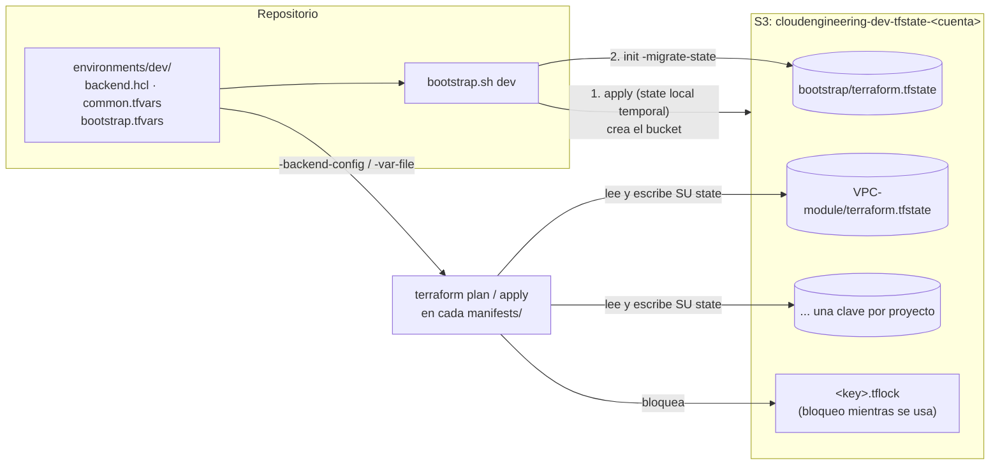

# 🪣 Bootstrap del state de Terraform (bucket S3 por ambiente) – Terraform

Este proyecto crea el **bucket de Amazon S3 donde se guarda el state de Terraform** de todos los demás proyectos **de un ambiente** (hoy solo `dev`): VPC, ALB, cluster ECS, ECR, servicios y el Bastion opcional (las carpetas de [`modules/`](../modules/)).

Hay **un bucket por ambiente**. Se crea con el script **[`bootstrap.sh`](bootstrap.sh)**, que hace el primer `apply` con un state local temporal y después **mueve el state del propio bootstrap al bucket que acaba de crear**. Así no queda ningún state local que guardar a mano.

> ⚠️ **Es lo primero que se crea en cada ambiente.** Ningún otro proyecto puede hacer `terraform init` sin este bucket: todos guardan su state en él.

| 🧭 Ficha rápida | |
|---|---|
| **Paso en el despliegue** | **0** – una vez por ambiente, antes que todo ([guía](../README.md#guía-de-despliegue-paso-a-paso)) |
| **Depende de** | Ningún otro módulo. Usa `environments/<env>/backend.hcl`, `common.tfvars` y `bootstrap.tfvars` |
| **Lo usan** | Todos los proyectos del ambiente: guardan su state en este bucket (`backend.tf` + `backend.hcl`) y leen el de los demás (`terraform_remote_state`) |
| **Recursos (`plan`)** | 7 |
| **Tiempo de despliegue** | Menos de 1 min |
| **Costo principal** | Prácticamente nada: almacenamiento S3 de unos pocos KB y peticiones |

> 🗺️ Vista general de toda la plataforma: [README de Terraform](../README.md).

---

## Índice

1. 📦 [¿Qué se crea?](#qué-se-crea)
2. 📚 [Conceptos básicos](#conceptos-básicos)
3. 🗺️ [Diagrama](#diagrama)
4. 🔍 [Cómo funciona](#cómo-funciona)
5. 🔗 [¿De qué depende? (remote state)](#de-qué-depende-remote-state)
6. 📁 [Estructura de archivos](#estructura-de-archivos)
7. 🏷️ [Versiones](#versiones)
8. ⚙️ [Variables](#variables)
9. 📤 [Outputs](#outputs)
10. 🧪 [Cómo probarlo sin crear nada (plan)](#cómo-probarlo-sin-crear-nada-plan)
11. 🚀 [Cómo desplegarlo paso a paso](#cómo-desplegarlo-paso-a-paso)
12. 🌱 [Crear el bucket de un ambiente nuevo](#crear-el-bucket-de-un-ambiente-nuevo)
13. 🔄 [Migrar states locales al bucket](#migrar-states-locales-al-bucket)
14. 🔒 [Seguridad](#seguridad)
15. 💰 [Costos](#costos)
16. 🛠️ [Problemas frecuentes](#problemas-frecuentes)

---

## ¿Qué se crea?

Un bucket S3 privado llamado **`<división>-<ambiente>-tfstate-<account_id>`**. Para `dev` en la cuenta actual: **`cloudengineering-dev-tfstate-373716886058`**. Cada proyecto guarda en él su state con una **clave** (ruta) propia, y el bootstrap también guarda ahí el suyo:

```text
s3://cloudengineering-dev-tfstate-373716886058/
├── bootstrap/terraform.tfstate                 (state del propio bucket)
├── VPC-module/terraform.tfstate
├── ALB-module/terraform.tfstate
├── ECS-cluster-module/terraform.tfstate
├── ECR-module/terraform.tfstate
├── ECS-services-module/services/
│   └── nginx-1/terraform.tfstate
└── EC2-bastion-host-module/terraform.tfstate   (solo si despliegas el Bastion opcional)
```

Como cada ambiente tiene **su propio bucket**, las claves son las mismas en todos los ambientes: el ambiente lo decide el bucket, no la clave.

| Recurso | Cantidad | ¿Para qué sirve? |
|---|---|---|
| **Bucket S3** | 1 | Guarda los states. `force_destroy = false`: no se puede borrar con states dentro |
| **Ownership controls** | 1 | `BucketOwnerEnforced`: sin ACLs; todos los objetos son del dueño del bucket |
| **Public access block** | 1 | Bloquea **todo** acceso público |
| **Versionado** | 1 | Cada `apply` conserva la versión anterior del state: se puede recuperar |
| **Cifrado por defecto** | 1 | **SSE-S3 (AES256)**: cada state se guarda cifrado |
| **Ciclo de vida** | 1 | Borra las versiones antiguas a los **90 días** y las subidas incompletas a los 7 |
| **Política del bucket** | 1 | **Deniega** cualquier acceso que no use TLS (HTTPS) |

> 💡 **Analogía:** el state es el **archivo de planos** del edificio: dice qué se construyó y dónde.
> - El bucket es la **caja fuerte común de un edificio** (un ambiente): una sola copia oficial de cada plano.
> - Guarda el historial de versiones y está cerrada con llave (cifrado, sin acceso público).
> - Tiene un cartel de **"en uso"** (bloqueo) mientras alguien la consulta.
> - El bootstrap es quien **construye la caja fuerte** y luego guarda dentro también sus propios planos.

---

## Conceptos básicos

| Término | Qué significa en palabras simples |
|---|---|
| **State (`terraform.tfstate`)** | El archivo donde Terraform anota todo lo que creó: IDs, IPs, etc. Es la "memoria" de un proyecto. **Contiene datos sensibles**, como las llaves SSH que genera Terraform. |
| **Backend** | Dónde guarda Terraform el state: `local` (un archivo en tu PC) o `s3` (un bucket). Se configura en `backend.tf`. |
| **Configuración parcial del backend** | `backend.tf` solo fija la `key`; el `bucket` y la `region` del ambiente se pasan en el `init` con `-backend-config=environments/<env>/backend.hcl`. Así el mismo código sirve para cualquier ambiente. |
| **Key (clave)** | La ruta del state dentro del bucket, por ejemplo `ALB-module/terraform.tfstate`. **Cada proyecto debe tener una distinta.** |
| **Bloqueo (lock)** | Mientras alguien ejecuta `plan` o `apply`, Terraform crea `<key>.tflock` en el bucket. Si otra persona lo intenta a la vez, espera o falla, en vez de corromper el state. |
| **`use_lockfile = true`** | Bloqueo **nativo de S3** (Terraform ≥ 1.10). Ya no hace falta una tabla de DynamoDB. |
| **Versionado** | S3 guarda las versiones anteriores de cada objeto. Si un state se estropea, se puede volver a una versión anterior. |
| **SSE-S3** | Cifrado del lado del servidor con llaves que administra S3 (AES256). Gratis y sin configuración. |
| **Migrar el state** | Mover un state de un backend a otro: `terraform init -migrate-state`. El bootstrap lo usa para pasar su state de local al bucket. |

---

## Diagrama



👀 **Cómo leerlo:**
- **`bootstrap.sh`** lee la configuración del ambiente, crea el bucket con un state local temporal y luego mueve ese state a `bootstrap/terraform.tfstate`.
- **Los demás proyectos** reciben el bucket del ambiente con `-backend-config=environments/dev/backend.hcl` y guardan su state en su clave.

---

## Cómo funciona

[`tfstate-bucket.tf`](manifests/tfstate-bucket.tf) crea el bucket con recursos nativos de AWS (sin módulos de terceros):

```hcl
resource "aws_s3_bucket" "tfstate" {
  bucket        = local.state_bucket          # <división>-<ambiente>-tfstate-<account_id>
  force_destroy = false
}
# + ownership_controls, public_access_block, versioning,
#   server_side_encryption_configuration (AES256), lifecycle_configuration y bucket_policy (solo TLS)
```

📌 **Detalles importantes:**
- **Nombre único global:** los nombres de bucket son únicos en todo AWS. Por eso incluyen el **ID de la cuenta**, que se lee con `data "aws_caller_identity"`, y el **ambiente**.
- **El ambiente sale de los `.tfvars`:** `environment` y `business_division` no tienen valor por defecto; llegan desde `environments/<env>/common.tfvars`.
- **El state del bootstrap vive en su propio bucket.** [`backend.tf`](manifests/backend.tf) usa la clave `bootstrap/terraform.tfstate`. Como el bucket no existe la primera vez, [`bootstrap.sh`](bootstrap.sh):
  1. comprueba que el `bucket` de `environments/<env>/backend.hcl` es el que va a crear (`<división>-<ambiente>-tfstate-<cuenta>`), y si no coincide se detiene **antes** de crear nada;
  2. si el bucket **no existe**, genera un `backend_override.tf` temporal con backend `local`, hace `init` + `apply` y comprueba el output `state_bucket`;
  3. borra el override y ejecuta `terraform init -migrate-state -force-copy -backend-config=…/backend.hcl`: el state pasa al bucket;
  4. comprueba que `bootstrap/terraform.tfstate` existe en S3 y **solo entonces** borra el state local;
  5. si el bucket **ya existe**, hace `init -reconfigure -backend-config=…` + `apply` (por ejemplo, para cambiar los días de retención).
- **Si se corta a mitad** (apply cancelado, error de red…), el state local se conserva en `manifests/terraform.tfstate` y basta con volver a ejecutar `./bootstrap.sh dev`: el script retoma desde ese state.
- **Los demás proyectos lo usan de dos formas:**
  1. **`backend.tf` + `backend.hcl`:** dónde guarda **su propio** state. El `backend.tf` del proyecto fija la clave; `backend.hcl` aporta el bucket del ambiente:
     ```hcl
     # <proyecto>/manifests/backend.tf
     terraform {
       backend "s3" {
         key          = "ALB-module/terraform.tfstate"   # una clave por proyecto
         encrypt      = true
         use_lockfile = true
       }
     }

     # environments/dev/backend.hcl
     bucket = "cloudengineering-dev-tfstate-373716886058"
     region = "us-east-1"
     ```
  2. **`remote-state-datasource.tf`:** lee los states de **otros** proyectos (`backend = "s3"`). El nombre del bucket se calcula con la misma fórmula a partir de `environment` y `business_division`, así que cambia solo con el ambiente; la variable `state_bucket` permite forzar otro.

---

## ¿De qué depende? (remote state)

**No depende de ningún otro módulo:** es lo primero que se despliega en cada ambiente.

Al revés, **todos** los proyectos del ambiente dependen de él:

| Proyecto | Guarda su state en (`key`) | Lee los states de |
|---|---|---|
| [`VPC-module`](../modules/VPC-module/README.md) | `VPC-module/terraform.tfstate` | — |
| [`ALB-module`](../modules/ALB-module/README.md) | `ALB-module/terraform.tfstate` | VPC |
| [`ECS-cluster-module`](../modules/ECS-cluster-module/README.md) | `ECS-cluster-module/terraform.tfstate` | — |
| [`ECR-module`](../modules/ECR-module/README.md) | `ECR-module/terraform.tfstate` | — |
| [`ECS-services-module`](../modules/ECS-services-module/README.md) | `ECS-services-module/services/nginx-1/terraform.tfstate` | VPC, ALB, cluster y ECR |
| [`EC2-bastion-host-module`](../modules/EC2-bastion-host-module/README.md) *(opcional)* | `EC2-bastion-host-module/terraform.tfstate` | VPC |

---

## Estructura de archivos

```
bootstrap/
├── README.md
├── bootstrap.sh                 # ./bootstrap.sh <ambiente>: crea el bucket y migra su state a él
└── manifests/
    ├── versions.tf              # Terraform + provider AWS
    ├── backend.tf               # Backend S3 parcial: key bootstrap/terraform.tfstate
    ├── generic-variables.tf     # región, ambiente, división (sin valores por defecto de ambiente)
    ├── local-values.tf          # name, common_tags, state_bucket (nombre del bucket)
    ├── tfstate-variables.tf     # state_noncurrent_version_days
    ├── tfstate-bucket.tf        # bucket + versionado, cifrado, bloqueo público, ciclo de vida, política TLS
    └── tfstate-outputs.tf       # state_bucket, aws_region, backend_hcl

environments/dev/                # valores del ambiente (fuera de esta carpeta)
├── backend.hcl                  # bucket + region del backend
├── common.tfvars                # us-east-1 / dev / CloudEngineering
└── bootstrap.tfvars             # state_noncurrent_version_days = 90
```

> ℹ️ Durante el primer `bootstrap.sh` aparecen temporalmente `manifests/backend_override.tf` y `manifests/terraform.tfstate`. El script los borra al terminar, y además están en el [`.gitignore`](../.gitignore).

---

## Versiones

| Componente | Versión |
|---|---|
| Terraform | `>= 1.16` (validado con v1.17.0). El bloqueo nativo de S3 necesita `>= 1.10` |
| Provider `hashicorp/aws` | `~> 6.67` |

---

## Variables

| Variable | Tipo | Valor en `dev` | Dónde | Descripción |
|---|---|---|---|---|
| `aws_region` / `environment` / `business_division` | texto | `us-east-1` / `dev` / `CloudEngineering` | [`environments/dev/common.tfvars`](../environments/dev/common.tfvars) | Generales, compartidas con todos los proyectos: con ellas se forma el nombre del bucket. `environment` y `business_division` son **obligatorias** |
| `state_noncurrent_version_days` | número | `90` | [`environments/dev/bootstrap.tfvars`](../environments/dev/bootstrap.tfvars) | Días que se conservan las versiones antiguas de cada state |

---

## Outputs

| Output | Ejemplo | ¿Para qué? |
|---|---|---|
| `state_bucket` | `cloudengineering-dev-tfstate-373716886058` | El valor de `bucket` en `environments/<env>/backend.hcl` |
| `aws_region` | `us-east-1` | El valor de `region` en `environments/<env>/backend.hcl` |
| `backend_hcl` | `bucket = "…"` / `region = "…"` | Contenido completo de `backend.hcl` para un ambiente nuevo |

---

## Cómo probarlo sin crear nada (plan)

```bash
cd ~/ECS-Tests/Terraform/bootstrap/manifests
E=~/ECS-Tests/Terraform/environments/dev
terraform init -backend=false
terraform fmt -check -recursive
terraform validate
```

Para un `plan` sin el bucket hace falta un backend local temporal (es lo que hace `bootstrap.sh` la primera vez):

```bash
printf 'terraform {\n  backend "local" {}\n}\n' > backend_override.tf
terraform init -reconfigure
terraform plan -var-file=$E/common.tfvars -var-file=$E/bootstrap.tfvars   # solo lee la cuenta; no crea nada
rm -f backend_override.tf && rm -rf .terraform
```

✅ **Resultado verificado** (2026-10-28, Terraform v1.17.0, sin `apply`): `Plan: 7 to add, 0 to change, 0 to destroy.`, con el bucket `cloudengineering-dev-tfstate-373716886058`, `AES256`, versiones antiguas a 90 días y la política que deniega el acceso sin TLS.

---

## Cómo desplegarlo paso a paso

> 🔐 **Siempre a mano y una vez por ambiente:** crea el bucket que usan como backend todos los demás proyectos del ambiente.

### Requisitos previos

1. **Credenciales de AWS** (perfil `default` o `AWS_PROFILE`) de la cuenta del ambiente, con permisos para crear buckets S3. Compruébalas con `aws sts get-caller-identity`.
2. **Terraform 1.16 o superior** y **AWS CLI v2**.
3. **`environments/<env>/backend.hcl`** con el bucket correcto para tu cuenta: `<división en minúsculas>-<ambiente>-tfstate-<cuenta>`. El script lo comprueba antes de crear nada.

### Pasos

Antes, comprueba las herramientas y las credenciales: ver [Antes de empezar](../README.md#antes-de-empezar-herramientas-y-preparación).

```bash
cd ~/ECS-Tests/Terraform/bootstrap
./bootstrap.sh dev          # muestra el plan (7 to add) y pide "yes"
```

El script termina con `State migrado a s3://cloudengineering-dev-tfstate-373716886058/bootstrap/terraform.tfstate`.

🔎 **Comprobar el bucket:**

```bash
B=cloudengineering-dev-tfstate-373716886058
aws s3api get-bucket-versioning     --bucket "$B"   # "Status": "Enabled"
aws s3api get-bucket-encryption     --bucket "$B"   # "SSEAlgorithm": "AES256"
aws s3api get-public-access-block   --bucket "$B"   # todo en true
aws s3 ls "s3://$B/bootstrap/"                       # terraform.tfstate
```

Después, despliega el resto de la plataforma siguiendo la [guía](../README.md#guía-de-despliegue-paso-a-paso).

### Actualizar la configuración del bucket

Para cambiar su configuración (por ejemplo, `state_noncurrent_version_days` en `bootstrap.tfvars`), vuelve a ejecutar `./bootstrap.sh dev`: como el bucket ya existe, hace `init` con `backend.hcl` y `apply`. Equivale a:

```bash
cd ~/ECS-Tests/Terraform/bootstrap/manifests
E=~/ECS-Tests/Terraform/environments/dev
terraform init -reconfigure -backend-config=$E/backend.hcl
terraform fmt -check -recursive
terraform validate
terraform plan  -var-file=$E/common.tfvars -var-file=$E/bootstrap.tfvars
terraform apply -var-file=$E/common.tfvars -var-file=$E/bootstrap.tfvars
```

### Eliminar

Es **lo último** que se destruye, y solo si abandonas el ambiente: el bucket guarda el state de todos sus proyectos, **incluido el del bootstrap**. Por eso, antes de vaciarlo, hay que devolver el state del bootstrap a local:

1. Destruye primero todos los demás proyectos del ambiente ([orden inverso](../README.md#destruir-todo-orden-inverso)).
2. Trae el state del bootstrap a local:
   ```bash
   cd ~/ECS-Tests/Terraform/bootstrap/manifests
   E=~/ECS-Tests/Terraform/environments/dev
   terraform init -reconfigure -backend-config=$E/backend.hcl
   printf 'terraform {\n  backend "local" {}\n}\n' > backend_override.tf
   terraform init -migrate-state -force-copy      # el state pasa a manifests/terraform.tfstate
   terraform state list                           # 7 recursos: comprueba que está
   ```
3. Vacía el bucket, **incluidas todas las versiones**. `force_destroy = false` impide borrarlo si tiene contenido:
   ```bash
   B=cloudengineering-dev-tfstate-373716886058
   aws s3api list-object-versions --bucket "$B" --output json \
     --query '{Objects: [Versions, DeleteMarkers][][].{Key: Key, VersionId: VersionId}}' > /tmp/borrar.json
   aws s3api delete-objects --bucket "$B" --delete file:///tmp/borrar.json
   ```
4. Destruye el bucket y limpia:
   ```bash
   terraform destroy -var-file=$E/common.tfvars -var-file=$E/bootstrap.tfvars
   rm -f backend_override.tf terraform.tfstate terraform.tfstate.backup && rm -rf .terraform
   ```

---

## Crear el bucket de un ambiente nuevo

El código no cambia: solo hace falta la carpeta del ambiente.

1. Copia `environments/dev/` a `environments/<nuevo>/` (por ejemplo `qa`).
2. En `common.tfvars` cambia `environment = "<nuevo>"` (y la región o la división si cambian).
3. En `backend.hcl` pon el bucket del nuevo ambiente: `<división en minúsculas>-<nuevo>-tfstate-<cuenta>` y su región.
4. Revisa los demás `.tfvars` (CIDRs de la VPC, tamaños, etc.).
5. `./bootstrap.sh <nuevo>`.

Detalle del resto de pasos: [Ambientes](../README.md#ambientes).

---

## Migrar states locales al bucket

Si un proyecto ya tenía un `terraform.tfstate` **local**, de antes de usar S3, el primer `terraform init` detecta el cambio de backend. Para **copiar** ese state al bucket del ambiente:

```bash
cd ~/ECS-Tests/Terraform
E=~/ECS-Tests/Terraform/environments/dev
for d in VPC-module ALB-module ECS-cluster-module ECR-module ECS-services-module/services/nginx-1 EC2-bastion-host-module; do
  echo "=== $d" && (cd "modules/$d/manifests" && terraform init -migrate-state -backend-config=$E/backend.hcl) || break
done
```

- Terraform pregunta `Do you want to copy existing state to the new backend?`: responde **`yes`**.
- **Comprueba** que cada proyecto ve lo mismo que antes:
  ```bash
  (cd modules/VPC-module/manifests && terraform state list)              # mismos recursos que antes
  aws s3 ls s3://cloudengineering-dev-tfstate-373716886058 --recursive
  ```
- **Después**, borra los states locales, que ya no se usan:
  ```bash
  find . \( -name 'terraform.tfstate' -o -name 'terraform.tfstate.backup' \) -path '*/manifests/*' -print   # revisa la lista
  # y bórralos con -delete en lugar de -print cuando estés seguro
  ```

> ℹ️ Si un proyecto **no** tenía state local, basta con `terraform init -backend-config=…`: no hay nada que migrar.

---

## Seguridad

| Control | Estado |
|---|---|
| Bucket **privado**: acceso público bloqueado y sin ACLs | ✅ |
| **Cifrado en reposo** SSE-S3 (AES256) y `encrypt = true` en cada backend | ✅ |
| **Solo TLS**: la política deniega peticiones sin HTTPS | ✅ |
| **Versionado**: se puede recuperar un state anterior | ✅ |
| **Bloqueo** nativo (`use_lockfile`): sin `apply` simultáneos sobre el mismo state | ✅ |
| `force_destroy = false`: no se borra el bucket con states dentro | ✅ |
| **Un bucket por ambiente**: los permisos sobre `dev` no dan acceso a los states de otros ambientes | ✅ |
| Sin state local: el del bootstrap también está en el bucket (versionado y cifrado) | ✅ |
| Cifrado con **llave KMS propia** (control de quién descifra y auditoría en CloudTrail) | ⏳ Pendiente ([pendientes de seguridad](../README.md#seguridad)) |
| Política del bucket que permita leer **solo** a usuarios o roles concretos | ⏳ Pendiente. Hoy puede leerlo cualquier identidad de la cuenta con permisos S3 |

### Mejoras recomendadas

Hallazgos de la [revisión de buenas prácticas](../README.md#revisión-y-plan-de-evolución) (2026-10-28) que afectan a este proyecto. El número es el del hallazgo en esa revisión y la fase, la del plan de evolución.

| # | Prioridad | Mejora | Fase |
|---|---|---|---|
| 2 | 🔴 Alta | Acceder con IAM Identity Center (SSO) y un **rol de despliegue** por ambiente en lugar de un usuario IAM con access keys; el bucket solo necesita dar acceso a esos roles | 2 |
| 3 | 🔴 Alta | **Bucket policy** que permita leer y escribir los states solo a los roles de despliegue, y cifrado con **KMS CMK** | 2 |
| 17 | 🟡 Operación | Versionar `.terraform.lock.hcl` y añadir `tflint` + `checkov` en `pre-commit` | 0 |

> ⚠️ **Los states describen toda la infraestructura** (IDs, ARNs, configuración). Limita quién tiene permisos `s3:GetObject` sobre el bucket. Si despliegas el Bastion opcional, **su state contiene la llave privada SSH** generada por Terraform.

---

## Costos

| Concepto | Costo aproximado |
|---|---|
| Almacenamiento | Por GB al mes. Los 7 states de un ambiente ocupan unos pocos KB, más las versiones de los últimos 90 días |
| Peticiones | Céntimos al mes: cada `plan`/`apply` hace unas pocas lecturas y escrituras, y crea/borra el `.tflock` |
| Versionado y cifrado SSE-S3 | Sin costo extra (solo el almacenamiento de las versiones) |

En la práctica, **menos de 1 USD al mes por ambiente**.

---

## Problemas frecuentes

| Síntoma | Causa probable | Solución |
|---|---|---|
| `backend.hcl usa el bucket '…', pero el bootstrap crearía '…'` | `backend.hcl` es de otra cuenta, otro ambiente u otra división | Pon en `environments/<env>/backend.hcl` el bucket que indica el mensaje |
| `environment = "…" en common.tfvars no coincide con la carpeta` | Copiaste `environments/dev/` y no cambiaste `environment` | Corrige `common.tfvars` |
| `El apply no terminó` / `El apply se canceló` | Respondiste algo distinto de `yes`, o falló AWS | Vuelve a ejecutar `./bootstrap.sh <env>`: retoma desde el state local |
| `BucketAlreadyExists` | El nombre ya existe en otra cuenta (los nombres son globales) | Muy improbable, porque incluye el ID de la cuenta. Cambia `local.state_bucket`, `backend.hcl` y pasa el nombre con la variable `state_bucket` en los proyectos |
| `BucketAlreadyOwnedByYou` | El bucket ya existe en tu cuenta, creado fuera de este state | Impórtalo: `terraform import -var-file=$E/common.tfvars -var-file=$E/bootstrap.tfvars aws_s3_bucket.tfstate <bucket>` tras un `init` con `backend.hcl`, y luego `./bootstrap.sh <env>` |
| En otro proyecto: `NoSuchBucket` / `S3 bucket does not exist` al hacer `terraform init` | Aún no se ejecutó el bootstrap del ambiente, o `backend.hcl` no coincide | `./bootstrap.sh <env>` y revisa `backend.hcl` |
| `Backend configuration changed` | El proyecto se inicializó antes con otro backend u otro ambiente | `terraform init -reconfigure -backend-config=…` (no copia nada) o `-migrate-state` (copia el state) |
| `Error acquiring the state lock` | Otro `plan`/`apply` está usando ese state, o uno anterior se interrumpió | Espera. Si nadie lo usa: `terraform force-unlock <LOCK_ID>`, con el ID que muestra el error |
| `AccessDenied` al leer o escribir el state | Tu usuario no tiene permisos sobre el bucket, o la petición no usa TLS | Revisa tus permisos `s3:ListBucket`, `s3:GetObject`, `s3:PutObject` y `s3:DeleteObject` |
| `BucketNotEmpty` al destruir | El bucket aún tiene states o versiones | Ver [Eliminar](#eliminar) |
