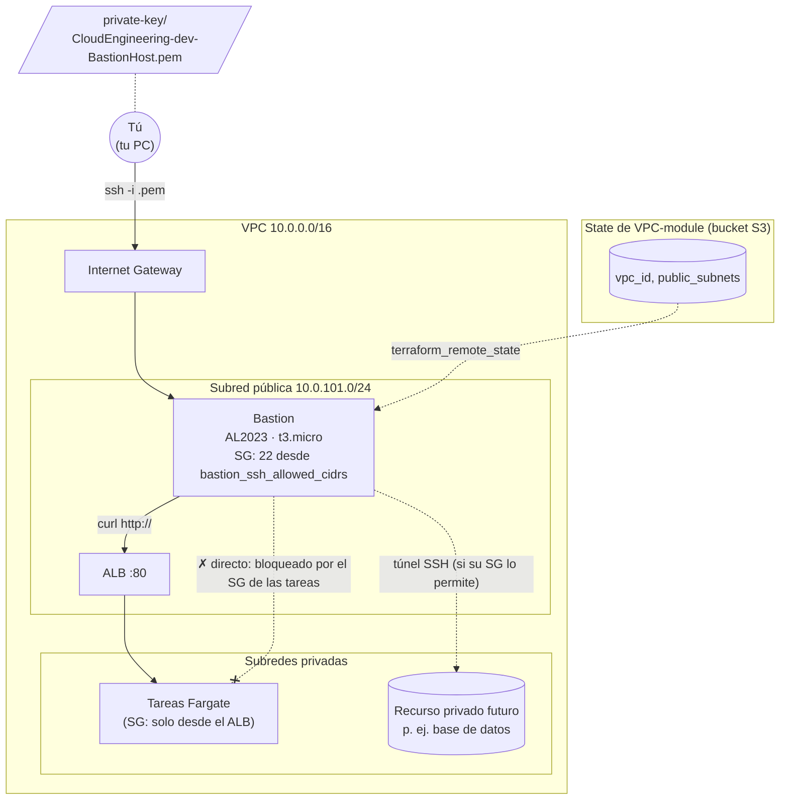

# 🛡️ AWS EC2 Bastion Host (opcional) – Terraform

Este proyecto **opcional** crea un **Bastion Host**: un servidor pequeño en una subred pública de la VPC que sirve como **puerta de entrada por SSH** a la red de la plataforma.

> ℹ️ **No forma parte del flujo principal** (S3 → VPC → ALB → cluster → ECR → `nginx-1`). La plataforma es **solo Fargate**: no hay servidores EC2 propios a los que entrar, y para abrir una terminal dentro de un contenedor se usa **ECS Exec** ([ver cluster](../ECS-cluster-module/README.md#cómo-usar-el-cluster-desde-otro-proyecto)). Despliega el Bastion solo si necesitas un punto de diagnóstico dentro de la VPC o un túnel SSH hacia un recurso privado futuro (por ejemplo, una base de datos).

El Bastion **lee el state de la VPC** para saber en qué VPC y subred crearse, y **genera su propia llave SSH** (key pair), con el mismo nombre que el Bastion.

| 🧭 Ficha rápida | |
|---|---|
| **Paso en el despliegue** | **Opcional** – en cualquier momento después de la VPC ([guía](../../README.md#paso-6-opcional-bastion-host-ec2-bastion-host-module)) |
| **Depende de** | Bucket del state del ambiente ([`bootstrap`](../../bootstrap/README.md)) y [`VPC-module`](../VPC-module/README.md) |
| **Lo usan** | Tú: diagnóstico de red dentro de la VPC (DNS, salida por Internet, ALB) y túneles SSH hacia recursos privados que añadas en el futuro. Ningún otro módulo lee su state |
| **Recursos (`plan`)** | 8 (con una sola IP en `bastion_ssh_allowed_cidrs`) |
| **Tiempo de despliegue** | 1–2 min |
| **Costo principal** | La instancia `t3.micro` (~7,6 USD/mes) y su IPv4 pública (~3,65 USD/mes) |

> ⚠️ **Antes de desplegar este módulo deben existir el bucket S3 del state y la VPC.** Si no, `terraform init` falla con `NoSuchBucket` o el `plan` con `Unable to find remote state`.

> 🗺️ Vista general de toda la plataforma: [README de Terraform](../../README.md).

---

## Índice

1. 📦 [¿Qué se crea?](#qué-se-crea)
2. 📚 [Conceptos básicos](#conceptos-básicos)
3. 🗺️ [Diagrama](#diagrama)
4. 🔍 [Cómo funciona](#cómo-funciona)
5. 🔗 [¿De qué depende? (remote state)](#de-qué-depende-remote-state)
6. 📁 [Estructura de archivos](#estructura-de-archivos)
7. 🏷️ [Versiones](#versiones)
8. ⚙️ [Variables](#variables)
9. 📤 [Outputs](#outputs)
10. 🧪 [Cómo probarlo sin crear nada (plan)](#cómo-probarlo-sin-crear-nada-plan)
11. 🚀 [Cómo desplegarlo paso a paso](#cómo-desplegarlo-paso-a-paso)
12. 🔌 [Cómo conectarse y qué se puede hacer desde el Bastion](#cómo-conectarse-y-qué-se-puede-hacer-desde-el-bastion)
13. 🔒 [Seguridad](#seguridad)
14. 💰 [Costos](#costos)
15. 🛠️ [Problemas frecuentes](#problemas-frecuentes)

---

## ¿Qué se crea?

Un servidor Linux (Amazon Linux 2023, `t3.micro`) en la **primera subred pública** de la VPC, con una **IP pública fija**, un **firewall** que solo deja entrar SSH y una **llave SSH nueva** creada por el propio proyecto. La llave privada se guarda **solo en tu PC** (y en el state).

| Recurso | Cantidad | ¿Para qué sirve? |
|---|---|---|
| **Llave privada** (`tls_private_key`) | 1 | Generada por Terraform (ED25519) |
| **Key Pair** | 1 | La llave pública en AWS. Se llama igual que el Bastion (`CloudEngineering-dev-BastionHost`) |
| **Archivo `.pem` local** | 1 | La llave privada en `manifests/private-key/CloudEngineering-dev-BastionHost.pem` (permisos `0400`) |
| **Instancia EC2 (Bastion)** | 1 | El servidor al que te conectas por SSH. Disco raíz **gp3 cifrado**, IMDSv2 obligatorio |
| **Elastic IP** | 1 | La IP pública fija del Bastion |
| **Security Group** + reglas | 1 + 1 por CIDR + 1 de salida | Entrada SSH (22) solo desde `bastion_ssh_allowed_cidrs`; salida libre |

> 💡 **Analogía:** si la VPC es un edificio de oficinas, el Bastion es la **portería de servicio**: una entrada opcional para el personal técnico. Los visitantes (usuarios) entran por la recepción (el ALB).

---

## Conceptos básicos

| Término | Qué significa en palabras simples |
|---|---|
| **Bastion Host** | Servidor expuesto a Internet cuya única función es servir de "puente" hacia la red privada. |
| **SSH** | Protocolo para conectarse a la terminal de un servidor Linux de forma cifrada. Usa el puerto 22. |
| **Key Pair** | Una llave pública, que guarda AWS, y una llave privada (`.pem`), que guardas tú. Sin el `.pem` no puedes entrar. |
| **ED25519** | El tipo de llave que se genera: moderno, seguro y más corto que RSA. |
| **Provider `tls` / `local`** | `tls` **genera** la llave privada y `local` la **guarda** como archivo en tu PC. |
| **AMI** | La imagen del sistema operativo con la que arranca el servidor: la más reciente de Amazon Linux 2023 **en el momento de crearlo**. |
| **Elastic IP** | IP pública fija que se asocia a la instancia. |
| **ProxyJump (`ssh -J`)** | Saltar a un servidor privado **a través** del Bastion sin copiar la llave privada al Bastion. |
| **ECS Exec** | Terminal dentro de un contenedor Fargate. Es la forma de "entrar" a las tareas; no necesita el Bastion, pero hay que habilitarlo en cada servicio ([mejoras de los servicios](../ECS-services-module/README.md#mejoras-recomendadas)). |

---

## Diagrama



👀 **Cómo leerlo:**
- **Tu conexión:** sale de tu PC, entra por el Internet Gateway y llega a la Elastic IP del Bastion.
- **Las tareas Fargate no son accesibles directamente** desde el Bastion: su Security Group solo admite tráfico del ALB. Desde el Bastion sí puedes probar el servicio **a través del ALB**.
- **Recursos privados futuros:** el Bastion puede abrir un túnel hacia ellos si su Security Group admite al del Bastion (output `bastion_security_group_id`).

---

## Cómo funciona

El Bastion se crea con el módulo oficial `terraform-aws-modules/ec2-instance/aws` en [`ec2bastion-instance.tf`](manifests/ec2bastion-instance.tf):

```hcl
module "ec2_public" {
  source  = "terraform-aws-modules/ec2-instance/aws"
  version = "6.4.1"

  name          = local.bastion_name                    # CloudEngineering-dev-BastionHost
  ami           = data.aws_ami.amzlinux2023.id
  instance_type = var.instance_type
  key_name      = module.key_pair.key_pair_name
  subnet_id     = data.terraform_remote_state.vpc.outputs.public_subnets[0]

  ignore_ami_changes = true                             # una AMI nueva no reemplaza el Bastion
  root_block_device  = { encrypted = true, type = "gp3" }

  create_security_group  = false                        # usa el SG de ec2bastion-securitygroups.tf
  vpc_security_group_ids = [aws_security_group.bastion.id]
}
```

- **`ignore_ami_changes = true`:** la AMI se busca con `most_recent = true`. Sin esta opción, cada vez que Amazon publica una AMI nueva el `plan` propondría **destruir y recrear** el Bastion. Para actualizarlo a propósito: `terraform apply -replace='module.ec2_public.aws_instance.ignore_ami[0]'`.
- **`root_block_device`:** disco raíz `gp3` **cifrado**, sin depender del cifrado EBS por defecto de la cuenta.
- **IMDSv2:** el módulo lo exige por defecto (`http_tokens = required`).

### ¿Cómo se crea la llave SSH? (key pair)

En [`ec2bastion-keypair.tf`](manifests/ec2bastion-keypair.tf):

```hcl
module "key_pair" {
  source  = "terraform-aws-modules/key-pair/aws"
  version = "3.0.1"

  key_name              = local.bastion_name
  create_private_key    = true
  private_key_algorithm = "ED25519"
}

resource "local_sensitive_file" "bastion_private_key" {
  content         = module.key_pair.private_key_openssh
  filename        = "${path.module}/private-key/${module.key_pair.key_pair_name}.pem"
  file_permission = "0400"
}
```

1. Terraform **genera** la llave (provider `tls`).
2. Sube la **llave pública** a AWS como key pair `CloudEngineering-dev-BastionHost`.
3. Guarda la **llave privada** en tu PC (`manifests/private-key/…pem`, `0400`). **No se copia al Bastion.**
4. La instancia se crea con ese key pair.

📌 `terraform destroy` borra el key pair y el `.pem` local. Un nuevo `apply` genera una llave **nueva**. Si pierdes el `.pem`, `terraform apply` lo vuelve a escribir desde el state.

### ¿Cómo viaja el tráfico?

| Dirección | Regla del Security Group | Qué significa |
|---|---|---|
| **Entrada** | TCP 22 desde cada CIDR de `bastion_ssh_allowed_cidrs` | Solo SSH, y solo desde las IPs permitidas |
| **Salida** | Todo hacia `0.0.0.0/0` | Puede salir a Internet (por el Internet Gateway, sin NAT) y hablar con la VPC |

---

## ¿De qué depende? (remote state)

Guarda su state en `EC2-bastion-host-module/terraform.tfstate` del [bucket S3](../../bootstrap/README.md) y lee el de la VPC en [`remote-state-datasource.tf`](manifests/remote-state-datasource.tf):

| Dónde | Valor leído | Para qué |
|---|---|---|
| [`ec2bastion-securitygroups.tf`](manifests/ec2bastion-securitygroups.tf) | `vpc_id` | Crear el Security Group en la VPC correcta |
| [`ec2bastion-instance.tf`](manifests/ec2bastion-instance.tf) | `public_subnets[0]` | Colocar el Bastion en la primera subred pública |
| [`ec2bastion-outputs.tf`](manifests/ec2bastion-outputs.tf) | `vpc_id` | Output informativo |

El nombre del bucket se calcula solo (`<división>-<ambiente>-tfstate-<cuenta>`, igual que el bootstrap); usa `state_bucket` si es otro.

**Nadie lee el state del Bastion**: puedes crearlo y destruirlo sin afectar al resto de la plataforma (salvo que lo destruyas *después* de la VPC, ver [Eliminar](#eliminar)).

---

## Estructura de archivos

```
modules/EC2-bastion-host-module/
├── README.md
└── manifests/
    ├── versions.tf                    # Terraform + providers (aws, tls, local)
    ├── backend.tf                     # State en el bucket S3 del ambiente (clave EC2-bastion-host-module/terraform.tfstate)
    ├── generic-variables.tf           # región, entorno, división
    ├── local-values.tf                # nombres (incluido bastion_name) y etiquetas
    ├── remote-state-datasource.tf     # Lectura del state de la VPC
    ├── ami-datasource.tf              # AMI más reciente de Amazon Linux 2023 (x86_64)
    ├── ec2bastion-variables.tf        # tipo de instancia, IPs permitidas, bucket del state
    ├── ec2bastion-keypair.tf          # key pair + .pem local
    ├── ec2bastion-securitygroups.tf   # Security Group y reglas
    ├── ec2bastion-instance.tf         # La instancia (módulo oficial)
    ├── ec2bastion-elasticip.tf        # Elastic IP
    ├── ec2bastion-outputs.tf          # Outputs
    └── private-key/                   # Lo crea el apply: CloudEngineering-dev-BastionHost.pem (¡no subir a git!)
```

> ℹ️ **Los valores no están en el módulo**, sino en el ambiente: generales en [`environments/dev/common.tfvars`](../../environments/dev/common.tfvars) y propios en [`environments/dev/ec2-bastion.tfvars`](../../environments/dev/ec2-bastion.tfvars). El bucket del backend, en [`environments/dev/backend.hcl`](../../environments/dev/backend.hcl) (ver [Ambientes](../../README.md#ambientes)).

> ℹ️ **Cambio respecto a versiones anteriores:** se eliminó `ec2bastion-provisioners.tf`. Copiaba la llave privada a `/tmp` del propio Bastion (sin utilidad en una plataforma Fargate y con riesgo, porque deja la llave en un host público) y escribía `local-exec-output-files/` en tu PC. Ya no hace falta salida SSH desde tu PC durante el `apply`.

---

## Versiones

| Componente | Versión | Comentario |
|---|---|---|
| Terraform | `>= 1.16` | Validado con v1.17.0 |
| Provider `hashicorp/aws` | `~> 6.67` | Validado con 6.70.0 (sin `.terraform.lock.hcl` en el repositorio) |
| Provider `hashicorp/tls` | `~> 4.4` | Genera la llave privada |
| Provider `hashicorp/local` | `~> 2.9` | Guarda el `.pem` |
| Módulo `terraform-aws-modules/ec2-instance/aws` | `6.4.1` | |
| Módulo `terraform-aws-modules/key-pair/aws` | `3.0.1` | |
| Sistema operativo | Amazon Linux 2023 (x86_64) | |

---

## Variables

| Variable | Tipo | Valor en `dev` | Descripción |
|---|---|---|---|
| `aws_region` / `environment` / `business_division` | texto | `us-east-1` / `dev` / `CloudEngineering` | Generales; **deben coincidir** con la VPC |
| `instance_type` | texto | `t3.micro` | Tamaño del servidor |
| `bastion_ssh_allowed_cidrs` | lista | `["0.0.0.0/0"]` | IPs que pueden entrar por SSH. **Cámbialo a tu IP** (`["<tu-ip>/32"]`) |
| `state_bucket` | texto | `null` → `cloudengineering-dev-tfstate-<cuenta>` | Bucket con el state de la VPC |
| `remote_state_local_dir` | texto | `null` | Solo pruebas: states locales en lugar del bucket |

| Recurso | Nombre |
|---|---|
| Instancia y Key Pair | `CloudEngineering-dev-BastionHost` |
| Llave privada | `private-key/CloudEngineering-dev-BastionHost.pem` |
| Security Group | `CloudEngineering-dev-public-bastion-sg` |
| Elastic IP | `CloudEngineering-dev-bastion-eip` |

---

## Outputs

| Output | Descripción |
|---|---|
| `ssh_command` | Comando SSH listo para copiar |
| `ec2_bastion_eip` | IP pública fija |
| `ec2_bastion_private_ip` | IP privada dentro de la VPC |
| `ec2_bastion_public_instance_ids` / `ec2_bastion_availability_zone` | ID y AZ de la instancia |
| `bastion_security_group_id` | Para permitir el Bastion como origen en el SG de un recurso privado |
| `key_pair_name` / `private_key_path` | Nombre del key pair y ruta local del `.pem` |
| `vpc_id` | VPC leída del remote state |

---

## Cómo probarlo sin crear nada (plan)

```bash
cd ~/ECS-Tests/Terraform/modules/EC2-bastion-host-module/manifests
E=~/ECS-Tests/Terraform/environments/dev
terraform init -reconfigure -backend-config=$E/backend.hcl
terraform fmt -check -recursive
terraform validate
terraform plan -var-file=$E/common.tfvars -var-file=$E/ec2-bastion.tfvars        # necesita credenciales, el bucket del state y el state de la VPC
```

✅ **Verificado** (2026-10-28, Terraform v1.17.0, sin `apply`): `fmt -check` y `validate` correctos, y `plan` → `Plan: 8 to add, 0 to change, 0 to destroy.` Sin la VPC aplicada, el `plan` falla con `Unable to find remote state`.

🔎 **Qué deberías ver en el `plan`: 8 recursos** (con una sola IP permitida): `module.key_pair.tls_private_key`, `module.key_pair.aws_key_pair`, `local_sensitive_file.bastion_private_key`, `module.ec2_public.aws_instance.ignore_ami[0]` (con `root_block_device { encrypted = true, volume_type = "gp3" }`), `aws_security_group.bastion`, 1 regla de entrada por CIDR, 1 regla de salida y `aws_eip.bastion_eip`.

---

## Cómo desplegarlo paso a paso

### Requisitos previos

1. **Bucket del state y VPC aplicados** ([`bootstrap`](../../bootstrap/README.md) y [`VPC-module`](../VPC-module/README.md)). No necesita ALB, cluster, ECR ni servicios.
2. **Terraform 1.16+** y **credenciales de AWS** (`aws sts get-caller-identity`).
3. **Recomendado:** tu IP en `bastion_ssh_allowed_cidrs` (`environments/dev/ec2-bastion.tfvars`). Averíguala con `curl -s https://checkip.amazonaws.com`.

### Pasos

```bash
cd ~/ECS-Tests/Terraform/modules/EC2-bastion-host-module/manifests
E=~/ECS-Tests/Terraform/environments/dev
terraform init -reconfigure -backend-config=$E/backend.hcl
terraform fmt -check -recursive
terraform validate
terraform plan -var-file=$E/common.tfvars -var-file=$E/ec2-bastion.tfvars          # Plan: 8 to add
terraform apply -var-file=$E/common.tfvars -var-file=$E/ec2-bastion.tfvars
terraform output -raw ssh_command
```

### Eliminar

```bash
E=~/ECS-Tests/Terraform/environments/dev
terraform destroy -var-file=$E/common.tfvars -var-file=$E/ec2-bastion.tfvars
```

**Destrúyelo antes que la VPC**: AWS no puede borrar la subred pública ni el Internet Gateway mientras el Bastion y su Elastic IP sigan ahí.

---

## Cómo conectarse y qué se puede hacer desde el Bastion

```bash
# Desde EC2-bastion-host-module/manifests/
ssh -i private-key/CloudEngineering-dev-BastionHost.pem ec2-user@$(terraform output -raw ec2_bastion_eip)
```

🔎 **Diagnóstico útil desde dentro de la VPC:**

```bash
curl -s https://checkip.amazonaws.com                # salida a Internet
curl -i http://<alb_dns_name>/                        # el servicio nginx-1 a través del ALB
dig +short <alb_dns_name>                             # resolución DNS
```

🚫 **Lo que no se puede hacer (por diseño):**
- **Entrar por SSH a las tareas Fargate:** no hay servidor ni SSH. Usa **ECS Exec** (`aws ecs execute-command`, ver el [cluster](../ECS-cluster-module/README.md#cómo-usar-el-cluster-desde-otro-proyecto)), que antes hay que habilitar en el servicio.
- **Llamar directamente a la IP privada de una tarea:** el SG de las tareas solo admite al ALB.

🔐 **Túnel hacia un recurso privado futuro** (por ejemplo, una base de datos en las subredes database), sin copiar la llave al Bastion:

```bash
# Reenvía localhost:5432 de tu PC al recurso privado a través del Bastion
ssh -i private-key/CloudEngineering-dev-BastionHost.pem -N \
    -L 5432:<endpoint-privado>:5432 ec2-user@<ec2_bastion_eip>

# O salta a un servidor privado que use el mismo key pair
ssh -i private-key/CloudEngineering-dev-BastionHost.pem -J ec2-user@<ec2_bastion_eip> ec2-user@<IP-privada>
```

Para que funcione, el Security Group del recurso privado debe admitir `bastion_security_group_id`.

---

## Seguridad

| Control | Estado |
|---|---|
| Disco raíz cifrado (`gp3`, `encrypted = true`) | ✅ |
| IMDSv2 obligatorio | ✅ (por defecto del módulo) |
| La llave privada **no** se copia al Bastion | ✅ (se usa `ssh -J` / túneles desde tu PC) |
| SSH solo desde IPs concretas | ⚠️ **Pendiente:** por defecto `0.0.0.0/0`. Cámbialo a tu IP `/32` |
| Llave privada fuera del state | ⚠️ La llave generada por Terraform queda en el state (bucket S3, SSE-S3) y en `private-key/*.pem` sin cifrar. Limita quién lee el bucket y no subas el `.pem` a git |
| Acceso sin puerto 22 ni llaves (SSM Session Manager) | ⏳ Mejora futura: añadir un instance profile con `AmazonSSMManagedInstanceCore` y quitar la regla SSH |

Al ser opcional, lo más seguro es **crearlo solo cuando lo necesites y destruirlo al terminar**.

### Mejoras recomendadas

Hallazgos de la [revisión de buenas prácticas](../../README.md#revisión-y-plan-de-evolución) (2026-10-28) que afectan a este proyecto. El número es el del hallazgo en esa revisión y la fase, la del plan de evolución.

| # | Prioridad | Mejora | Fase |
|---|---|---|---|
| 4 | 🔴 Alta | Eliminarlo, o moverlo a una **subred privada con SSM Session Manager**: instance profile con `AmazonSSMManagedInstanceCore`, sin regla de SSH, sin llave y sin EIP | 0 / 1 |
| 4 | 🔴 Alta | Mientras exista con SSH, restringir `bastion_ssh_allowed_cidrs` a tu IP `/32` (hoy `0.0.0.0/0`) | 0 |
| 3 | 🔴 Alta | **No generar la llave con Terraform:** hoy queda en el state y en `private-key/*.pem`. Con Session Manager no hace falta | 1 |
| — | ℹ️ Verificar | IMDSv2: confirmar en el `plan` que `metadata_options.http_tokens = "required"` (lo exige el módulo `ec2-instance` por defecto, según su documentación) | 0 |

---

## Costos

| Recurso | Costo aproximado (us-east-1) |
|---|---|
| EC2 `t3.micro` | ~0,0104 USD/h (~7,6 USD/mes) mientras está encendida; puede entrar en la capa gratuita |
| IPv4 pública (Elastic IP) | ~0,005 USD/h (~3,65 USD/mes), en uso o no |
| EBS raíz gp3 (8 GB) | ~0,64 USD/mes |
| Security Group / Key Pair | Gratis |

---

## Problemas frecuentes

| Síntoma | Causa probable | Solución |
|---|---|---|
| `Unable to find remote state` | La VPC no está aplicada, o el bucket no es el esperado | Aplica `VPC-module`; usa `state_bucket` si el bucket tiene otro nombre |
| `NoSuchBucket` en `terraform init` | No existe el bucket del state, o el `bucket` de `environments/<env>/backend.hcl` es de otra cuenta | Aplica [`bootstrap`](../../bootstrap/README.md) y revisa `backend.tf` |
| `InvalidKeyPair.Duplicate` | Ya existe un key pair `CloudEngineering-dev-BastionHost` fuera de este state | Bórralo en la consola (EC2 → Key Pairs) |
| `ssh: connect to host … port 22: Connection timed out` | Tu IP no está en `bastion_ssh_allowed_cidrs`, o tu red bloquea el puerto 22 | Revisa tu IP pública y aplica de nuevo |
| `UNPROTECTED PRIVATE KEY FILE` | Permisos del `.pem` demasiado abiertos (p. ej. copiado a Windows) | `chmod 400 <ruta-del-pem>` |
| `Permission denied (publickey)` | `.pem` de un despliegue anterior | Usa el de `terraform output private_key_path` |
| `curl` a la IP privada de una tarea no responde | El SG de las tareas solo admite al ALB | Prueba a través del ALB, o usa ECS Exec |
| El Bastion sigue con una AMI antigua | `ignore_ami_changes = true` | `terraform apply -replace='module.ec2_public.aws_instance.ignore_ami[0]'` |
| `terraform destroy` de la VPC falla con `DependencyViolation` | El Bastion (o su EIP) sigue en la subred pública | Destruye antes el Bastion |
