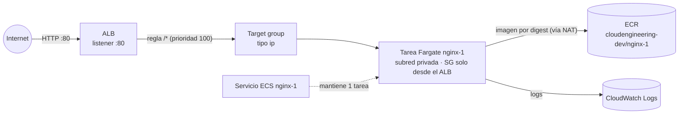

# 🧩 Servicios ECS (Fargate) – Terraform

Este proyecto despliega **tus aplicaciones** en el [cluster ECS](../ECS-cluster-module/README.md), detrás del [ALB](../ALB-module/README.md). Hay **un directorio y un state por servicio** (`services/<nombre>/manifests/`).

Hoy contiene un solo servicio de prueba: **`nginx-1`**, un nginx oficial copiado al [ECR](../ECR-module/README.md), que responde en `http://<dns del ALB>/`.

| 🧭 Ficha rápida | |
|---|---|
| **Paso en el despliegue** | **5** – el último ([guía](../../README.md#guía-de-despliegue-paso-a-paso)) |
| **Depende de** | Bucket del state, [`VPC-module`](../VPC-module/README.md), [`ALB-module`](../ALB-module/README.md), [`ECS-cluster-module`](../ECS-cluster-module/README.md) y [`ECR-module`](../ECR-module/README.md) **con la imagen ya subida** |
| **Lo usan** | Nadie: es la capa final |
| **Recursos (`plan`)** | 10 por servicio |
| **Tiempo de despliegue** | 2–4 min (el `apply` espera a que la tarea esté sana) |
| **Costo principal** | La tarea Fargate (0,25 vCPU / 0,5 GB): ~9 USD/mes con 1 tarea 24/7 |

---

## Índice

1. 📦 [¿Qué se crea?](#qué-se-crea)
2. 🗺️ [Diagrama](#diagrama)
3. 🔗 [¿De qué depende? (remote state)](#de-qué-depende-remote-state)
4. 📁 [Estructura de archivos](#estructura-de-archivos)
5. 🏷️ [Versiones](#versiones)
6. ⚙️ [Variables](#variables)
7. 📤 [Outputs](#outputs)
8. 🧪 [Cómo probarlo sin crear nada (plan)](#cómo-probarlo-sin-crear-nada-plan)
9. 🚀 [Cómo desplegarlo paso a paso](#cómo-desplegarlo-paso-a-paso)
10. ➕ [Añadir otro servicio](#añadir-otro-servicio)
11. 🔒 [Seguridad](#seguridad)
12. 🛠️ [Problemas frecuentes](#problemas-frecuentes)

---

## ¿Qué se crea?

Todo en [`ecs-service.tf`](services/nginx-1/manifests/ecs-service.tf):

| Recurso | Nombre (nginx-1) | ¿Para qué sirve? |
|---|---|---|
| `aws_iam_role` + `aws_iam_role_policy_attachment` | `CloudEngineering-dev-nginx-1-exec` | **Rol de ejecución**: ECS lo usa para descargar la imagen del ECR y escribir los logs (`AmazonECSTaskExecutionRolePolicy`) |
| `aws_cloudwatch_log_group` | `/ecs/CloudEngineering-dev-ecs-cluster/nginx-1` | Logs del contenedor (7 días) |
| `aws_security_group` + regla de entrada + regla de salida | `CloudEngineering-dev-nginx-1-tasks-sg` | Solo el **Security Group del ALB** llega al puerto 80 de las tareas. Salida libre (ECR y logs, por el NAT) |
| `aws_lb_target_group` | `CloudEngineering-dev-nginx-1-tg` | Tipo `ip` (Fargate/`awsvpc`). Health check `GET /` |
| `aws_lb_listener_rule` | prioridad `100`, ruta `/*` | Envía al servicio las peticiones del listener HTTP :80 del ALB |
| `aws_ecs_task_definition` | familia `CloudEngineering-dev-nginx-1` | 1 contenedor, Fargate, 256 CPU / 512 MiB, `X86_64`. La imagen va **fijada por digest** |
| `aws_ecs_service` | `nginx-1` | 1 tarea en `FARGATE`, subredes **privadas**, sin IP pública, *circuit breaker* con rollback |

> ℹ️ La imagen se resuelve con el data source `aws_ecr_image` a partir de `ecr_repository` + `image_tag`. Si el tag no está subido, el `plan` falla antes de crear nada.

---

## Diagrama



---

## ¿De qué depende? (remote state)

Guarda su state en `ECS-services-module/services/nginx-1/terraform.tfstate` del [bucket S3](../../bootstrap/README.md) y lee:

| State | Outputs que usa |
|---|---|
| `VPC-module` | `vpc_id`, `private_subnets` |
| `ALB-module` | `http_listener_arn`, `alb_security_group_id`, `alb_url` |
| `ECS-cluster-module` | `cluster_arn`, `cluster_name` |
| `ECR-module` | `repository_urls`, `repository_names` |

---

## Estructura de archivos

```
modules/ECS-services-module/
├── README.md
└── services/
    └── nginx-1/
        └── manifests/
            ├── versions.tf                 # Terraform + provider aws
            ├── backend.tf                  # State en el bucket S3 del ambiente (clave ECS-services-module/services/nginx-1/terraform.tfstate)
            ├── generic-variables.tf        # región, entorno, división
            ├── local-values.tf             # nombres, etiquetas e imagen por digest
            ├── remote-state-datasource.tf  # states de VPC, ALB, cluster y ECR + imagen del ECR
            ├── service-variables.tf        # variables del servicio
            ├── ecs-service.tf              # IAM, logs, SG, target group, regla del ALB, task definition, servicio
            └── service-outputs.tf          # outputs
```

> ℹ️ **Los valores no están en el módulo**, sino en el ambiente: generales en [`environments/dev/common.tfvars`](../../environments/dev/common.tfvars) y propios en [`environments/dev/services/nginx-1.tfvars`](../../environments/dev/services/nginx-1.tfvars). El bucket del backend, en [`environments/dev/backend.hcl`](../../environments/dev/backend.hcl) (ver [Ambientes](../../README.md#ambientes)).

---

## Versiones

| Componente | Versión | Comentario |
|---|---|---|
| Terraform | `>= 1.16` | Validado con v1.17.0 |
| Provider `hashicorp/aws` | `~> 6.67` | Validado con 6.70.0 (sin `.terraform.lock.hcl` en el repositorio) |
| Módulos externos | — | Solo recursos nativos de AWS |

---

## Variables

Valores en [`environments/dev/services/nginx-1.tfvars`](../../environments/dev/services/nginx-1.tfvars):

| Variable | Valor (nginx-1) | Descripción |
|---|---|---|
| `aws_region` / `environment` / `business_division` | `us-east-1` / `dev` / `CloudEngineering` | Generales ([`environments/dev/common.tfvars`](../../environments/dev/common.tfvars)), compartidas con los demás módulos del ambiente |
| `service_name` | `nginx-1` | Nombre del servicio y del contenedor (minúsculas, números y `-`; máx. 31 caracteres) |
| `ecr_repository` | `nginx-1` | Repositorio (clave de `repositories` en ECR-module) |
| `image_tag` | `1.0.0` | Tag subido con `push-image.sh`. **`latest` no se admite** (validación) |
| `container_port` | `80` | Puerto del contenedor y del target group |
| `task_cpu` / `task_memory` | `256` / `512` | Tamaño de la tarea (combinación válida de Fargate) |
| `desired_count` | `1` | Tareas en ejecución |
| `listener_rule_priority` | `100` | Prioridad de la regla (única por listener) |
| `path_patterns` | `["/*"]` | Rutas que van a este servicio |
| `health_check_path` | `/` | Ruta del health check del ALB |
| `log_retention_days` | `7` | Retención de los logs |
| `state_bucket` | `null` | Bucket de los states (por defecto `<división>-<ambiente>-tfstate-<cuenta>`, como en el bootstrap) |
| `remote_state_local_dir` | `null` | Solo pruebas: states locales en lugar de S3 |

---

## Outputs

| Output | Descripción |
|---|---|
| `service_url` | URL del ALB (`http://<dns>`) |
| `service_name` | Nombre del servicio ECS |
| `image` | Imagen desplegada (`…/nginx-1@sha256:…`) |
| `task_definition_arn` | Revisión de la task definition |
| `target_group_arn` | Target group del ALB |
| `tasks_security_group_id` | Security Group de las tareas |
| `log_group_name` | Log group de los contenedores |

---

## Cómo probarlo sin crear nada (plan)

Necesita el bucket del ambiente, VPC, ALB, cluster y ECR aplicados (lee sus states) y la imagen subida a ECR:

```bash
cd ~/ECS-Tests/Terraform/modules/ECS-services-module/services/nginx-1/manifests
E=~/ECS-Tests/Terraform/environments/dev
terraform init -reconfigure -backend-config=$E/backend.hcl
terraform fmt -check -recursive
terraform validate
terraform plan -var-file=$E/common.tfvars -var-file=$E/services/nginx-1.tfvars
```

Mientras falte algo de eso, puedes comprobar el código con `terraform init -backend=false`, `fmt -check` y `validate` ([cómo](../../README.md#probar-sin-crear-nada)).

✅ **Resultado verificado** (2026-10-28, Terraform v1.17.0, sin `apply`):

| Prueba | Resultado |
|---|---|
| `fmt -check` y `validate` | Correctos |
| `plan` con la imagen **sin subir** | Falla con `reading ECR Images: couldn't find resource` (esperado: el servicio exige la imagen en ECR) |
| `plan` con las dependencias aplicadas y la imagen subida | `Plan: 10 to add, 0 to change, 0 to destroy.` |
| `-var image_tag=latest` | Falla con la validación de `image_tag` |

---

## Cómo desplegarlo paso a paso

### Requisitos previos

1. Aplicados, en este orden: [`bootstrap`](../../bootstrap/README.md), [`VPC-module`](../VPC-module/README.md), [`ALB-module`](../ALB-module/README.md), [`ECS-cluster-module`](../ECS-cluster-module/README.md) y [`ECR-module`](../ECR-module/README.md).
2. La imagen subida al ECR:
   ```bash
   cd ~/ECS-Tests/Terraform/modules/ECR-module
   ./push-image.sh nginx-1 1.0.0 --from public.ecr.aws/nginx/nginx:stable-alpine
   ```

### Pasos

```bash
cd ~/ECS-Tests/Terraform/modules/ECS-services-module/services/nginx-1/manifests
E=~/ECS-Tests/Terraform/environments/dev
terraform init -reconfigure -backend-config=$E/backend.hcl
terraform fmt -check -recursive
terraform validate
terraform plan -var-file=$E/common.tfvars -var-file=$E/services/nginx-1.tfvars          # Plan: 10 to add
terraform apply -var-file=$E/common.tfvars -var-file=$E/services/nginx-1.tfvars         # espera a que la tarea esté sana (wait_for_steady_state)
curl -i "$(terraform output -raw service_url)/"   # HTTP/1.1 200 OK + "Welcome to nginx!"
```

### Eliminar

```bash
E=~/ECS-Tests/Terraform/environments/dev
terraform destroy -var-file=$E/common.tfvars -var-file=$E/services/nginx-1.tfvars
```

Destruye el servicio **antes** que el cluster, el ALB y la VPC.

---

## Añadir otro servicio

1. Copia `services/nginx-1/` a `services/<nuevo>/`.
2. En `backend.tf` cambia la `key` a `ECS-services-module/services/<nuevo>/terraform.tfstate` (**obligatorio**: si no, pisaría el state de nginx-1).
3. Copia `environments/dev/services/nginx-1.tfvars` a `environments/dev/services/<nuevo>.tfvars` (uno por cada ambiente donde se despliegue) y cambia `service_name` (igual que la carpeta), `ecr_repository`, `image_tag`, `listener_rule_priority` (única) y `path_patterns` (por ejemplo `["/nuevo/*"]` con prioridad menor que 100, para que se evalúe antes que `/*`).
4. Sube su imagen con `push-image.sh` y despliégalo: en `services/<nuevo>/manifests`, `terraform init -reconfigure -backend-config=$E/backend.hcl` y `terraform apply -var-file=$E/common.tfvars -var-file=$E/services/<nuevo>.tfvars`.

---

## Seguridad

- Las tareas están en **subredes privadas**, sin IP pública; solo el SG del ALB llega al puerto del contenedor.
- La imagen se despliega **por digest**: no puede cambiar aunque alguien vuelva a usar el tag (además los repos son IMMUTABLE).
- El rol de ejecución solo tiene la política gestionada `AmazonECSTaskExecutionRolePolicy`. No hay *task role* (la app no llama a AWS).
- Pendiente: HTTPS (certificado ACM + listener 443 en el ALB), y restringir `alb_allowed_cidrs`.

### Mejoras recomendadas

Hallazgos de la [revisión de buenas prácticas](../../README.md#revisión-y-plan-de-evolución) (2026-10-28) que afectan a este proyecto. El número es el del hallazgo en esa revisión y la fase, la del plan de evolución.

| # | Prioridad | Mejora | Fase |
|---|---|---|---|
| 6 | 🟠 Media | La trust policy del rol de ejecución necesita las condiciones `aws:SourceAccount` y `ArnLike aws:SourceArn` = `arn:aws:ecs:<región>:<cuenta>:*` (*confused deputy*) | 0 |
| 7 | 🟠 Media | Sustituir `AmazonECSTaskExecutionRolePolicy` (`Resource: "*"`) por una política inline: `ecr:GetAuthorizationToken` sobre `*`, `BatchGetImage` y `GetDownloadUrlForLayer` solo sobre el repositorio del servicio, y `logs:CreateLogStream` y `PutLogEvents` solo sobre su log group | 0 |
| 8 | 🟠 Media | **ECS Exec** no está habilitado: falta `enable_execute_command` (variable, `true` en dev), un task role con `ssmmessages:*` e `initProcessEnabled` | 1 |
| 9 | 🟠 Media | Un **task role** por servicio (vacío por defecto, con políticas pasadas por variable) y `secrets` desde Secrets Manager o SSM, con permisos solo a esos ARNs | 1 |
| 10 | 🟠 Media | La salida de las tareas (`-1` hacia `0.0.0.0/0`) debería limitarse al 443, sobre todo con VPC endpoints | 1 |
| 11 | 🟠 Media | **Contenedor endurecido:** `readonlyRootFilesystem`, `user` que no sea root, `healthCheck`, `stopTimeout` y `ulimits` | 1 |
| 12 | 🟡 Arquitectura | Un módulo hijo `ecs-service` en lugar de copiar la carpeta de cada servicio | 1 |
| 13 | 🟡 Arquitectura | Leer VPC, ALB, cluster y ECR desde SSM Parameter Store en lugar de `terraform_remote_state` | 1 |
| 14 | 🟡 Arquitectura | **Autoescalado** (target tracking por CPU o `ALBRequestCountPerTarget`) y `desired_count ≥ 2` en producción | 1 / 2 |
| 15 | 🟡 Operación | Alarmas: 5xx del ALB, `UnHealthyHostCount`, CPU y memoria, y tareas en ejecución | 1 |
| — | 🟡 Costos | Imágenes y tareas **ARM64 (Graviton)**, ~20 % más baratas | 3 |

---

## Problemas frecuentes

| Síntoma | Causa probable | Solución |
|---|---|---|
| `couldn't find resource` en `data.aws_ecr_image.this` | El tag no está subido al repositorio | `./push-image.sh nginx-1 1.0.0 --from public.ecr.aws/nginx/nginx:stable-alpine` |
| `Unable to find remote state` | Falta aplicar VPC, ALB, cluster o ECR, o el bucket de `environments/<env>/backend.hcl` no es el de tu cuenta | Aplica los módulos en orden; revisa `backend.hcl` y `state_bucket` |
| `PriorityInUse` al crear la regla | Otro servicio usa la misma `listener_rule_priority` | Usa una prioridad única |
| El `apply` se queda esperando y termina con rollback del *circuit breaker* | La tarea no pasa el health check o no arranca | `aws logs tail /ecs/CloudEngineering-dev-ecs-cluster/nginx-1` y `aws ecs describe-services --cluster CloudEngineering-dev-ecs-cluster --services nginx-1` |
| `CannotPullContainerError` | La tarea no tiene salida a Internet | Comprueba el NAT Gateway de la VPC |
| `curl` devuelve **404** "no hay ningun servicio en esta ruta" | La regla no coincide o el servicio no está desplegado | Revisa `path_patterns` y que el `apply` haya terminado |
| `curl` devuelve **503** | No hay tareas sanas en el target group | Espera 1–2 min o revisa los logs |
