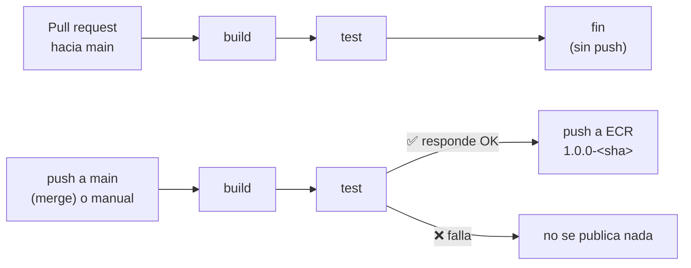

# Cuenta regresiva a Año Nuevo

Aplicación Node.js (sin dependencias externas) que muestra un cronómetro con cuenta regresiva hasta Año Nuevo y una barra de progreso animada con el avance del año.

Tiene un **workflow de CI en GitHub Actions** que construye la imagen Docker, la prueba y, si responde bien, la sube a **Amazon ECR** ([ver CI](#ci-con-github-actions)).

## Índice

1. [Configuración (`.env`)](#configuración-env)
2. [Ejecutar con Docker](#ejecutar-con-docker)
3. [Ejecutar en local](#ejecutar-en-local)
4. [Endpoints](#endpoints)
   - [`GET /health`](#get-health)
   - [`GET /api/config`](#get-apiconfig)
   - [Página y archivos estáticos](#página-y-archivos-estáticos)
   - [Errores](#errores)
   - [Cómo probar los endpoints](#cómo-probar-los-endpoints)
5. [CI con GitHub Actions](#ci-con-github-actions)
   - [Flujo y disparadores](#flujo-y-disparadores)
   - [Qué hace cada job](#qué-hace-cada-job)
   - [Tag de la imagen](#tag-de-la-imagen)
   - [Variables y secretos de GitHub](#variables-y-secretos-de-github)
   - [Puesta en marcha (una sola vez)](#puesta-en-marcha-una-sola-vez)
   - [Probar el smoke test en local](#probar-el-smoke-test-en-local)
   - [Desplegar la imagen en ECS](#desplegar-la-imagen-en-ecs)
   - [Problemas frecuentes](#problemas-frecuentes)

## Configuración (`.env`)

| Variable          | Descripción                                   | Por defecto |
|-------------------|-----------------------------------------------|-------------|
| `PORT`            | Puerto HTTP                                   | `3000`      |
| `TIMEZONE`        | Zona horaria IANA (ej. `America/Bogota`)      | `UTC`       |
| `PRIMARY_COLOR`   | Color principal (hex, `rgb()`, `hsl()`, nombre) | `#7c3aed` |
| `SECONDARY_COLOR` | Color secundario del degradado                | `#06b6d4`   |

Copia `.env.example` a `.env` y ajusta los valores.

## Ejecutar con Docker

```bash
docker compose up -d --build
```

Abre http://localhost:3000. Tras cambiar el `.env`, aplica los cambios con:

```bash
docker compose up -d --force-recreate
```

Sin Compose:

```bash
docker build -t countdown-new-year .
docker run -d -p 3000:3000 --env-file .env countdown-new-year
```

## Ejecutar en local

Requiere Node.js 18+:

```bash
npm start
```

## Endpoints

La app es un servidor HTTP de Node.js sin dependencias ([`server.js`](server.js)) que escucha en `PORT` (por defecto `3000`). Solo acepta **`GET`** y **`HEAD`**.

| Método | Ruta | Respuesta | Uso |
|---|---|---|---|
| `GET` / `HEAD` | [`/health`](#get-health) | `200` JSON `{"status":"ok"}` | Health check: Docker `HEALTHCHECK`, smoke test del CI y el target group del ALB |
| `GET` / `HEAD` | [`/api/config`](#get-apiconfig) | `200` JSON con la configuración y las fechas | La usa la página al cargar para pintar la cuenta regresiva |
| `GET` / `HEAD` | `/` | `200` HTML (`public/index.html`) | La página de la cuenta regresiva |
| `GET` / `HEAD` | `/index.html`, `/app.js`, `/styles.css` | `200` con su `Content-Type` | Archivos estáticos de [`public/`](public) |
| `GET` / `HEAD` | Cualquier otra ruta | `404` `Not found` (texto) | — |
| Otros (`POST`, `PUT`, `DELETE`…) | Cualquier ruta | `405` `Method not allowed` | — |

> ⚠️ `/health` y `/api/config` se comparan con la **ruta exacta**: con parámetros (`/api/config?x=1`) o con una barra final (`/health/`) responden `404`.

### `GET /health`

Indica que el proceso está vivo y atendiendo peticiones. No comprueba nada más (la app no tiene dependencias externas).

```http
HTTP/1.1 200 OK
Content-Type: application/json; charset=utf-8
Cache-Control: no-store

{"status":"ok"}
```

Lo usan:
- El `HEALTHCHECK` del [`Dockerfile`](Dockerfile) (cada 30 s, con `wget`).
- El [smoke test](ci/smoke-test.sh) del CI.
- El `health_check_path` del target group, cuando la app se despliegue en ECS ([ver](#desplegar-la-imagen-en-ecs)).

### `GET /api/config`

Devuelve la configuración del `.env` ya validada y las fechas que la página necesita para la cuenta regresiva. Se calcula en cada petición (`Cache-Control: no-store`).

Ejemplo con `TIMEZONE=America/Bogota` y `PRIMARY_COLOR=#ff0000`:

```json
{
  "timezone": "America/Bogota",
  "primaryColor": "#ff0000",
  "secondaryColor": "#06b6d4",
  "currentYear": 2026,
  "nextYear": 2027,
  "yearStart": 1767243600000,
  "newYear": 1798779600000,
  "serverNow": 1792682899676
}
```

| Campo | Tipo | Descripción |
|---|---|---|
| `timezone` | texto | Zona horaria IANA en uso. Si `TIMEZONE` no es válida, `UTC` (y el log avisa: `TIMEZONE "Foo/Bar" no es válida, usando UTC`) |
| `primaryColor` / `secondaryColor` | texto | Colores del tema. Si el valor del `.env` no es válido, se usan `#7c3aed` / `#06b6d4` |
| `currentYear` / `nextYear` | número | Año actual en esa zona horaria y el siguiente |
| `yearStart` | número (ms epoch UTC) | 1 de enero 00:00:00 del año actual **en esa zona horaria** (inicio de la barra de progreso) |
| `newYear` | número (ms epoch UTC) | 1 de enero 00:00:00 del año siguiente en esa zona horaria (fin de la cuenta regresiva) |
| `serverNow` | número (ms epoch UTC) | Hora del servidor. La página la usa para corregir el reloj del navegador (`clockSkew`) |

📌 Las fechas tienen en cuenta el horario de verano (DST): por ejemplo, con `Europe/Madrid` el 1 de enero es UTC+1.

### Página y archivos estáticos

| Ruta | `Content-Type` |
|---|---|
| `/` y `/index.html` | `text/html; charset=utf-8` |
| `/app.js` | `application/javascript; charset=utf-8` |
| `/styles.css` | `text/css; charset=utf-8` |

Solo se sirven archivos de [`public/`](public). Cualquier intento de salir de esa carpeta (por ejemplo `/../server.js`) termina en `404` o `403 Forbidden`.

### Errores

| Código | Cuándo | Cuerpo |
|---|---|---|
| `404` | Ruta que no es un endpoint ni un archivo de `public/` | `Not found` (`text/plain`) |
| `403` | La ruta resuelta queda fuera de `public/` | `Forbidden` |
| `405` | Método distinto de `GET` o `HEAD` | `Method not allowed` |

### Cómo probar los endpoints

**1. Arranca la app** (en WSL Ubuntu), con Docker:

```bash
cd ~/ECS-Tests/apps/countdown-new-year
docker build -t countdown-new-year .
docker run -d --name countdown -p 3000:3000 -e TIMEZONE=America/Bogota countdown-new-year
```

o sin Docker (Node.js 18+): `npm start`.

**2. Prueba cada endpoint con `curl`:**

```bash
# Health check: HTTP 200 y {"status":"ok"}
curl -i http://localhost:3000/health

# Configuración: JSON formateado
curl -s http://localhost:3000/api/config | python3 -m json.tool

# Solo el código HTTP de la página y de un archivo estático
curl -s -o /dev/null -w '%{http_code} %{content_type}\n' http://localhost:3000/
curl -s -o /dev/null -w '%{http_code} %{content_type}\n' http://localhost:3000/app.js

# Errores esperados
curl -s -o /dev/null -w '%{http_code}\n' http://localhost:3000/no-existe         # 404
curl -s -o /dev/null -w '%{http_code}\n' -X POST http://localhost:3000/health    # 405
```

**3. O todas las comprobaciones de una vez**, con el mismo script que usa el CI (incluido el `HEALTHCHECK` de Docker):

```bash
bash ci/smoke-test.sh http://localhost:3000 countdown
```

**4. Ver cuánto falta para Año Nuevo** desde la terminal, con los datos de `/api/config`:

```bash
curl -s http://localhost:3000/api/config | python3 -c '
import json, sys
c = json.load(sys.stdin)
s = (c["newYear"] - c["serverNow"]) // 1000
print(f"Faltan {s // 86400} días {s % 86400 // 3600} h {s % 3600 // 60} min para {c["nextYear"]} ({c["timezone"]})")'
```

**5. Probar otra zona horaria o colores:** vuelve a crear el contenedor con otras variables y revisa `/api/config`:

```bash
docker rm -f countdown
docker run -d --name countdown -p 3000:3000 -e TIMEZONE=Europe/Madrid -e PRIMARY_COLOR=tomato countdown-new-year
curl -s http://localhost:3000/api/config | python3 -m json.tool   # "timezone": "Europe/Madrid", "primaryColor": "tomato"
```

**6. Limpiar:**

```bash
docker rm -f countdown
```

> ℹ️ **En AWS:** cuando exista el servicio ECS de esta app ([ver](#desplegar-la-imagen-en-ecs)), los mismos comandos sirven cambiando `http://localhost:3000` por la URL del ALB (`terraform output -raw service_url` en el servicio).

✅ **Verificado** (Docker en WSL, imagen construida desde este directorio): `/health` y `/api/config` → `200` JSON con `Cache-Control: no-store`; `/`, `/index.html`, `/app.js` y `/styles.css` → `200` con su `Content-Type`; `/no-existe`, `/api/config?x=1` y `/../server.js` → `404`; `POST /health` → `405`; `HEAD /health` → `200`; `TIMEZONE=Foo/Bar` → aviso y `UTC`.

---

## CI con GitHub Actions

Workflow: [`.github/workflows/countdown-new-year-ci.yml`](../../.github/workflows/countdown-new-year-ci.yml), en la raíz del repositorio `adrianjsosag/ECS-Tests`.

> 📖 **Explicación detallada con diagramas** (flujo de los jobs y secuencia OIDC + ECR): [`README-countdown-new-year-ci.md`](../../.github/workflows/README-countdown-new-year-ci.md). Aquí queda el resumen, la configuración y la puesta en marcha.

| Pieza | Valor |
|---|---|
| Repositorio ECR | `cloudengineering-dev/countdown-new-year` ([`ECR-module`](../../Terraform/ECR-module/README.md)) |
| Rol IAM que usa el workflow | `CloudEngineering-dev-gha-countdown-new-year` ([`GitHub-OIDC-module`](../../Terraform/GitHub-OIDC-module/README.md#roles-y-quién-los-usa)) |
| Autenticación en AWS | OIDC: credenciales temporales, **sin llaves de AWS en GitHub** |
| Smoke test | [`ci/smoke-test.sh`](ci/smoke-test.sh) (no se copia a la imagen: está en `.dockerignore`) |

### Flujo y disparadores



| Evento | Cuándo ocurre | Jobs |
|---|---|---|
| `pull_request` hacia `main` | Abres o actualizas un PR | `build` → `test` (**nunca** push) |
| `push` a `main` | Merge de un PR o push directo | `build` → `test` → `push` |
| `workflow_dispatch` | Botón **Run workflow** en la pestaña *Actions* | `build` → `test` → `push` (si se lanza sobre `main`) |

- **Filtro de rutas:** solo se ejecuta si cambian archivos de `apps/countdown-new-year/` o el propio workflow.
- **Concurrencia:** en un PR, un commit nuevo cancela la ejecución anterior. En `main` no se cancela, para no cortar un push a medias.
- **El push depende del test** (`needs: [build, test]`): si el test falla, la imagen no se sube.

### Qué hace cada job

| Job | Pasos |
|---|---|
| **`build`** | `node --check` de `server.js` y `public/app.js` → calcula el [tag](#tag-de-la-imagen) → `docker build --platform linux/amd64` con etiquetas OCI (repositorio, commit, versión) → guarda la imagen como artifact (1 día) para los otros jobs |
| **`test`** | Carga la imagen → `docker run -p 3000:3000 -e TIMEZONE=UTC` → [`ci/smoke-test.sh`](ci/smoke-test.sh) → si falla, muestra `docker logs` → siempre borra el contenedor |
| **`push`** | Comprueba las variables y el secreto → carga la imagen → asume el rol por OIDC → login en ECR → si el tag ya existe, **no** lo vuelve a subir (aviso) → `docker push` → espera el escaneo de vulnerabilidades y escribe imagen, digest y hallazgos en el **resumen** de la ejecución |

✔️ **Qué comprueba el smoke test:**

| Prueba | Esperado |
|---|---|
| `GET /health` | HTTP 200 con `"status":"ok"` (espera hasta 60 s a que arranque) |
| `GET /` | HTTP 200 con la página HTML |
| `GET /api/config` | HTTP 200 con `"nextYear"` |
| `GET /app.js` | HTTP 200 (archivos estáticos) |
| `GET /no-existe` | HTTP 404 |
| `HEALTHCHECK` del Dockerfile | Estado `healthy` (el primer chequeo es a los 30 s) |

### Tag de la imagen

El tag es **`<version de package.json>-<sha corto del commit>`**, por ejemplo `1.0.0-e60567f`.

- El repositorio ECR es **IMMUTABLE**: un tag subido no se puede volver a usar. Con el SHA, cada commit tiene su propio tag y el push nunca choca.
- La versión hace legible qué release es. Para una versión nueva, cambia `version` en [`package.json`](package.json).
- Si relanzas el workflow sobre el mismo commit, el tag ya existe: el job lo avisa y termina bien sin volver a subirlo.

### Variables y secretos de GitHub

Se crean en **GitHub → repositorio `ECS-Tests` → Settings → Secrets and variables → Actions**:

| Tipo | Nombre | Valor | ¿De dónde sale? |
|---|---|---|---|
| **Variable** | `AWS_REGION` | `us-east-1` | Región de la plataforma (`terraform.tfvars`) |
| **Variable** | `ECR_REPOSITORY` | `cloudengineering-dev/countdown-new-year` | `terraform -chdir=Terraform/ECR-module/manifests output repository_names` |
| **Secreto** | `AWS_ROLE_ARN` | `arn:aws:iam::373716886058:role/CloudEngineering-dev-gha-countdown-new-year` | `terraform -chdir=Terraform/GitHub-OIDC-module/manifests output -json role_arns` → `countdown-new-year` |

🔗 **Relación entre las piezas:**

```text
countdown-new-year-ci.yml (job push)
  └─ secreto AWS_ROLE_ARN ──► rol CloudEngineering-dev-gha-countdown-new-year
                                 (GitHub-OIDC-module, entrada "countdown-new-year" de github_ci_roles)
                                 ├─ solo asumible desde adrianjsosag/ECS-Tests, rama main
                                 └─ solo puede hacer push a ──► cloudengineering-dev/countdown-new-year
                                                                 (= variable ECR_REPOSITORY, ECR-module)
```

> ℹ️ `AWS_ROLE_ARN` no es una credencial (sin un token de GitHub válido no sirve para nada), pero se guarda como secreto para no exponer el ID de la cuenta en los logs. No hacen falta `AWS_ACCESS_KEY_ID` ni `AWS_SECRET_ACCESS_KEY`.

### Puesta en marcha (una sola vez)

Desde la terminal de WSL Ubuntu (detalle en el [README de Terraform](../../Terraform/README.md)):

```bash
cd ~/ECS-Tests/Terraform

# 1. Bucket del state (si aún no existe)
(cd S3-tfstate-backend-module/manifests && terraform init && terraform apply)

# 2. ECR con el repositorio cloudengineering-dev/countdown-new-year
(cd ECR-module/manifests && terraform init && terraform apply)

# 3. OIDC provider + rol del CI
(cd GitHub-OIDC-module/manifests && terraform init && terraform apply && terraform output -json role_arns)
```

4. Crea en GitHub las 2 variables y el secreto de la [tabla anterior](#variables-y-secretos-de-github).
5. Haz un cambio en `apps/countdown-new-year/` y abre un PR (solo build + test). Al hacer merge a `main`, la imagen se sube a ECR.

### Probar el smoke test en local

En WSL Ubuntu, los mismos pasos que el job `test`:

```bash
cd ~/ECS-Tests/apps/countdown-new-year
docker build --platform linux/amd64 -t countdown-new-year:local .
docker run -d --name countdown-test -p 3000:3000 -e TIMEZONE=UTC countdown-new-year:local
bash ci/smoke-test.sh http://localhost:3000 countdown-test
docker rm -f countdown-test
```

✅ **Verificado** (sin GitHub ni AWS): el build con el tag `1.0.0-e60567f` y el smoke test completo pasan (`healthy`). Sin la app arrancada, el script termina con código 1. `actionlint` y `shellcheck` no dan avisos.

### Desplegar la imagen en ECS

El CI **solo publica** la imagen; no despliega. Para ejecutarla en el cluster, crea un servicio copiando `Terraform/ECS-services-module/services/nginx-1/` (ver [Añadir otro servicio](../../Terraform/ECS-services-module/README.md#añadir-otro-servicio)) con:

```hcl
service_name   = "countdown-new-year"
ecr_repository = "countdown-new-year"
image_tag      = "1.0.0-e60567f"   # el tag que muestra el resumen del job push
container_port = 3000
health_check_path = "/health"
```

### Problemas frecuentes

| Síntoma | Causa probable | Solución |
|---|---|---|
| El workflow no se ejecuta | El commit no cambia nada de `apps/countdown-new-year/` ni el workflow | Es el filtro de rutas; usa **Run workflow** para lanzarlo a mano |
| El job `push` aparece como *skipped* | Es un pull request (o una rama distinta de `main`) | Es lo esperado: solo se sube en `main` |
| `Falta la variable AWS_REGION` / `Falta el secreto AWS_ROLE_ARN` | No se crearon en GitHub | Ver [Variables y secretos](#variables-y-secretos-de-github) |
| `Not authorized to perform sts:AssumeRoleWithWebIdentity` | El rol no existe, el secreto es de otro rol, o la ejecución no es de la rama `main` | Aplica `GitHub-OIDC-module` y revisa el secreto |
| `Could not fetch an OIDC token` | Falta `permissions: id-token: write` en el job `push` | Ya está en el workflow: no lo quites |
| `RepositoryNotFoundException` | `ECR_REPOSITORY` mal escrito o el ECR no está aplicado | `cloudengineering-dev/countdown-new-year`; aplica `ECR-module` |
| `AccessDeniedException ... ecr:PutImage` | `ECR_REPOSITORY` apunta a otro repositorio | El rol solo permite `cloudengineering-dev/countdown-new-year` |
| `ImageTagAlreadyExistsException` | Otro proceso subió el mismo tag | Haz un commit nuevo (nuevo SHA) o sube `version` en `package.json` |
| El test falla con `la app no respondió en 60s` | La app no arranca | Revisa la salida de `docker logs` en el paso *Logs del contenedor* |
